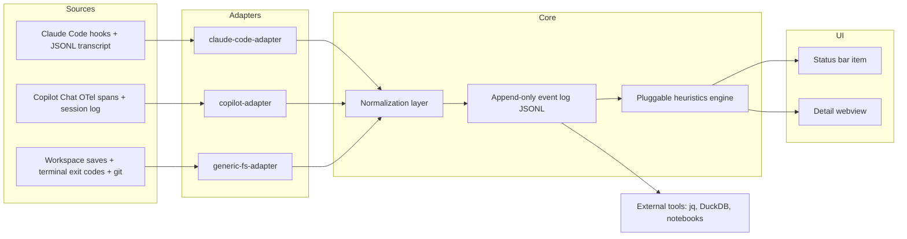

# snagboat

Snagboat is a planned VS Code extension that watches AI coding agents, normalizes their activity into a shared event schema, mines the resulting log for signs of trouble, and surfaces the result in a status bar indicator plus a detail view.

## Project status

This repository currently captures the v0.1 design plan for the extension. The core idea is to keep adapters agent-specific, keep everything downstream schema-driven, and keep all captured data local by default.

## Quickstart

1. Read the [architecture overview](docs/architecture.md).
2. Review the [normalized event schema and transformation matrix](docs/schema.md).
3. Read the [heuristics design](docs/heuristics.md).
4. Review the [privacy and retention model](PRIVACY.md).
5. Follow the [contribution guide](CONTRIBUTING.md) before proposing adapter or heuristic changes.

## Architecture overview

Adapters own all agent-specific parsing. The normalization layer is the only place that understands the common schema, so heuristics and UI code never need agent-specific branches.

## Planned settings reference

| Setting | Default | Purpose |
| --- | --- | --- |
| `snagboat.retention.rawDays` | `90` | Retain structural events before rolling them into daily aggregates. |
| `snagboat.retention.aggregateDays` | `-1` | Retain daily aggregates indefinitely; set to `0` to disable aggregate retention entirely. |
| `snagboat.captureContent` | `false` | Opt into storing truncated text excerpts used by the verbal-hedge heuristic, kept in the event log for as long as `rawDays`. Not yet built. Separate per-field retention is a planned follow-up (see [PRIVACY.md](PRIVACY.md#retention)). |
| `snagboat.tokenBudget.session` | unset | Warn when a single session crosses a configured token budget (local level). |
| `snagboat.tokenBudget.day` | unset | Warn when this workspace's usage for the current day crosses a configured token budget (project level). A global, cross-workspace level plus a treemap visualization is planned but not yet built. |
| `snagboat.heuristics.backtracking.window` | `10` (minutes) | Rolling window used to distinguish iteration from looping. Resolved as wall-clock minutes, not an event count. |
| `snagboat.heuristics.backtracking.minRepeats` | `3` | Minimum times the same target must be touched within the window before backtracking fires. |
| `snagboat.heuristics.stalled.minutes` | `15` | Warn when no events have arrived for this many minutes. |
| `snagboat.heuristics.toolChurn.window` | `5` (minutes) | Rolling window that tool-churn looks back over. |
| `snagboat.heuristics.toolChurn.minCalls` | `8` | Minimum tool calls within the window before tool-churn fires. |
| `snagboat.heuristics.toolChurn.maxDistinctTargets` | `2` | tool-churn only fires when calls in the window hit at most this many distinct targets. |

## Planned status indicators

| Primary status label | Planned glyph style | Decorative character name |
| --- | --- | --- |
| `On track` | Steady-dot or check-style codicon-weight glyph | Cruisin' Clyde |
| `Backtracking detected` | Loop or history-style glyph | Boomerang Bea |
| `Tool churn detected` | Sync or spin-style glyph | Loopy Lou |
| `Low-confidence language detected` | Question or pulse-style glyph | Wobbly Walt |
| `Token budget warning` | Dashboard or meter-style glyph | Meter Mo |
| `Session stalled` | Clock or mute-style glyph | Snoozy Sam |

The final extension should use simple SVG or codicon-weight icons in the actual status bar, keep the visible status text meaningful even without the glyph, and treat the character names as decorative mnemonic copy only in supporting UI such as tooltips or the detail view.

## Repository docs

- [Architecture](docs/architecture.md)
- [Schema and transformation matrix](docs/schema.md)
- [Heuristics](docs/heuristics.md)
- [Implementation roadmap](docs/roadmap.md)
- [Privacy](PRIVACY.md)
- [Contributing](CONTRIBUTING.md)
- [Third-party license plan](THIRD_PARTY_LICENSES.md)
