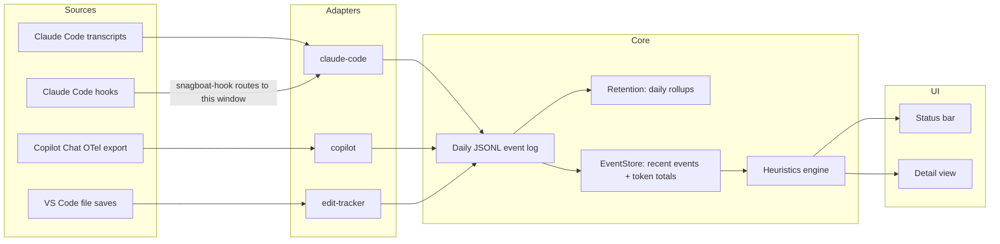

# snagboat

Snagboat is a VS Code extension that watches AI coding agents (Claude Code and GitHub Copilot Chat), normalizes their activity into one local event log, and flags signs of trouble: an agent looping on the same file, churning through tool calls, going quiet, blowing a token budget, or sounding unsure of itself. Results show up in the status bar and a detail view. Everything stays on your machine.

## Status

Working, but early (version `0.0.1`), not yet published to the Marketplace or Open VSX, and installed from source. macOS and Linux only: Claude Code hooks go through a POSIX shell script. See [what's not built yet](#not-built-yet).

## What it watches

| Source | How | What you get |
| --- | --- | --- |
| Claude Code | Tails the session transcripts in `~/.claude/projects/<project>/` | Token usage per API message (input, output, cache read/creation), model, and, if you opt in, reply excerpts |
| Claude Code | `PostToolUse` and `Stop` hooks, added to the project's `.claude/settings.json` automatically | Tool calls with their target (file path or shell command) and success or failure; turn boundaries |
| GitHub Copilot Chat | Copilot's OpenTelemetry export to a local receiver | Turns with token usage and model; tool calls; reply excerpts if both Copilot and Snagboat capture content |
| VS Code | File saves | Edits per file, for agent-independent signals |

## Install

Requires VS Code 1.119 or later, and Node.js 22 or later to build.

```bash
git clone https://github.com/DChristianson/snagboat.git
cd snagboat
npm install
npm run package                                     # builds and writes snagboat-0.0.1.vsix
code --install-extension snagboat-0.0.1.vsix --force
```

Then reload each open VS Code window (**Developer: Reload Window**). Snagboat activates on startup.

### Claude Code setup

Nothing to configure. Snagboat finds the project's transcripts on its own and, on activation, adds two hook entries to the project's `.claude/settings.json` that run `~/.snagboat/bin/snagboat-hook`. The hook entries never block or fail Claude Code, even if Snagboat isn't running. If `.claude/settings.json` is committed in your repo, the change will show up in `git status`; the entry is the same for every user and machine. To remove it, delete the hook entries whose command ends in `# snagboat-hook-receiver`.

### Copilot setup

Copilot only sends telemetry if you turn it on. In your VS Code settings:

```json
{
  "github.copilot.chat.otel.enabled": true,
  "github.copilot.chat.otel.exporterType": "otlp-http",
  "github.copilot.chat.otel.otlpEndpoint": "http://127.0.0.1:4318"
}
```

The port must match `snagboat.copilot.otlpPort` (default `4318`). Only one VS Code window can listen on it; see [known limitations](#known-limitations).

## Using it

- **Status bar:** today's tokens, agent events, and local edits (resetting at local midnight), plus the most important active finding. Hover for a breakdown by agent, all-time totals, active findings, and any health problems with Snagboat itself (shown as ⚠).
- **Detail view:** click the status bar item, or run **Snagboat: Open Detail View**. It shows:
  - today's totals;
  - active findings, each of which you can **acknowledge** (hidden from the status bar until that problem clears) or **mute** (hidden for this workspace until unmuted), or use to filter the timeline to the events behind it;
  - a per-day token chart by agent over 7, 30, or 90 days, with a table view;
  - a filterable timeline of the last 24 hours, where file targets open the file and reply excerpts can be expanded.
- **Commands:** **Snagboat: Show Token/Event Breakdown** prints the breakdown to an output channel; **Snagboat: Clear Event Log** deletes this workspace's logged events after confirming.

### Findings

| Heuristic | Fires when | Status bar glyph |
| --- | --- | --- |
| `backtracking` | The same file or command is touched several times in a short window with no success in between | `$(history)` |
| `tool-churn` | Many tool calls in a short window land on very few distinct targets | `$(sync)` |
| `stalled` | No agent activity for a while | `$(clock)` |
| `token-budget` | A session, or today's total for this workspace, crosses a budget you set | `$(dashboard)` |
| `verbal-hedge` | Replies in one session repeatedly hedge or self-correct ("I think", "let me try again", "my mistake"). Informational, and a warning only alongside repeated or failing tool activity. Needs `snagboat.captureContent`. | `$(comment-discussion)` |

With no active finding the glyph is `$(pulse)`; a problem with Snagboat itself shows `$(warning)`. Details: [docs/heuristics.md](docs/heuristics.md).

## Settings

| Setting | Default | Purpose |
| --- | --- | --- |
| `snagboat.captureContent` | `false` | Store up to 500 characters of each agent reply (never prompts, tool output, or file contents) for the verbal-hedge heuristic, kept as long as `rawDays`. Copilot also needs `github.copilot.chat.otel.captureContent`. |
| `snagboat.retention.rawDays` | `90` | Days of raw events to keep, counting today. Older days are rolled up into daily totals. |
| `snagboat.retention.aggregateDays` | `-1` | Days of daily totals to keep; `-1` keeps them forever, `0` keeps none. |
| `snagboat.tokenBudget.session` | unset | Warn when one session's tokens cross this total. |
| `snagboat.tokenBudget.day` | unset | Warn when this workspace's tokens for the day cross this total. |
| `snagboat.copilot.otlpPort` | `4318` | Local port for Copilot's telemetry. |
| `snagboat.copilot.captureStructure` | `false` | Development aid: record the structure of Copilot's telemetry (span names, links, attribute names, numbers; every text value replaced by its length) to help map it. Summarize with `npm run summarize:copilot`. |
| `snagboat.heuristics.backtracking.window` | `10` (minutes) | Window backtracking looks back over. |
| `snagboat.heuristics.backtracking.minRepeats` | `3` | Touches of one target within the window before backtracking fires. |
| `snagboat.heuristics.toolChurn.window` | `5` (minutes) | Window tool-churn looks back over. |
| `snagboat.heuristics.toolChurn.minCalls` | `8` | Tool calls within the window before tool-churn can fire. |
| `snagboat.heuristics.toolChurn.maxDistinctTargets` | `2` | Tool-churn fires only if those calls hit at most this many targets. |
| `snagboat.heuristics.stalled.minutes` | `15` | Minutes without activity before stalled fires. |
| `snagboat.heuristics.verbalHedge.window` | `10` (minutes) | Window verbal-hedge looks back over. |
| `snagboat.heuristics.verbalHedge.minTurns` | `2` | Hedging replies in one session within the window before verbal-hedge fires. |

## Privacy

Nothing leaves your machine, and there is no telemetry on the extension's UI. Events are stored as daily JSONL files in VS Code's per-workspace storage, readable with `jq`, DuckDB, or a notebook. By default Snagboat stores structure, not content, with one exception worth knowing: for Claude Code's Bash tool, an event's target is the **full shell command**, which can contain secrets. Agent reply text is stored only if you turn on `snagboat.captureContent`. [PRIVACY.md](PRIVACY.md) lists exactly what each source records and every place Snagboat stores anything.

## How it fits together



Adapters own all agent-specific parsing and emit one normalized event shape ([docs/schema.md](docs/schema.md)); heuristics and UI never branch on which agent produced an event. Each VS Code window runs its own hook receiver on its own port, and the hook script routes each Claude Code project's hooks to the window that has it open. Details: [docs/architecture.md](docs/architecture.md).

## Development

Open the repo in VS Code and press F5 to run Snagboat in an Extension Development Host, with `npm run watch` rebuilding as you edit.

| Script | What it does |
| --- | --- |
| `npm run build` | Bundles `src/extension.ts` to `dist/extension.js` with esbuild |
| `npm run watch` | Rebuilds on change |
| `npm run test:unit` | Unit tests, no VS Code needed |
| `npm test` | Compiles and bundles, then runs the integration suite in a real VS Code instance via `@vscode/test-electron` |
| `npm run replay:heuristics` | Replays your local Claude Code transcripts through every heuristic and reports what would have fired; prints counts and times only |
| `npm run summarize:copilot` | Summarizes a Copilot structure capture: span tree, attributes, and where token counts live |
| `npm run verify:transcripts` | Replays your own local Claude Code transcripts for this project through the adapter and checks token totals; prints totals only |
| `npm run package` | Builds the `.vsix` |
| `npm run licenses` | Regenerates `THIRD_PARTY_LICENSES.md` from the bundled dependencies (`-- --check` verifies it, as CI does) |

## Known limitations

- **Copilot telemetry is collected by one window.** Copilot in every window exports to the same port, so the first window to claim it records all Copilot activity and the others show a "failed to listen on port" health warning. Claude Code doesn't have this problem.
- **The Copilot receiver doesn't authenticate requests**, so another local process could submit fake Copilot events. Claude Code hooks are token-protected. See [SECURITY.md](SECURITY.md).
- **Workspace folders added to a window after it opens** start receiving Claude Code hooks only after a reload.
- **Windows is unsupported**: the hook script needs a POSIX shell.

## Not built yet

From the [roadmap](docs/roadmap.md):

- per-field retention (for example, keeping shell commands and reply excerpts for less time than other fields)
- terminal exit codes and `git diff` polling, to tell real edits from no-op saves
- a token budget across all workspaces, with a treemap view
- extension points for third-party adapters and heuristics
- log export to CSV and SQLite
- CI

## Repository docs

- [Architecture](docs/architecture.md)
- [Schema and transformation matrix](docs/schema.md)
- [Heuristics](docs/heuristics.md)
- [Roadmap](docs/roadmap.md)
- [Privacy](PRIVACY.md)
- [Security policy](SECURITY.md)
- [Contributing](CONTRIBUTING.md)
- [Third-party licenses](THIRD_PARTY_LICENSES.md)
