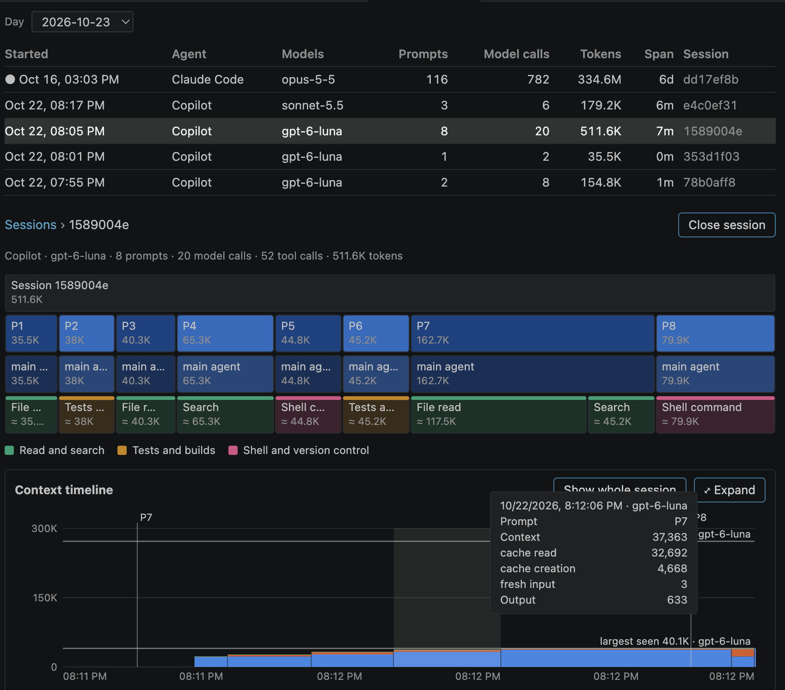
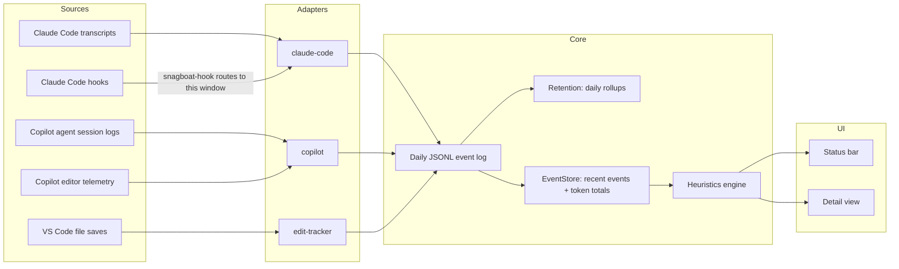

# snagboat

Snagboat is a VS Code extension that watches AI coding agents (Claude Code and GitHub Copilot Chat), normalizes their activity into one local event log, and flags signs of trouble: an agent looping on the same file, churning through tool calls, going quiet, blowing a token budget, or sounding unsure of itself. Results show up in the status bar and a detail view. Everything stays on your machine.



## Why

**The name.** In the 1800s, [snagboats](https://en.wikipedia.org/wiki/Snagboat) pulled sunken trees, called snags, out of rivers like the Mississippi. You couldn't see a snag from the deck, and snags were the steamboat's deadliest hazard. Henry Shreve built the first snagboat, the *Heliopolis*, in 1829. This Snagboat watches for the hazards you can't see in your agent sessions: loops, churn, a context quietly filling up.

I built it for myself. I spend long stretches in agent sessions and wanted to see them top down: which prompt kicked off what, where the tokens went, and when things started going sideways. What's here is basic, but I get more use out of it every week.

**Build your own.** This is the age of AI. Why download a plugin and live with someone else's choices? Point your agent at this repo, or at an empty one, and build the version with the views and heuristics you actually want. Snagboat is a starting point, not a product. (Yes, "X, not Y" is the most AI sentence there is.)

## Status

Working, but early (version `0.0.1`). Install it from a [GitHub release](https://github.com/DChristianson/snagboat/releases); it's not yet on the Marketplace or Open VSX. macOS and Linux only: Claude Code hooks go through a POSIX shell script. See [what's not built yet](#not-built-yet).

## What it watches

| Source | How | What you get |
| --- | --- | --- |
| Claude Code | Tails the session transcripts in `~/.claude/projects/<project>/` | Token usage per API message (input, output, cache read/creation), model, reply excerpts, your prompts' text, and the session's title |
| Claude Code | `PostToolUse` and `Stop` hooks, added to the project's `.claude/settings.json` automatically | Tool calls with their target (file path or shell command) and success or failure; turn boundaries |
| GitHub Copilot (Agent mode) | Reads the Copilot CLI's session logs in `~/.copilot/session-state/`, which VS Code's agent host writes for every Agent-mode session | Prompts and their text, reply excerpts, the session's name, every model call with token usage, model, and the model's context limit, and tool calls with their commands and outcomes |
| GitHub Copilot (editor features) | Copilot's optional OpenTelemetry export to a local receiver | Token usage of inline and next-edit suggestions and other editor-side model calls, kept separate from agent turns |
| VS Code | File saves | Edits per file, for agent-independent signals |

## Install

Requires VS Code 1.119 or later.

Download `snagboat-<version>.vsix` from the [latest release](https://github.com/DChristianson/snagboat/releases/latest), then:

```bash
code --install-extension snagboat-0.0.1.vsix
```

Or build it yourself (needs Node.js 22 or later):

```bash
git clone https://github.com/DChristianson/snagboat.git
cd snagboat
npm install
npm run package                                     # builds and writes snagboat-0.0.1.vsix
code --install-extension snagboat-0.0.1.vsix --force
```

Then reload each open VS Code window (**Developer: Reload Window**). Snagboat activates on startup.

### Claude Code setup

Nothing to configure. Snagboat finds the project's transcripts on its own and, on activation, adds two hook entries to the project's `.claude/settings.json` that run `~/.snagboat/bin/snagboat-hook`. The hook entries never block or fail Claude Code, even if Snagboat isn't running. If `.claude/settings.json` is committed in your repo, the change will show up in `git status`; the entry is the same for every user and machine. To remove it, delete the hook entries whose command ends in `# snagboat-hook-receiver`.

### Copilot setup

Agent mode needs no setup: Snagboat reads its session logs, picking the sessions started inside each window's workspace.

To also count the tokens used by Copilot's inline and next-edit suggestions, turn on Copilot's telemetry in your VS Code settings:

```json
{
  "github.copilot.chat.otel.enabled": true,
  "github.copilot.chat.otel.exporterType": "otlp-http",
  "github.copilot.chat.otel.otlpEndpoint": "http://127.0.0.1:4318"
}
```

The port must match `snagboat.copilot.otlpPort` (default `4318`). Only one VS Code window can listen on it; see [known limitations](#known-limitations). In current VS Code, Agent mode runs in VS Code's built-in agent host through the Copilot CLI, which doesn't send this telemetry, so it only covers editor features.

## Using it

- **Status bar:** today's tokens, agent events, and local edits (resetting at local midnight), plus the most important active finding. Hover for a breakdown by agent, all-time totals, active findings, and any health problems with Snagboat itself (shown as ⚠).
- **Detail view:** click the status bar item, or run **Snagboat: Open Detail View**. Its **Overview** tab shows:
  - today's totals;
  - active findings, each of which you can **acknowledge** (hidden from the status bar until that problem clears) or **mute** (hidden for this workspace until unmuted), or use to filter the timeline to the events behind it;
  - a per-day token chart by agent over 7, 30, or 90 days, with a table view;
  - a filterable timeline of the last 24 hours, where file targets open the file, prompts and reply excerpts can be expanded, and sessions show their names.

  Its **Sessions** tab lists each day's agent sessions by name. Opening one shows a **turn tree** (where the session's tokens went: by prompt, then main agent or subagent, then an approximate split by tool category; click to zoom; calls that can't be tied to a prompt, such as ones logged by older Snagboat versions, are grouped as **Unlinked** until a backfill) above a **context timeline** (how much context each model call sent, split into cache read, cache creation, and fresh input, with your prompts, compactions, findings, and each model's largest-seen and limit lines), and a list of the session's findings. Findings include earlier ones, found by replaying the session through the heuristics when you open it, as well as active ones. Select a prompt (in the tree or on the timeline) to read what you asked. Expand the timeline for output tokens, subagent lanes, and drag-to-zoom. Findings ("Show in session"), session ids in the Overview timeline, and the daily chart's bars all link into it, as does **Snagboat: Open Session...**.
- **Commands:**
  - **Snagboat: Show Token/Event Breakdown** prints the breakdown to an output channel.
  - **Snagboat: Backfill Sessions from Transcripts...** re-reads the transcripts behind days logged by older versions and rewrites those days, so their sessions get turns, turn ends, and tool calls, and their past findings are complete. It shows what will change and asks first.
  - **Snagboat: Remove Captured Text** deletes stored prompts and reply excerpts, keeping the events, and can turn capture off.
  - **Snagboat: Clear Event Log** deletes this workspace's logged events after confirming.

### Findings

Most heuristics judge each session's current turn (everything since your latest prompt), so they clear when you prompt again.

| Heuristic | Fires when | Status bar glyph |
| --- | --- | --- |
| `runaway-turn` | One prompt has driven 100 or more model calls or tool calls | `$(run-all)` |
| `context-pressure` | Context was compacted automatically during the turn (warning), or is near the model's limit (info) | `$(fold)` |
| `cache-thrash` | Calls in one turn keep rewriting the prompt cache instead of reusing it | `$(flame)` |
| `backtracking` | One target fails repeatedly, or one file is edited over and over, within a turn | `$(history)` |
| `tool-churn` | A burst of tool calls in one session mostly hits the same one or two targets | `$(sync)` |
| `stalled` | An unfinished turn has had no agent activity for a while: a long-running tool, a permission prompt, or a stuck agent. A finished turn going quiet never fires. | `$(clock)` |
| `token-budget` | A session, or today's total for this workspace, crosses a budget you set | `$(dashboard)` |
| `verbal-hedge` | Replies in one session repeatedly hedge or self-correct ("I think", "let me try again", "my mistake"). Informational, and a warning only alongside repeated or failing tool activity. Needs `snagboat.captureContent` (on by default). | `$(comment-discussion)` |

Default thresholds come from replaying real sessions; `npm run replay:heuristics` replays yours.

With no active finding the glyph is `$(pulse)`; a problem with Snagboat itself shows `$(warning)`. Details: [docs/heuristics.md](docs/heuristics.md).

## Settings

| Setting | Default | Purpose |
| --- | --- | --- |
| `snagboat.captureContent` | `true` | Store your prompts (up to 2,000 characters), agent reply excerpts (up to 500), and session names, with common secrets redacted. Never tool output or file contents. Prompts and replies are kept for `textDays`. Copilot editor features' replies also need `github.copilot.chat.otel.captureContent`. |
| `snagboat.retention.rawDays` | `90` | Days of raw events to keep, counting today. Older days are rolled up into daily totals. |
| `snagboat.retention.textDays` | `30` | Days captured prompts and reply excerpts are kept, counting today. Older events keep everything else, without the text. |
| `snagboat.retention.aggregateDays` | `-1` | Days of daily totals to keep; `-1` keeps them forever, `0` keeps none. |
| `snagboat.tokenBudget.session` | unset | Warn when one session's tokens cross this total. |
| `snagboat.tokenBudget.day` | unset | Warn when this workspace's tokens for the day cross this total. |
| `snagboat.copilot.otlpPort` | `4318` | Local port for Copilot's telemetry. |
| `snagboat.copilot.captureStructure` | `false` | Development aid: record the structure of Copilot's telemetry (span names, links, attribute names, numbers; every text value replaced by its length) to help map it. Summarize with `npm run summarize:copilot`. |
| `snagboat.heuristics.runawayTurn.maxModelCalls` | `100` | Model calls in one turn (main agent and subagents) before runaway-turn fires. |
| `snagboat.heuristics.runawayTurn.maxToolCalls` | `100` | Tool calls in one turn before runaway-turn fires. |
| `snagboat.heuristics.contextPressure.percent` | `90` | Share of the model's context limit at which context-pressure reports. |
| `snagboat.heuristics.cacheThrash.minTokens` | `50000` | Cache tokens a call must write (and more than it reads) to count as a rewrite. |
| `snagboat.heuristics.cacheThrash.minCalls` | `2` | Rewrites in one turn before cache-thrash fires. |
| `snagboat.heuristics.backtracking.minFailures` | `3` | Failures on one target within a turn before backtracking fires. |
| `snagboat.heuristics.backtracking.minEdits` | `10` | Edits to one file within a turn before backtracking fires. |
| `snagboat.heuristics.toolChurn.window` | `5` (minutes) | Window tool-churn looks back over. |
| `snagboat.heuristics.toolChurn.minCalls` | `8` | Targeted tool calls in one session within the window before tool-churn can fire. |
| `snagboat.heuristics.toolChurn.minShare` | `0.9` | Share of those calls the two most-hit targets must take. |
| `snagboat.heuristics.stalled.minutes` | `15` | Quiet minutes in an unfinished turn before stalled fires. |
| `snagboat.heuristics.stalled.maxMinutes` | `180` | Quiet minutes after which the turn counts as abandoned and stalled stops. |
| `snagboat.heuristics.verbalHedge.window` | `10` (minutes) | Window verbal-hedge looks back over. |
| `snagboat.heuristics.verbalHedge.minTurns` | `2` | Hedging replies in one session within the window before verbal-hedge fires. |

## Privacy

Nothing leaves your machine, and there is no telemetry on the extension's UI. Events are stored as daily JSONL files in VS Code's per-workspace storage, readable with `jq`, DuckDB, or a notebook. Two things worth knowing. **Snagboat stores your prompts' text** by default, along with agent reply excerpts and session names: common secret formats are redacted first, prompts and replies are kept for 30 days (`snagboat.retention.textDays`), and **Snagboat: Remove Captured Text** deletes them on demand; turn `snagboat.captureContent` off to store no text at all. And for Claude Code's Bash tool, an event's target is the **full shell command**, which can contain secrets. [PRIVACY.md](PRIVACY.md) lists exactly what each source records and every place Snagboat stores anything.

## How it fits together



Adapters own all agent-specific parsing and emit one normalized event shape ([docs/schema.md](docs/schema.md)); heuristics and UI never branch on which agent produced an event. Each VS Code window runs its own hook receiver on its own port, and the hook script routes each Claude Code project's hooks to the window that has it open. Details: [docs/architecture.md](docs/architecture.md).

## Development

Open the repo in VS Code and press F5 to run Snagboat in an Extension Development Host, with `npm run watch` rebuilding as you edit.

| Script | What it does |
| --- | --- |
| `npm run build` | Bundles `src/extension.ts` to `dist/extension.js` with esbuild |
| `npm run watch` | Rebuilds on change |
| `npm run test:unit` | Unit tests, no VS Code needed |
| `npm test` | Compiles and bundles, then runs the integration suite in a real VS Code instance via `@vscode/test-electron` |
| `npm run replay:heuristics` | Replays your local Claude Code transcripts through every heuristic and reports what would have fired; prints counts and times only |
| `npm run summarize:copilot` | Summarizes a Copilot structure capture: span tree, attributes, and where token counts live |
| `npm run verify:transcripts` | Replays your own local Claude Code transcripts for this project through the adapter and checks token totals; prints totals only |
| `npm run package` | Builds the `.vsix` |
| `npm run licenses` | Regenerates `THIRD_PARTY_LICENSES.md` from the bundled dependencies (`-- --check` verifies it, as CI does) |

## Known limitations

- **Copilot editor telemetry is collected by one window.** Copilot in every window exports to the same port, so the first window to claim it records all inline-suggestion usage and the others show a "failed to listen on port" health warning. Copilot agent sessions and Claude Code don't have this problem.
- **The Copilot receiver doesn't authenticate requests**, so another local process could submit fake Copilot events. Claude Code hooks are token-protected. See [SECURITY.md](SECURITY.md).
- **Windows is unsupported**: the hook script needs a POSIX shell.

## Not built yet

From the [roadmap](docs/roadmap.md):

- a shorter retention for shell commands and file paths (text already has one)
- terminal exit codes and `git diff` polling, to tell real edits from no-op saves
- a token budget across all workspaces, with a treemap view
- extension points for third-party adapters and heuristics
- log export to CSV and SQLite

## Repository docs

- [Architecture](docs/architecture.md)
- [Schema and transformation matrix](docs/schema.md)
- [Heuristics](docs/heuristics.md)
- [Roadmap](docs/roadmap.md)
- [Privacy](PRIVACY.md)
- [Security policy](SECURITY.md)
- [Contributing](CONTRIBUTING.md)
- [Third-party licenses](THIRD_PARTY_LICENSES.md)
