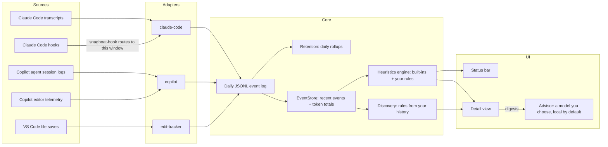

# snagboat

Snagboat is a VS Code extension that watches AI coding agents (Claude Code and GitHub Copilot Chat), normalizes their activity into one local event log, and flags signs of trouble: an agent looping on the same file, churning through tool calls, going quiet, blowing a token budget, or sounding unsure of itself. Results show up in the status bar and a detail view. Everything stays on your machine.


## Highlights

- **One event log for both agents.** Claude Code and Copilot activity, normalized into daily JSONL you can read with `jq` or DuckDB.
- **Eight heuristics, tuned on real sessions.** Thresholds come from replaying real transcripts, and the same replay runs in the unit tests.
- **Heuristics from your own history.** Discovery proposes rules and thresholds from what's unusual for you, each scored by replay before you accept it.
- **A privacy-first advisor.** A model explains sessions and findings: local by default, a redacted digest for hosted providers, the payload shown before it's sent, no tools for the model, and an audit log.

## How it fits together



Adapters own all agent-specific parsing and emit one normalized event shape ([docs/schema.md](docs/schema.md)); heuristics and UI never branch on which agent produced an event. Each VS Code window runs its own hook receiver on its own port, and the hook script routes each Claude Code project's hooks to the window that has it open. Details: [docs/architecture.md](docs/architecture.md).

## Why

I built it for myself. I spend long stretches in agent sessions and wanted to see them top down: which prompt kicked off what, where the tokens went, and when things started going sideways. What's here is basic, but I get more use out of it every week.

**The name.** In the 1800s, [snagboats](https://en.wikipedia.org/wiki/Snagboat) pulled sunken trees, called snags, out of rivers like the Mississippi. You couldn't see a snag from the deck, and snags were the steamboat's deadliest hazard. Henry Shreve built the first snagboat, the *Heliopolis*, in 1829. This Snagboat watches for the hazards you can't see in your agent sessions: loops, churn, a context quietly filling up.

**Build your own.** This is the age of AI. Why download a plugin and live with someone else's choices? Point your agent at this repo, or at an empty one, and build the version with the views and heuristics you actually want. Snagboat is a starting point.

## Status

Working, but early (version `0.0.2`; see the [changelog](CHANGELOG.md)). Install it from a [GitHub release](https://github.com/DChristianson/snagboat/releases); it's not yet on the Marketplace or Open VSX. macOS and Linux only: Claude Code hooks go through a POSIX shell script. See [what's not built yet](#not-built-yet).

## What it watches

| Source | How | What you get |
| --- | --- | --- |
| Claude Code | Tails the session transcripts in `~/.claude/projects/<project>/` | Token usage per API message (input, output, cache read/creation), model, reply excerpts, your prompts' text, and the session's title |
| Claude Code | `PostToolUse` and `Stop` hooks, added to the project's `.claude/settings.json` automatically | Tool calls with their target (file path or shell command) and success or failure; turn boundaries |
| GitHub Copilot (Agent mode) | Reads the Copilot CLI's session logs in `~/.copilot/session-state/`, which VS Code's agent host writes for every Agent-mode session | Prompts and their text, reply excerpts, the session's name, every model call with token usage, model, and the model's context limit, and tool calls with their commands and outcomes |
| GitHub Copilot (editor features) | Copilot's optional OpenTelemetry export to a local receiver | Token usage of inline and next-edit suggestions and other editor-side model calls, kept separate from agent turns |
| VS Code | File saves | Edits per file, for agent-independent signals |

## Install

Requires VS Code 1.119 or later.

Download `snagboat-<version>.vsix` from the [latest release](https://github.com/DChristianson/snagboat/releases/latest), then:

```bash
code --install-extension snagboat-0.0.2.vsix
```

Or build it yourself (needs Node.js 22 or later):

```bash
git clone https://github.com/DChristianson/snagboat.git
cd snagboat
npm install
npm run package                                     # builds and writes snagboat-0.0.2.vsix
code --install-extension snagboat-0.0.2.vsix --force
```

Then reload each open VS Code window (**Developer: Reload Window**). Snagboat activates on startup.

### Claude Code setup

Nothing to configure. Snagboat finds the project's transcripts on its own and, on activation, adds two hook entries to the project's `.claude/settings.json` that run `~/.snagboat/bin/snagboat-hook`. The hook entries never block or fail Claude Code, even if Snagboat isn't running. If `.claude/settings.json` is committed in your repo, the change will show up in `git status`; the entry is the same for every user and machine. To remove them, run **Snagboat: Remove Claude Code Hooks from Project...**, which also turns off `snagboat.claudeCode.configureHooks` for the folder so they aren't added back (or delete the entries whose command ends in `# snagboat-hook-receiver`, and turn that setting off yourself).

### Copilot setup

Agent mode needs no setup: Snagboat reads its session logs, picking the sessions started inside each window's workspace.

To also count the tokens used by Copilot's inline and next-edit suggestions, turn on Copilot's telemetry in your VS Code settings:

```json
{
  "github.copilot.chat.otel.enabled": true,
  "github.copilot.chat.otel.exporterType": "otlp-http",
  "github.copilot.chat.otel.otlpEndpoint": "http://127.0.0.1:4318"
}
```

The port must match `snagboat.copilot.otlpPort` (default `4318`). Only one VS Code window can listen on it; see [known limitations](#known-limitations). In current VS Code, Agent mode runs in VS Code's built-in agent host through the Copilot CLI, which doesn't send this telemetry, so it only covers editor features.

## Quick tour

- **Status bar:** today's tokens, agent events, and local edits, plus the most important active finding. Hover for the breakdown by agent and any health problems with Snagboat itself.
- **Detail view** (click the status bar, or **Snagboat: Open Detail View**): the **Overview** tab has today's totals, findings to acknowledge or mute, a daily token chart, and a filterable 24-hour timeline.
- **Sessions tab:** each day's sessions by name. Open one for its turn tree (where the tokens went, by prompt, agent, and tool category), its context timeline, and its findings, past ones included.
- **Suggestions tab** (**Snagboat: Discover Heuristics**): rules, thresholds, and shell categories proposed from your own history, scored by replay; accept, adjust, or dismiss.
- **Snagboat: Write Review** writes a weekly Markdown review of this workspace to `~/.snagboat/reviews/`.

Every view and command: [docs/usage.md](docs/usage.md). Every setting: [docs/settings.md](docs/settings.md).

## Findings

Most heuristics judge each session's current turn (everything since your latest prompt), so they clear when you prompt again.

| Heuristic | Fires when | Status bar glyph |
| --- | --- | --- |
| `runaway-turn` | One prompt has driven 100 or more model calls or tool calls | `$(run-all)` |
| `context-pressure` | Context was compacted automatically during the turn (warning), or is near the model's limit (info) | `$(fold)` |
| `cache-thrash` | Calls in one turn keep rewriting the prompt cache instead of reusing it | `$(flame)` |
| `backtracking` | One target fails repeatedly, or one file is edited over and over, within a turn | `$(history)` |
| `tool-churn` | A burst of tool calls in one session mostly hits the same one or two targets | `$(sync)` |
| `stalled` | An unfinished turn has had no agent activity for a while: a long-running tool, a permission prompt, or a stuck agent. A finished turn going quiet never fires. | `$(clock)` |
| `token-budget` | A session, or today's total for this workspace, crosses a budget you set | `$(dashboard)` |
| `verbal-hedge` | Replies in one session repeatedly hedge or self-correct ("I think", "let me try again", "my mistake"). Informational, and a warning only alongside repeated or failing tool activity. Needs `snagboat.captureContent` (on by default). | `$(comment-discussion)` |

Default thresholds come from replaying real sessions; `npm run replay:heuristics` replays yours, and the Suggestions tab compares them with your history. Your own rules run alongside, as JSON (see [docs/heuristics.md](docs/heuristics.md#rules)).

With no active finding the glyph is `$(pulse)`; a problem with Snagboat itself shows `$(warning)`. Details: [docs/heuristics.md](docs/heuristics.md).

**Notifications** are off by default. Set `snagboat.nudges.notify` to `warnings` (or `all`) to be told when a finding appears, with buttons to show it in its session, explain it, acknowledge it, or mute it. There's at most one per turn, never a modal dialog, and `snagboat.nudges.quiet` keeps any heuristic out of them. With notifications on, `runaway-turn` and `context-pressure` also warn early, at 80% of their thresholds (`earlyWarning`), while there's still time to act: "Heading for a runaway turn: 80 of 100 model calls". `snagboat.nudges.advisor` adds the advisor's one-line suggestion under the finding in the status bar tooltip.

## Advisor (optional)

**Explain** asks a model you choose what happened in a session, a turn, or a finding, and shows its answer beside the session, labelled as model output. Use the **Explain session** button in the Sessions tab, **Explain turn** on a selected prompt, **Explain** on a finding, or **Snagboat: Explain Session...**.

**Ask the advisor**, in the Suggestions tab, gives discovery's candidates plain names, summaries, and suggested actions, proposes up to three rules of its own, and groups your shell commands into categories ("Network" for `curl` and `wget`). Each is checked like a rule you'd write, scored by replaying your history, and marked as the advisor's; nothing is saved until you accept. After **Snagboat: Write Review**, **Ask the Advisor** adds a model's judgment to the review.

- **Local by default.** `snagboat.advisor.providers` starts with one provider: Ollama at `http://localhost:11434/v1`. Any OpenAI-compatible server on this machine works (LM Studio, llama.cpp). With no model set, Snagboat lists the server's models the first time you use it.
- **Hosted only if you add one.** A provider at any other address must use https and needs your API key, set with **Snagboat: Set Advisor API Key...** and kept in VS Code's secret storage. Every request to it is recorded in a local audit log.
- **The model sees a digest, not your log.** The digest is a summary built for one request:
  - shell commands become their category and command name (`tests-builds: npm`);
  - paths are made relative to the workspace, or hashed;
  - prompts and session names go to local providers only, unless you allow more per provider (`send`);
  - reply excerpts go nowhere unless you allow them.

  The model gets no tools, so it can only answer.
- **Small local models** may cut a whole session's digest to fit their context window; Explain warns when that happens. For Ollama, a larger window (`OLLAMA_CONTEXT_LENGTH=16384 ollama serve`) fixes it, and explaining one turn or finding sends far less.
- **You see it first.** Before a provider's first request, and again whenever its address or sending rules change, Snagboat opens the exact payload and asks. **Snagboat: Preview Advisor Digest...** shows a session's digest as any provider would get it.

## Privacy

Nothing leaves your machine unless you set up a hosted advisor provider and approve what it receives (see [Advisor](#advisor-optional)), and there is no telemetry on the extension's UI. Events are stored as daily JSONL files in VS Code's per-workspace storage, readable with `jq`, DuckDB, or a notebook. Two things worth knowing. **Snagboat stores your prompts' text** by default, along with agent reply excerpts and session names: common secret formats are redacted first, prompts and replies are kept for 30 days (`snagboat.retention.textDays`), and **Snagboat: Remove Captured Text** deletes them on demand; turn `snagboat.captureContent` off to store no text at all. And for Claude Code's Bash tool, an event's target is the **full shell command**, which can contain secrets. [PRIVACY.md](PRIVACY.md) lists exactly what each source records and every place Snagboat stores anything.

## Development

Open the repo in VS Code and press F5 to run Snagboat in an Extension Development Host, with `npm run watch` rebuilding as you edit.

| Script | What it does |
| --- | --- |
| `npm run build` | Bundles `src/extension.ts` to `dist/extension.js` with esbuild |
| `npm run watch` | Rebuilds on change |
| `npm run test:unit` | Unit tests, no VS Code needed |
| `npm test` | Compiles and bundles, then runs the integration suite in a real VS Code instance via `@vscode/test-electron` |
| `npm run replay:heuristics` | Replays your local Claude Code transcripts through every heuristic and reports what would have fired; prints counts and times only |
| `npm run summarize:copilot` | Summarizes a Copilot structure capture: span tree, attributes, and where token counts live |
| `npm run verify:transcripts` | Replays your own local Claude Code transcripts for this project through the adapter and checks token totals; prints totals only |
| `npm run package` | Builds the `.vsix` |
| `npm run licenses` | Regenerates `THIRD_PARTY_LICENSES.md` from the bundled dependencies (`-- --check` verifies it, as CI does) |

## Known limitations

- **Copilot editor telemetry is collected by one window.** Copilot in every window exports to the same port, so the first window to claim it records all inline-suggestion usage and the others show a "failed to listen on port" health warning. Copilot agent sessions and Claude Code don't have this problem.
- **The Copilot receiver doesn't authenticate requests**, so another local process could submit fake Copilot events. Claude Code hooks are token-protected. See [SECURITY.md](SECURITY.md).
- **Windows is unsupported**: the hook script needs a POSIX shell.

## Not built yet

From the [roadmap](docs/roadmap.md):

- several advisors, each with its own prompts and data access, and the advisor's use of your prompts' text
- telling an agent that's waiting on you from one that's stuck (`stalled`)
- terminal exit codes and `git diff` polling, to tell real edits from no-op saves
- a token budget across all workspaces, with a treemap view
- extension points for third-party adapters and heuristics
- log export to CSV and SQLite
- publishing to the Marketplace and Open VSX

## Repository docs

- [Usage: views and commands](docs/usage.md)
- [Settings](docs/settings.md)
- [Architecture](docs/architecture.md)
- [Schema and transformation matrix](docs/schema.md)
- [Heuristics](docs/heuristics.md)
- [Roadmap](docs/roadmap.md)
- [Privacy](PRIVACY.md)
- [Security policy](SECURITY.md)
- [Contributing](CONTRIBUTING.md)
- [Third-party licenses](THIRD_PARTY_LICENSES.md)
