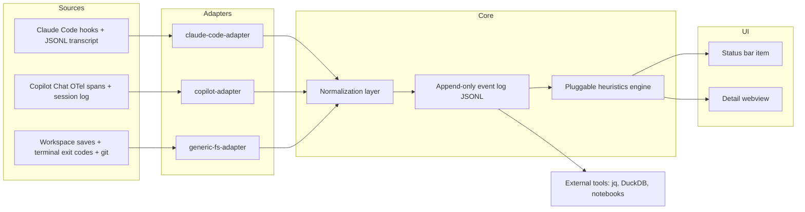

# snagboat

Snagboat is a planned VS Code extension that watches AI coding agents, normalizes their activity into a shared event schema, mines the resulting log for signs of trouble, and surfaces the result in a status bar indicator plus a detail view.

## Project status

This repository currently captures the v0.1 design plan for the extension. The core idea is to keep adapters agent-specific, keep everything downstream schema-driven, and keep all captured data local by default.

## Quickstart

1. Read the [architecture overview](docs/architecture.md).
2. Review the [normalized event schema and transformation matrix](docs/schema.md).
3. Read the [heuristics design](docs/heuristics.md).
4. Review the [privacy and retention model](PRIVACY.md).
5. Follow the [contribution guide](CONTRIBUTING.md) before proposing adapter or heuristic changes.

## Architecture overview

Adapters own all agent-specific parsing. The normalization layer is the only place that understands the common schema, so heuristics and UI code never need agent-specific branches.

## Planned settings reference

| Setting | Default | Purpose |
| --- | --- | --- |
| `snagboat.retention.rawDays` | `90` | Retain structural events before rolling them into daily aggregates. |
| `snagboat.retention.textDays` | `3` | Retain captured text excerpts when content capture is enabled. |
| `snagboat.captureContent` | `false` | Opt into storing truncated text excerpts used by the verbal-hedge heuristic. |
| `snagboat.tokenBudget.session` | unset | Warn when a single session crosses a configured token budget. |
| `snagboat.tokenBudget.day` | unset | Warn when the current day crosses a configured token budget. |
| `snagboat.heuristics.backtracking.window` | TBD | Tune the short rolling window used to distinguish iteration from looping. |
| `snagboat.heuristics.stalled.minutes` | TBD | Define when an active session is considered stalled. |

## Planned status indicators

- 🚗 **Cruisin' Clyde** — no open findings in the active window
- 🪃 **Boomerang Bea** — backtracking detected
- 🔁 **Loopy Lou** — tool churn detected
- 🤔 **Wobbly Walt** — hedge language paired with behavioral trouble
- ⛽ **Meter Mo** — token budget warning
- 💤 **Snoozy Sam** — an active session has stalled

The final extension should use simple SVG or codicon-weight icons in the actual status bar, while keeping these names for tooltips and detail views.

## Repository docs

- [Architecture](docs/architecture.md)
- [Schema and transformation matrix](docs/schema.md)
- [Heuristics](docs/heuristics.md)
- [Implementation roadmap](docs/roadmap.md)
- [Privacy](PRIVACY.md)
- [Contributing](CONTRIBUTING.md)
- [Third-party license plan](THIRD_PARTY_LICENSES.md)
