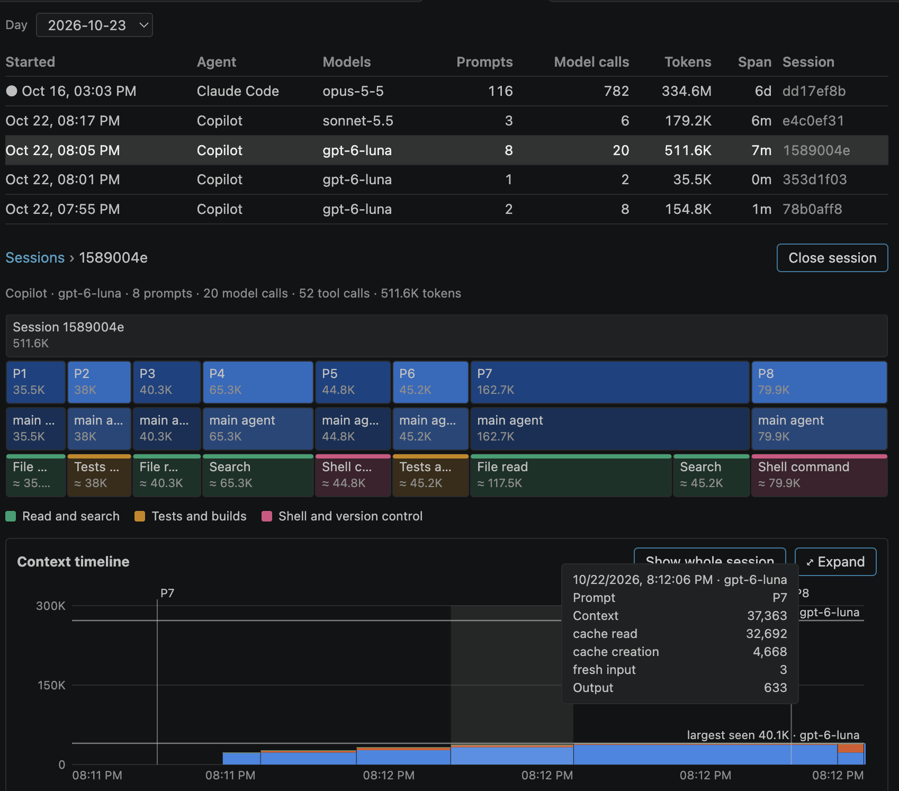

# snagboat

Snagboat is a VS Code extension that watches AI coding agents (Claude Code and GitHub Copilot Chat), normalizes their activity into one local event log, and flags signs of trouble: an agent looping on the same file, churning through tool calls, going quiet, blowing a token budget, or sounding unsure of itself. Each sign it flags is a **finding**, raised by one of its **heuristics**: rules that watch the agents' recorded activity for one kind of trouble. Findings show up in the status bar and a detail view. Everything stays on your machine.



- **Tells you when an agent is in trouble.** Looping on one file or command, churning through tool calls, going quiet, filling its context, or burning tokens past a budget you set: eight heuristics watch for these and flag them in the status bar, each with [what to try](#findings).
- **Shows where the tokens went.** Each session's turn tree splits its tokens by prompt, agent, and tool category, for Claude Code and Copilot alike.
- **One event log for both agents.** Their activity is normalized into one daily JSONL format you can also read with `jq` or DuckDB.
- **Learns what's unusual for you.** Discovery proposes rules and thresholds from your own history, each scored by replaying that history before you accept it.
- **Explains, privately.** A model you choose explains sessions and findings: local by default; a hosted one gets a redacted digest, which you see before it's first sent, and every request to it is logged.

## Try it in your browser

No install needed: the [web demo](https://dchristianson.github.io/snagboat/) runs the Explore tab's views over example sessions, or over your own event log files, read in the browser and sent nowhere ([PRIVACY.md](PRIVACY.md#the-web-demo)).

## An example

You ask Claude Code to fix a failing test and turn to something else. That prompt starts a **turn**: the prompt and everything the agent does in answer to it, until it stops or you prompt again. The agent runs `npm test`, edits a file, runs it again, and it fails a third time. That trips the `backtracking` heuristic, and the status bar now shows its finding: "npm test failed 3 times in this turn". You click the status bar, and the detail view lists the finding; **Show in session** opens the session, where the turn tree shows what this prompt has cost so far. You stop the agent, read the failure yourself, and prompt again with what it was missing. The new prompt starts a new turn, and the finding clears.

Each heuristic has a line on [what to try](#findings) when it fires.

## Status and requirements

Working, but early (version `0.0.2`; see the [changelog](CHANGELOG.md) and [what's not built yet](#not-built-yet)). Free and open source under the [MIT license](LICENSE).

- **Agents:** Claude Code and GitHub Copilot only. Other agents, such as Cursor's or Codex, aren't watched.
- **VS Code** 1.145 or later.
- **Platforms:** macOS and Linux. Windows is new and less tried: Claude Code hooks run through Git Bash there, as Claude Code itself requires (see [known limitations](#known-limitations)).
- **Node.js** 24 or later, to build from source or to run the `snagboat` command line. The extension itself runs on the Node.js that VS Code ships.
- **Where to get it:** a [GitHub release](https://github.com/DChristianson/snagboat/releases). It's not yet on the Marketplace or Open VSX.

## Install

> **Before you install**
>
> - **It edits a file in your projects.** For every folder you open in VS Code, Snagboat adds two hook entries to `.claude/settings.json`: commands Claude Code runs after each tool call and when the agent stops, which tell Snagboat what happened. If that file is committed, the change shows up in `git status`. [Removing them](#claude-code-setup) is one command.
> - **It stores your prompts' text** and the agents' reply excerpts, for 30 days by default (common secret formats are redacted first). Turn `snagboat.captureContent` off to store no text.
> - **It records full shell commands** from Claude Code's Bash tool, which can contain secrets. They're kept as long as their events: 90 days by default.
>
> All of it stays on your machine. Details: [PRIVACY.md](PRIVACY.md).

Download `snagboat-<version>.vsix` from the [latest release](https://github.com/DChristianson/snagboat/releases/latest), then:

```bash
code --install-extension snagboat-0.0.2.vsix
```

Or build it yourself (needs Node.js 24 or later):

```bash
git clone https://github.com/DChristianson/snagboat.git
cd snagboat
npm install
npm run package                                     # builds and writes snagboat-0.0.2.vsix
code --install-extension snagboat-0.0.2.vsix --force
```

Then reload each open VS Code window (**Developer: Reload Window**). Snagboat activates on startup.

### Claude Code setup

Nothing to configure. Snagboat finds the project's transcripts on its own and, on activation, adds two hook entries to the project's `.claude/settings.json` that run `~/.snagboat/bin/snagboat-hook`. The hook entries never block or fail Claude Code, even if Snagboat isn't running. If `.claude/settings.json` is committed in your repo, the change will show up in `git status`; the entry is the same for every user and machine. To remove them, run **Snagboat: Remove Claude Code Hooks from Project...**, which also turns off `snagboat.claudeCode.configureHooks` for the folder so they aren't added back (or delete the entries whose command ends in `# snagboat-hook-receiver`, and turn that setting off yourself).

### Copilot setup

Agent mode needs no setup: Snagboat reads its session logs, picking the sessions started inside each window's workspace.

To also count the tokens used by Copilot's inline and next-edit suggestions, turn on Copilot's OpenTelemetry export in your VS Code settings. OpenTelemetry is an open standard for telemetry, and OTLP its protocol; here Copilot sends it to a receiver Snagboat runs on your machine.

```json
{
  "github.copilot.chat.otel.enabled": true,
  "github.copilot.chat.otel.exporterType": "otlp-http",
  "github.copilot.chat.otel.otlpEndpoint": "http://127.0.0.1:4318"
}
```

The port must match `snagboat.copilot.otlpPort` (default `4318`). Only one VS Code window can listen on it; see [known limitations](#known-limitations). In current VS Code, Agent mode runs in VS Code's built-in agent host through the Copilot CLI, which doesn't send this telemetry, so it only covers editor features.

## Quick tour

- **Status bar:** today's tokens, agent events, and local edits, plus the most important active finding. Snagboat counts tokens, not dollars: it has no price data. Hover for the breakdown by agent and any health problems with Snagboat itself.
- **Detail view** (click the status bar, or **Snagboat: Open Detail View**): the **Overview** tab has today's totals, active findings, a daily token chart, and a filterable 24-hour timeline. **Acknowledge** a finding to hide it from the status bar until that problem clears; **mute** a heuristic to hide its findings in this workspace until you unmute it.
- **Sessions tab:** each day's sessions by name. Open one for its turn tree (where the tokens went, by prompt, agent, and tool category), its context timeline, and its findings, past ones included.
- **Explore tab** (experimental): up to eight sessions through a carousel of visualizers: charts and diagrams (timelines, treemaps, graphs, and more), each drawing the same sessions its own way. A puck, a small panel you can drag to any corner, names the current visualizer and filters the carousel by its tags. The same views are in the [web demo](#try-it-in-your-browser).
- **Suggestions tab** (**Snagboat: Discover Heuristics**): rules, thresholds, and shell categories proposed from your own history, scored by replay; accept, adjust, or dismiss.
- **Snagboat: Write Review** writes a weekly Markdown review of this workspace to `~/.snagboat/reviews/`.

Every view and command: [docs/usage.md](docs/usage.md). Every setting: [docs/settings.md](docs/settings.md).

## Findings

Most heuristics judge each session's current turn (everything since your latest prompt), so they clear when you prompt again.

| Heuristic | Fires when (defaults) | What to try | Status bar icon |
| --- | --- | --- | --- |
| `runaway-turn` | One prompt has driven 100 or more model calls, or 100 or more tool calls | Check the turn is still on track. If not, stop it and split the job into narrower prompts. | `run-all` |
| `context-pressure` | Context was compacted automatically during the turn, meaning earlier conversation was summarized to make room (warning), or the latest call sent 90% or more of the model's limit (info) | After a compaction, restate anything the agent still needs, since earlier details were summarized. Near the limit, wrap up the thread or start a fresh session. | `fold` |
| `cache-thrash` | Two or more calls in one turn each wrote 50,000 or more tokens to the prompt cache (where the provider keeps the start of a prompt, so the next call can reuse it at a lower price), more than they read from it | Something early in the prompt changes on every call: instructions, the tool list, or files injected each time. Find it and keep it stable, so calls reuse the cache instead of paying full price. | `flame` |
| `backtracking` | In one turn, one target (a file or shell command) failed 3 or more times, or one file was edited 10 or more times | Stop the agent and look at why that command or file keeps failing or changing, then re-prompt with what it's missing. | `history` |
| `tool-churn` | In 5 minutes, 8 or more tool calls in one session, at least 90% of them on the same one or two targets | Look at those calls (the finding filters the Overview timeline to them). If the agent is going in circles, interrupt and redirect it. | `sync` |
| `stalled` | An unfinished turn has had no agent activity for 15 minutes: a long-running tool, a permission prompt, or a stuck agent. A finished turn going quiet never fires; after 3 hours the turn counts as abandoned. | Go to the agent: answer a permission prompt or question, or stop it if it's stuck. | `clock` |
| `token-budget` | A session, or today's total for this workspace, crosses a budget you set (none by default) | Start a fresh session, or open the session's turn tree to see where the tokens went. | `dashboard` |
| `verbal-hedge` | Two or more replies in one session hedge or self-correct ("I think", "let me try again", "my mistake") within 10 minutes. Informational, and a warning only alongside repeated or failing tool activity. Needs `snagboat.captureContent` (on by default). | Skim the agent's recent replies. If it's also repeating or failing actions, step in with more context. | `comment-discussion` |

When a finding is a false alarm for you, raise its threshold ([settings](docs/settings.md#heuristic-thresholds)), or mute it. Default thresholds come from replaying real sessions; `npm run replay:heuristics` replays yours, and the Suggestions tab compares them with your history. Your own rules run alongside, as JSON (see [docs/heuristics.md](docs/heuristics.md#rules)).

The icons are VS Code's built-in [codicons](https://microsoft.github.io/vscode-codicons/dist/codicon.html), named here: the status bar shows the icon of the most important active finding. With none it shows `pulse`. A `warning` icon is about Snagboat itself, not your agent: something like a port it couldn't listen on, or a rule that doesn't validate. Hover the status bar for the message, or run **Snagboat: Show Token/Event Breakdown** to print it in the Snagboat output with any rule problems. A port warning usually means another window already has the port ([known limitations](#known-limitations)); a rule problem goes away when you fix or remove that entry in `snagboat.rules` or `snagboat.toolCategories`. Details: [docs/heuristics.md](docs/heuristics.md).

**Notifications** are off by default. Set `snagboat.nudges.notify` to `warnings` (or `all`) to be told when a finding appears, with buttons to show it in its session, explain it, acknowledge it, or mute it. There's at most one per turn, never a modal dialog, and `snagboat.nudges.quiet` keeps any heuristic out of them. With notifications on, `runaway-turn` and `context-pressure` also warn early, at 80% of their thresholds (`earlyWarning`), while there's still time to act: "Heading for a runaway turn: 80 of 100 model calls". `snagboat.nudges.advisor` adds the advisor's one-line suggestion under the finding in the status bar tooltip.

## What it watches

| Source | How | What you get |
| --- | --- | --- |
| Claude Code | Tails the session transcripts in `~/.claude/projects/<project>/` | Token usage per API message (input, output, cache read/creation), model, reply excerpts, your prompts' text, and the session's title |
| Claude Code | `PostToolUse` and `Stop` hooks, added to the project's `.claude/settings.json` automatically | Tool calls with their target (file path or shell command) and success or failure; turn boundaries |
| GitHub Copilot (Agent mode) | Reads the Copilot CLI's session logs in `~/.copilot/session-state/`, which VS Code's agent host writes for every Agent-mode session | Prompts and their text, reply excerpts, the session's name, every model call with token usage, model, and the model's context limit, and tool calls with their commands and outcomes |
| GitHub Copilot (editor features) | Copilot's optional OpenTelemetry export to a local receiver | Token usage of inline and next-edit suggestions and other editor-side model calls, kept separate from agent turns |
| VS Code | File saves | Edits per file, for agent-independent signals |

Each agent has an adapter that turns its logs into one event shape ([docs/schema.md](docs/schema.md)), so heuristics and views never depend on which agent produced an event. By default each VS Code window collects for its own workspace: it runs its own hook receiver, and the hook script routes each Claude Code project's hooks to the window that has it open. With the per-user store preview on, a core service collects for every project and each window is its client ([command line](#command-line-early)). How the parts fit together: [docs/architecture.md](docs/architecture.md#data-flow).

## Advisor (optional)

**Explain** asks a model you choose what happened in a session, a turn, or a finding, and shows its answer beside the session, labelled as model output. Use the **Explain session** button in the Sessions tab, **Explain turn** on a selected prompt, **Explain** on a finding, or **Snagboat: Explain Session...**.

**Ask the advisor**, in the Suggestions tab, gives discovery's candidates plain names, summaries, and suggested actions, proposes up to three rules of its own, and groups your shell commands into categories ("Network" for `curl` and `wget`). Each is checked like a rule you'd write, scored by replaying your history, and marked as the advisor's; nothing is saved until you accept. After **Snagboat: Write Review**, **Ask the Advisor** adds a model's judgment to the review.

- **Local by default.** `snagboat.advisor.providers` starts with one provider: Ollama at `http://localhost:11434/v1`. Any OpenAI-compatible server on this machine works (LM Studio, llama.cpp). With no model set, Snagboat lists the server's models the first time you use it.
- **Hosted only if you add one.** A provider at any other address must use https and needs your API key, set with **Snagboat: Set Advisor API Key...** and kept in VS Code's secret storage. Every request to it is recorded in a local audit log.
- **Several advisors, if you like.** `snagboat.advisors` lists advisors with the abilities each offers (summarize a session or the week, propose heuristics, propose nudges) and what each may receive per ability; `snagboat.advisor.defaults` picks the one used, and **Ask another advisor** offers the rest. See [settings.md](docs/settings.md#installed-advisors).
- **The model sees a digest, not your log.** The digest is a summary built for one request:
  - shell commands become their category and command name (`tests-builds: npm`);
  - paths are made relative to the workspace, or hashed;
  - prompts and session names go to local providers only, unless you allow more per provider (`send`);
  - reply excerpts go nowhere unless you allow them.

  The model gets no tools, so it can only answer.
- **Small local models** may cut a whole session's digest to fit their context window; Explain warns when that happens. For Ollama, a larger window (`OLLAMA_CONTEXT_LENGTH=16384 ollama serve`) fixes it, and explaining one turn or finding sends far less.
- **You see it first.** Before a provider's first request, and again whenever its address or sending rules change, Snagboat opens the exact payload and asks. **Snagboat: Preview Advisor Digest...** shows a session's digest as any provider would get it.

## Command line (early)

`snagboat` reads the same event logs from a terminal or an agent, without VS Code running. Every command prints JSON with `--json`, and only `migrate` writes anything.

```sh
node dist/snagboat.js sessions            # sessions in the workspace containing this folder
node dist/snagboat.js session <id> --json # one session's summary
node dist/snagboat.js sessions --all      # every workspace's sessions
node dist/snagboat.js stores              # where the logs are
node dist/snagboat.js config              # the settings that apply here, and where each comes from
node dist/snagboat.js migrate --dry-run   # what migrate would copy into ~/.snagboat/data
node dist/snagboat.js migrate             # copy every store into the per-user store
node dist/snagboat.js sessions --all --store user   # read the per-user store
```

`snagboat serve` runs the **core service** (preview): one local process per user that reads and writes the per-user store for other tools, on `127.0.0.1` only, found through `~/.snagboat/core.json`. `snagboat core start` starts it in the background, `core status` and `core stop` find it, and it stops by itself after 30 idle minutes (`--idle-minutes`). **While it runs, the core records Claude Code and Copilot CLI sessions in every project on this machine**, not only ones open in VS Code: it reads `~/.claude/projects` and `~/.copilot/session-state`, files each project under the workspace that contains it (or its repository), and applies retention to them. A project's `"collect": false`, `"collect.unopened": false` in your `~/.snagboat/config.json`, or `--no-collect` limits it ([privacy](PRIVACY.md#what-is-captured)). Claude Code hooks for a project with no VS Code window open go to the core too, and once a core has run, hooks that find no core are kept until it next starts. With `snagboat.storage.perUserStore` on, VS Code starts the core and each window becomes its client: the core collects and writes, and a window shows its own workspace from it ([handoff](docs/design/handoff-3c.md)).

`migrate` is for the per-user store preview (`snagboat.storage.perUserStore`). It copies, never moves or deletes; running it again copies only what's new. To check a migration, save `sessions --all --json` to a file before migrating, then run `migrate --verify <file>`: every session in it must be in the per-user store with the same prompt, tool-call and token counts.

By default a command reads only the store of the workspace that contains the current folder; `--all` is the explicit way to read across workspaces. It finds stores written by VS Code and its forks (Insiders, VSCodium, Cursor, Windsurf), including their servers in a dev container or over Remote-SSH (`~/.vscode-server` and the like; run the CLI on that side), or one store named by `SNAGBOAT_STORE`. The server doesn't record which workspace a store belongs to, so Snagboat writes it in the store (`snagboat-workspace.json`) when a window opens it. A server store from before that has no record until its folder is opened again: until then only `--all` reads it, and `migrate` skips it. It's built by `npm run build`; publishing it as an npm package comes later ([architecture RFC](docs/design/architecture-rfc.md)).

## Privacy

Nothing leaves your machine unless you set up a hosted advisor provider and approve what it receives (see [Advisor](#advisor-optional)), and there is no telemetry on the extension's UI. Events are stored as daily JSONL files in VS Code's per-workspace storage (or in `~/.snagboat/data` with the per-user store preview), readable with `jq`, DuckDB, or a notebook. Two things worth knowing. **Snagboat stores your prompts' text** by default, along with agent reply excerpts and session names: common secret formats are redacted first, prompts and replies are kept for 30 days (`snagboat.retention.textDays`), and **Snagboat: Remove Captured Text** deletes them on demand; turn `snagboat.captureContent` off to store no text at all. And for Claude Code's Bash tool, an event's target is the **full shell command**, which can contain secrets. [PRIVACY.md](PRIVACY.md) lists exactly what each source records and every place Snagboat stores anything.

## Why

I built it for myself. I spend long stretches in agent sessions and wanted to see them top down: which prompt kicked off what, where the tokens went, and when things started going sideways. What's here is basic, but I get more use out of it every week.

**The name.** In the 1800s, [snagboats](https://en.wikipedia.org/wiki/Snagboat) pulled sunken trees, called snags, out of rivers like the Mississippi. You couldn't see a snag from the deck, and snags were the steamboat's deadliest hazard. Henry Shreve built the first snagboat, the *Heliopolis*, in 1829. This Snagboat watches for the hazards you can't see in your agent sessions: loops, churn, a context quietly filling up.

**Build your own.** This is the age of AI. Why download a plugin and live with someone else's choices? Snagboat is a starting point, MIT licensed, and there are three ways to make it yours:

- **Without code:** raise or lower any heuristic's thresholds ([settings](docs/settings.md#heuristic-thresholds)), and write your own rules as JSON in `snagboat.rules` ([docs/heuristics.md](docs/heuristics.md#rules)).
- **In a fork:** add a heuristic (one file in `src/heuristics/`), an adapter for another agent (one folder in `src/adapters/`), or a visualizer for the Explore tab (one file in `media/viz/`, plus its entry in `src/ui/visualizers.ts`). [CONTRIBUTING.md](CONTRIBUTING.md) has the layout and the steps for heuristics and adapters; [docs/architecture.md](docs/architecture.md#detail-webview) has the visualizer contract.
- **From scratch:** point your coding agent at this repo, or at an empty one, and build the version with the views and heuristics you actually want.

## Development

Open the repo in VS Code and press F5 to run Snagboat in an Extension Development Host, with `npm run watch` rebuilding as you edit.

| Script | What it does |
| --- | --- |
| `npm run build` | Bundles `src/extension.ts` to `dist/extension.js` with esbuild, and the web demo's bundle, so a Node import creeping into the browser-side model fails here |
| `npm run build:web` | Builds the web demo into `out/web/`: type-checks the page, bundles it, and copies the explorer's scripts and stylesheet in; the Pages workflow deploys that folder |
| `npm run watch` | Rebuilds on change |
| `npm run test:unit` | Unit tests, no VS Code needed |
| `npm test` | Compiles and bundles, then runs the integration suite in a real VS Code instance via `@vscode/test-electron` |
| `npm run replay:heuristics` | Replays your local Claude Code transcripts through every heuristic and reports what would have fired; prints counts and times only |
| `npm run summarize:copilot` | Summarizes a Copilot structure capture: span tree, attributes, and where token counts live |
| `npm run verify:transcripts` | Replays your own local Claude Code transcripts for this project through the adapter and checks token totals; prints totals only |
| `npm run package` | Builds the `.vsix` |
| `npm run licenses` | Regenerates `THIRD_PARTY_LICENSES.md` from the bundled dependencies (`-- --check` verifies it, as CI does) |
| `npm run check:readme` | Asks Claude Haiku newcomer questions about this README, from the README alone; run by hand ([docs/design/readme-check.md](docs/design/readme-check.md)) |

## Known limitations

- **Copilot editor telemetry is collected by one window.** Copilot in every window exports to the same port, so the first window to claim it records all inline-suggestion usage and the others show a "failed to listen on port" health warning. Copilot agent sessions and Claude Code don't have this problem.
- **The Copilot receiver doesn't authenticate requests**, so another local process could submit fake Copilot events. Claude Code hooks are token-protected. See [SECURITY.md](SECURITY.md).
- **Windows is new**: hook routing passes the unit tests on Windows in CI, through Git Bash's `sh` and `curl` as Claude Code runs it, but hasn't been tried with Claude Code on a real Windows machine, and the VS Code integration tests don't run on Windows yet.

## Not built yet

From the [roadmap](docs/roadmap.md):

- the four default advisors, Purser, Navigator, Bosun and Lookout, each with one measurement goal ([architecture RFC](docs/design/architecture-rfc.md#advisors-and-measurable-outcomes))
- telling an agent that's waiting on you from one that's stuck (`stalled`)
- terminal exit codes and `git diff` polling, to tell real edits from no-op saves
- a token budget across all workspaces, with a treemap view
- extension points for third-party adapters and heuristics
- log export to CSV and SQLite
- publishing to the Marketplace and Open VSX

## Repository docs

- [Usage: views and commands](docs/usage.md)
- [Settings](docs/settings.md)
- [Architecture](docs/architecture.md)
- [Schema and transformation matrix](docs/schema.md)
- [Heuristics](docs/heuristics.md)
- [Roadmap](docs/roadmap.md)
- [Privacy](PRIVACY.md)
- [Security policy](SECURITY.md)
- [Contributing](CONTRIBUTING.md)
- [Third-party licenses](THIRD_PARTY_LICENSES.md)
