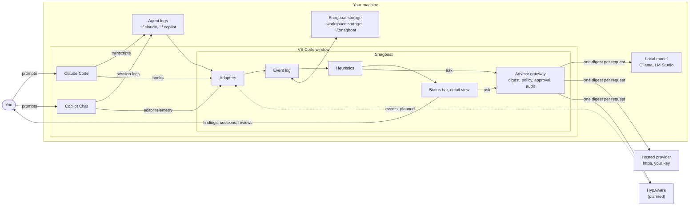
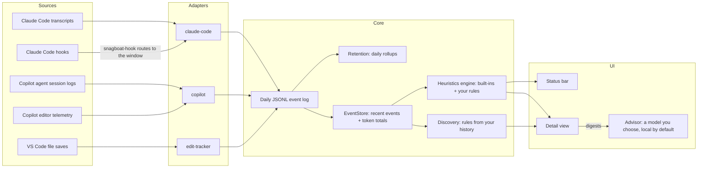

# Architecture

## Design principle

Adapters know agent-specific formats; nothing downstream does. The normalization layer is the only place that understands the common schema, which keeps new adapters additive instead of invasive.

## Where everything lives

How Snagboat relates to the systems around it: you, VS Code, the two coding agents, what's on disk, and the advisors. Inside Snagboat only its spine is drawn, from adapters to the UI, plus the Advisor, which is the only way anything leaves. The table below ties each part of Snagboat, the drawn ones and the ones behind them (discovery, review, nudges), to its modules and to where it keeps things on disk.



| Part | Modules | On disk |
| --- | --- | --- |
| Coding agents | Outside Snagboat | `~/.claude/projects/<project>/*.jsonl` (transcripts, subagents), `~/.copilot/session-state/<id>/events.jsonl`, the project's `.claude/settings.json` (hook entries), and `~/.snagboat/bin/snagboat-hook` with `~/.snagboat/routes/<folder>`, which Claude Code runs and which posts to the window that has the project open |
| Adapters | [src/adapters/claude-code](../src/adapters/claude-code/) (transcript tailer, and a hook receiver on the window's own port when the window collects), [src/adapters/copilot](../src/adapters/copilot/) (session-log tailer when the window collects, OTLP receiver on `:4318` in both modes), the edit tracker in [src/vscode/editTracker.ts](../src/vscode/editTracker.ts) | `checkpoints/` in the workspace's folder |
| Claude Code plugin (preview) | [plugins/snagboat](../plugins/snagboat/): hooks (`hooks/snagboat-hook` runs the same forwarder VS Code installs, `hooks/forward.sh`, generated by `npm run build:plugin`), `.mcp.json` running `snagboat mcp` ([src/cli/mcp.ts](../src/cli/mcp.ts)), slash commands, and `bin/snagboat` (the bundled CLI, with a Node 24 check); the status line is `snagboat statusline` ([src/cli/statusline.ts](../src/cli/statusline.ts)) | `~/.snagboat/bin/snagboat` (points at the plugin's CLI) |
| Core service (preview) | [src/core/service](../src/core/service/): the server, its collectors and store writer, and the client a window uses ([the two modes](#the-two-modes)); started by `snagboat serve` in [src/cli](../src/cli/) | `~/.snagboat/core.json`, `~/.snagboat/core.route`; `~/.snagboat/data/core/checkpoints/` and `~/.snagboat/data/spool/` |
| Event log | [src/core](../src/core/): `eventLog`, `retention`, `aggregate`, `checkpointStore`, `eventBus`, `userStore`, `migrate`, `config`; [src/backfill](../src/backfill/) | `events/<day>.jsonl` and `aggregates/` in the workspace's folder: VS Code's workspace storage, or `~/.snagboat/data/workspaces/<key>/` with the per-user store |
| Schema | [packages/schema](../packages/schema/) (`@snagboat/schema`, an npm workspace): `types` (`NormalizedEvent`), the event's JSON Schema (`normalizedEvent.v1.schema.json`), `toolCategory`, `eventDay`, `sessions`, `contextMarks`, `sessionModel` (`buildSessionView`); self-contained and browser-safe, the future schema package ([design/architecture-rfc.md](design/architecture-rfc.md)) | |
| EventStore | [src/core](../src/core/): `eventStore`, `turns`, `dailyHistory`, `contextLimits` | In memory, rehydrated from the log |
| Heuristics | [src/heuristics](../src/heuristics/): `engine`, `builtIns` and the eight heuristics, `rule`, `ruleHeuristic`, `ruleStore`, `findingsRegistry`, `replay`, `responses` | `rules.json` in global storage (`~/.snagboat/rules.json` with the per-user store); mutes in `workspaceState` |
| Discovery | [src/discovery](../src/discovery/), including `suggestionsController` (the Suggestions view VS Code and the core both serve); [src/ui](../src/ui/): `ruleTransfer` | Dismissed suggestions in VS Code's global state, or `~/.snagboat/suggestions.json` with the per-user store on |
| Review | [src/review](../src/review/): `review`, `presentation`, `effectiveness` (how each heuristic did, shared with propose-heuristics) | `~/.snagboat/reviews/*.md` |
| Nudger | [src/nudges/nudger.ts](../src/nudges/nudger.ts) | In memory (see the nudge refinements in the [roadmap](roadmap.md#planned-tasks)) |
| Advisor | [src/advisor](../src/advisor/): `goals` (advisors as goals: persona.md front matter and the four built-in), `measures`, `report`, `digest`, `providers`, `advisors`, `audit`, `prompts` (the three layers of every system prompt), one module per ability: `summarizeSession` (with the headline form), `summarizeWeek`, `proposeHeuristics`, `proposeNudges`, `proposeTactics`; and `headlines` (the per-session cache and what's due); the VS Code side (pickers, keys, progress) is `Advisor` in [src/vscode/advisor.ts](../src/vscode/advisor.ts) | `advisor-audit.jsonl` in global storage, API keys in `SecretStorage`, approved payloads in `globalState`; `~/.snagboat/advisors/<id>/` for an advisor's prompt files (`persona.md` and one per ability) ([tuning](design/trusted-advisor.md#tuning-an-advisor)) |
| UI | [src/ui](../src/ui/): `statusBar`, `detailPanel`, `detailModel`, `sessionController`; [media/](../media/): the page's scripts (`detail.js`, `sessions.js`, `suggestions.js`, the detail view's own helpers in `shared.js`), Snagboat's theme (`theme.css`, mapped to VS Code's in `vscodeTheme.css`) and base styles (`base.css`), and its two session drawings in `drawings/` (`kit.js`, `turnTree.js`, `contextTimeline.js`, `drawings.css`); [src/extension.ts](../src/extension.ts) wires everything together | |
| Advisors outside Snagboat | Ollama, LM Studio, llama.cpp; any OpenAI-compatible https endpoint with your key; HypAware (planned) | |

Each VS Code window runs one extension host with all of this; two windows on different projects share the home folder and global storage but not workspace storage. With `snagboat.storage.perUserStore` on, collecting and writing move to the core service and each window becomes its client ([the two modes](#the-two-modes)); heuristics, nudges, the advisor and the UI still run in each window. Advisors get only what the `Advisor` module builds for one request ([the advisor](#advisor)).

## Data flow

Inside Snagboat, from each source to the views.



Adapters own all agent-specific parsing and emit one normalized event shape ([schema.md](schema.md)); heuristics and UI never branch on which agent produced an event. The diagram is the default mode, where each VS Code window collects: it runs its own hook receiver on its own port, and the hook script routes each Claude Code project's hooks to the window that has it open.

### The two modes

**Per-window (the default).** Each window collects for its own workspace: it tails that project's Claude Code transcripts and the Copilot CLI sessions started in it, receives its hooks, records edits and Copilot's OpenTelemetry export, and writes events, aggregates and checkpoints to VS Code's storage for that workspace. It runs retention on that folder.

**With the core (`snagboat.storage.perUserStore`, preview).** Data lives in `~/.snagboat/data`, one folder per workspace under `workspaces/`. VS Code starts the core service, `snagboat serve` (`dist/snagboat.js`, shipped in the extension), which listens on `127.0.0.1` only.

- The core collects Claude Code transcripts and Copilot CLI sessions for every project on the machine, files each under its workspace, and writes and prunes the store. Claude Code hooks reach it through `~/.snagboat/core.route`; when no core is running, the hook script leaves them in a spool the core reads when it next starts. `collect`, `collect.unopened` and `--no-collect` limit what it records ([settings](settings.md#outside-vs-code-snagboatconfigjson-and-snagboatjson)).
- Each window is a client with a token for its own workspace. It reads its folder once at startup, then follows the workspace's live feed (`GET /events/stream`), which also replays any day written while it was disconnected. It posts what only it sees (edits, and Copilot's OpenTelemetry export, whose spans don't say which workspace they came from) with `POST /events`, spooling them if the core can't take them.
- Backfill, relabelling shell calls, removing captured text and clearing the log rewrite days, so the window holds its folder while they run: the core spools that workspace's events and writes them afterwards.
- A window copies its settings to `~/.snagboat/config.json`, where the core reads them (with a project's `.snagboat.json`); changing retention settings asks the core to apply them right away.
- If the core can't start, or an older core without the client endpoints is running, the window collects and writes its own folder in `~/.snagboat/data`, and claims it so the core leaves it alone.
- `snagboat core stop` stops the core for good: open windows wait for another front door to start one. Any other exit, and a window starts a new core.

With the core, it also runs the heuristics for each workspace a window follows (built-ins, `rules.json` and the workspace's settings rules and thresholds) and sends the window its findings and early warnings on the same feed; `GET /findings` and `snagboat findings` answer anyone else. The window shows them (status bar, notifications) and evaluates them itself only while the core is away. The advisor and the UI run in each window in both modes; the window still builds the heuristics too, for replay, discovery and effectiveness ([architecture RFC](design/architecture-rfc.md)).

The core's modules, in [src/core/service](../src/core/service/):

| Module | What it does |
| --- | --- |
| `server.ts` | The HTTP server: tokens (the admin token in `core.json` reads every workspace and mints workspace tokens), events in and out, sessions, the live feed, hooks, flush, retention, shutdown, and the idle exit (30 minutes with no request or open feed) |
| `storeWriter.ts` | Writes each workspace's events once, through the same `EventSink` a window uses, and runs each workspace's retention; spools events for a claimed workspace until the claim is gone |
| `client.ts` | `CoreClient`, a window's connection: follows the live feed and reconnects, posts or spools events, holds the folder, asks for retention and findings |
| `gitOutcomesJob.ts` | Every 6 hours, reads each recorded workspace's git history (read-only) for the commit outcomes now due ([outcomes/gitOutcomes.ts](../src/outcomes/gitOutcomes.ts)) |
| `findings.ts` | Runs the heuristics for each followed workspace, with its own rules and thresholds, and reports changes to its findings and early warnings |
| `responses.ts` | `ResponseBook`: how you met a workspace's findings (useful, acknowledged, muted), from any front door; mutes in `finding-state.json` |
| `advisorModels.ts` | The core's advisor models: local ones only, from your user settings; a request waits for your approval of its payload in the page (`advisor-approvals.json`, shared with VS Code) |
| `suggestions.ts` | The advisor UI's Suggestions: one `SuggestionsController` per workspace over the core's store and the workspace's heuristics; accepted rules to `rules.json`, thresholds to `config.json`'s defaults, dismissals to `suggestions.json` |
| `sessionPages.ts` | The advisor UI's sessions: the list with outcome counts, a session's view (built as VS Code's Sessions tab builds it, findings replayed with the workspace's own heuristics) with its outcomes |
| `claudeCollector.ts` | Tails every project folder under `~/.claude/projects` with the window's `TranscriptTailer` |
| `copilotCollector.ts` | Reads every Copilot CLI session under `~/.copilot/session-state` and files it by the folder it started in |
| `containerCollectors.ts` | Dev containers' Claude Code transcripts: one `ClaudeCollector` per folder in `config.json`'s `containers.allow`, reading `<folder>/.snagboat/claude-projects` through the guard in [core/containerTranscripts.ts](../src/core/containerTranscripts.ts) (no symlinks, regular files only, capped lines) with checkpoints of its own. Each ingest tick (30 seconds) starts and stops them as the list changes. A transcript's cwd outside the folder is filed under the folder |
| `workspaces.ts` | Which workspace a project belongs to (the nearest known workspace folder, else its repository, else the folder itself), and whether to record it at all |
| `claims.ts` | `writer.json` in a workspace's folder: a window that writes the folder itself, or holds it briefly, claims it so the core doesn't write there too |
| `hooks.ts` | Maps hook payloads to events, and reads the hook spool on start |
| `lifecycle.ts` | Finds the running core, or starts one in the background (`node dist/snagboat.js serve`, detached) |
| `coreFile.ts` | `~/.snagboat/core.json` (port, admin token, pid, version; owner-only) and `core.route` |

## Adapter contract

```ts
interface AdapterCheckpoint {
  updatedAt: string;
  state: Record<string, unknown>;
}

interface AdapterContext {
  publish(event: NormalizedEvent): void;
  readCheckpoint(): Promise<AdapterCheckpoint | undefined>;
  writeCheckpoint(checkpoint: AdapterCheckpoint): Promise<void>;
  reportHealth(key: string, message: string | undefined): void;
}

interface AgentAdapter {
  readonly agentId: AgentId;
  init(ctx: AdapterContext): Promise<void>;
  start(): Promise<void>;
  stop(): Promise<void>;
}
```

Snagboat initializes an adapter once with an `AdapterContext`, then starts and stops collection separately. Adapters publish `NormalizedEvent` records directly through the context event stream, optionally embedding the source agent payload in `event.raw.event` for inspection or debugging. Checkpoints are adapter-owned state blobs so polling adapters can resume from the last processed file, line, or byte offset instead of rescanning from the beginning. Adapters save after every chunk they read, so the store serializes writes per adapter, keeps only the latest pending one, and writes atomically (temp file, then rename): an interrupted or overlapping plain write could leave a corrupt file, which reads as no checkpoint, so the adapter would re-read and re-log everything. Entries for source files that have since been deleted are dropped when a checkpoint is read, but only while the folder they came from exists. As a second line of defense, the extension drops any event whose id it has already logged, and reading a day's log keeps one copy of each event id. `reportHealth(key, message)` lets an adapter surface (or clear, by passing `undefined`) a named concern — e.g. "no workspace folder open" or "receiver failed to bind its port" — so genuine problems are visible in the status bar's health section instead of only in the Debug Console; `key` scopes independent concerns within the same adapter (e.g. `claude-code` can report both a `transcripts` and a `hooks` issue at once without one clobbering the other).

## Planned built-in adapters

### `claude-code-adapter`

- Registers `PostToolUse`, `PostToolUseFailure` (failed tool calls), `Stop`, `PermissionRequest` and `PermissionDenied` (permission prompts and auto mode's denials, recorded as `approval` outcomes; registered with `"async": true` so Claude Code never waits on them or reads a decision from them) hooks, routed per window: the hook entry in each project's `.claude/settings.json` runs a stable POSIX script (`~/.snagboat/bin/snagboat-hook`, sh + curl, ~12ms). A window that collects listens on its own OS-assigned port and writes `~/.snagboat/routes/<folder>` (port, random token, pid) for each workspace folder, updated as folders are added or removed; the script walks up from `CLAUDE_PROJECT_DIR` to the nearest route whose pid is alive and posts with that token. Receivers reject requests without the token, and refuse hooks whose project (sent by the script as `X-Snagboat-Project-Dir`, i.e. `CLAUDE_PROJECT_DIR`) is outside their folders, which guards against route-name collisions (`/w/x-y` and `/w/x/y` share a route name). The payload's `cwd` is not used for routing or checks: it follows Claude into other directories and worktrees mid-session. Copilot's agent runs the hooks in `.claude/settings.json` too, so hooks whose session id is a Copilot session (one with `~/.copilot/session-state/<id>/events.jsonl`) are dropped: the Copilot adapter already reads those tool calls and turn ends from that log. Modeled on Claude Code's own IDE discovery files (`~/.claude/ide/<port>.lock`). With no live route, or a window that refuses the hook, the script posts to the core through `~/.snagboat/core.route`, and with no core running it leaves the payload in the core's hook spool, if a core has ever run. A window that's the core's client runs no receiver and writes no routes; it still adds the hook entries.
- Tails the Claude Code JSONL transcript for the workspace (the core's `ClaudeCollector` runs the same tailer for every project), emitting one `turn_stop` per API message, and a `tool_call` for each tool use once its result is in (the same id as the hook's, so where hooks are on too a call counts once; without hooks, this is where tool calls come from): each response is written as one line per content block, all repeating the message's `usage`, so lines are merged by `message.id`. Recent message ids per file are kept in the adapter checkpoint, so a message split across reads or a restart is still counted once. `npm run verify:transcripts` replays this project's real transcripts to check the totals. File watching uses Node's `fs.watch` on the transcripts folder (filtering for `.jsonl`) plus a rescan every 60 seconds, which catches any event `fs.watch` misses and restarts the watch if the folder was removed; duplicate events are harmless since reads resume from the saved offset and take only complete lines. A watch can't be placed on a folder that doesn't exist yet, so when a project has no Claude Code session yet the tailer checks for the folder every 15 minutes and then reads each transcript from the top. Read and watcher errors are reported as health issues per transcript file.
- Adds its hook entries to each folder's `.claude/settings.json` on activation unless `snagboat.claudeCode.configureHooks` is off for that folder; **Snagboat: Remove Claude Code Hooks from Project...** removes them and turns it off.
- Uses checkpoints to resume transcript tailing and hooks plus transcripts as redundant data paths so token usage and text still work when hooks are missing.

### `copilot-adapter`

Two sources, because Copilot's agent and editor features report through different channels:

1. **Agent sessions: the Copilot CLI's session logs** (`~/.copilot/session-state/<session>/events.jsonl`). In current VS Code, Agent mode runs in VS Code's built-in agent host through the Copilot CLI, which writes a per-session event log and exports no OpenTelemetry. `cliSessions.ts` maps `user.message` to `user_prompt` (marker only), `session.usage_record` to a model call (`turn_stop`) with tokens, model, and the reported `maxPromptTokens` as `contextLimit`, and `tool.execution_complete` (with its `tool.execution_start`) to `tool_call`. `inputTokens` includes cached tokens, so the cache read and write counts are subtracted to get fresh input. Turns come from `interactionId`, following `parentId` for events without one. `cliTailer.ts` discovers session folders every 60 seconds, follows only sessions whose `session.start` `cwd` is inside this window's workspace (the core's `CopilotCollector` follows every session instead, and a client window doesn't run it), and uses the same watch-recent, catch-up-old rule as Claude Code's subagent folders.
2. **Editor features: OpenTelemetry**, an optional local OTLP receiver that Copilot Chat exports to when `github.copilot.chat.otel.*` is configured. Each `chat <model>` span is one model call. Outside an `invoke_agent` span these are editor features (inline and next-edit suggestions, chat titles, intent detection) and are recorded with `channel: 'inline'` and their `max_prompt_tokens` as `contextLimit`. `invoke_agent` and `execute_tool` spans are still mapped for VS Code versions that run Agent mode in the extension, and `chat` spans inside an `invoke_agent` are skipped to avoid double counting. Metrics and logs are accepted but not turned into events, since the spans carry the same token counts. Confirmed attributes: `session.id` is resource-level; `gen_ai.usage.input_tokens` includes `gen_ai.usage.cache_read.input_tokens`.

`snagboat.copilot.captureStructure` records the structure of the OTLP traffic (names, links, numbers; text replaced by its length), and `npm run summarize:copilot` prints it. That's how both findings above were made.

### `generic-fs-adapter`

- Watches `workspace.onDidSaveTextDocument`.
- Uses terminal shell-integration exit codes for command/test results.
- Polls `git status` and `git diff` to separate real edits from no-op saves.

This adapter stays active regardless of chat agent so behavioral heuristics still have a stable fallback signal.

## Extension points

- `snagboat.adapters` — lets third parties register new adapters through `package.json` contributions.
- `snagboat.heuristics` — lets teams ship project-specific heuristics without forking core.

Every new adapter should add or update its row in the transformation matrix documented in [docs/schema.md](schema.md).

## Event log and indexing

- Raw storage format: append-only daily JSONL files in the workspace's folder (VS Code's storage, or the per-user store), one per UTC day, with each event filed under the day it happened (its `ts`), not the day it was written, so catching up on an old transcript files history under the right days.
- Each day lives in exactly one place: its raw file while inside `rawDays`, its daily aggregate once rolled up. `EventSink` routes each incoming event accordingly: to the day's raw file if it has one or is inside the raw window; otherwise merged into the day's aggregate (batched, on the same queue as retention runs); and not stored at all if older than aggregate retention, in which case it's also left out of the all-time totals. Retention releases a day before rolling it up, so an event arriving mid-rollup goes to the aggregate rather than a raw file about to be deleted.
- Default behavior: local-only, no sync, no telemetry.
- Queryability: readable directly via `jq`, DuckDB, or notebooks.
- Optional export: `snagboat.exportLog` should offer SQLite and CSV export.
- Optional SQLite side index: rebuilt from JSONL if missing or corrupt so JSONL remains the source of truth.
- Retention (implemented): raw days past `snagboat.retention.rawDays` are rolled up into per-day `DailyAggregate` JSON files under `aggregates/` (written atomically before the raw file is deleted), and those are pruned past `snagboat.retention.aggregateDays`. `Aggregate` rehydrates from daily aggregates plus surviving raw days, preferring raw when both exist for a day, so the status bar's all-time totals survive rollup. `EventStore` is unaffected: its window is far shorter than any retention period.

## Backfill

**Snagboat: Backfill Sessions from Transcripts...** ([src/backfill/](../src/backfill/)) brings history logged by older builds up to date: turns and turn ends, tool calls (which live tailing only gets from hooks, so history read back from transcripts never had them), and the removal of Copilot metric events that older builds counted as agent turns.

1. **Choose days.** It offers every raw day with events from a re-readable session log (a Claude Code transcript or a Copilot CLI `events.jsonl`, named in the event's `raw.ref`) or old Copilot metric events. Days with unlinked calls, no tool calls, no turn ends, or metric events are preselected.
2. **Re-read.** Each source is read from the top with fresh parser state, a Claude Code session with all its subagent transcripts, through the same code as `npm run replay:heuristics` ([transcriptSession.ts](../src/adapters/claude-code/transcriptSession.ts)). The live tailers and their checkpoints are untouched.
3. **Plan** ([rebuild.ts](../src/backfill/rebuild.ts), [merge.ts](../src/backfill/merge.ts)). Rebuilt events are filed under their own day. Older builds filed events under the day they were written, so the days those misfiled events belong to are rewritten too, unless they're past raw retention, in which case the misfiled events stay put. Per day:
   - events from a re-read source are replaced by the rebuilt ones;
   - events logged after the re-read began are kept;
   - old Copilot metric events are dropped;
   - hook events are kept, gaining a tool category, the Stop hook's turn end, and a turn from the session's prompt times;
   - a rebuilt tool call already logged by a hook is left out. Hook tool calls are now keyed by `tool_use_id` like rebuilt ones; older ones match on session, tool, target, and time.
4. **Dry run.** The plan's before and after (model calls linked to a prompt, tool calls, turn ends, tokens) is shown, with per-day detail in the output channel, before anything is written.
5. **Write.** Each day is rewritten atomically (`EventLog.rewriteDay`: temp file, then rename) on the event log's write queue, so no live append interleaves, inside the storage queue shared with retention. Then every in-memory view (totals, daily history, session index, recent events, an open session) is reloaded from disk while live events wait, so none is counted twice or missed.

Sources that are gone (Claude Code deletes old transcripts) leave their events as they are, and are reported.

## Event query interface: `EventStore`

Implemented as part of v1's heuristics engine. `EventStore` is the single well-defined query interface heuristics are allowed to use for event data — direct access to `EventLog` or `Aggregate` is not permitted, an explicit design requirement so heuristics can't quietly grow ad hoc coupling to storage internals.

```ts
interface EventQuery {
  since?: string; until?: string;
  kinds?: NormalizedEventKind[]; agents?: AgentId[];
  sessionId?: string; target?: string; limit?: number;
}
interface TokenTotals { input: number; output: number; cacheRead: number; cacheCreation: number; }

interface ReadonlyEventStore {          // the interface heuristics actually see
  query(filter?: EventQuery): NormalizedEvent[];
  lastN(n: number): NormalizedEvent[];
  latestTs(): string | undefined;
  cumulativeTokens(scope: { sessionId?: string; day?: string }): TokenTotals;
}
```

Design notes:

- Holds a bounded in-memory window of recent events (sized generously at startup from configured heuristic windows) plus separate incremental per-session and per-day token accumulators. Query-time never falls back to disk — the window is seeded once via `rehydrateFrom(eventLog)` and maintained incrementally via `ingest(event)`, so a query never re-parses the on-disk log. If a heuristic's window setting is later widened past what's retained, `query()` results silently truncate; this is a known limitation, not a solved one.
- `cumulativeTokens` is not a scan over the window — it's a separate accumulator, so `token-budget` stays correct for sessions/days that have scrolled out of the raw-event window.
- Coexists with `Aggregate` rather than merging into it: `Aggregate` answers "all-time per-agent totals for the status bar" (a different question, already shipped and tested); consolidating the two is a candidate for whenever retention/rollup work touches `Aggregate` anyway.

## Heuristics engine

`HeuristicsEngine` (see [heuristics.md](heuristics.md) for the `Heuristic`/`Finding` contract) runs on two triggers: pushed on every event (filtered cheaply by each heuristic's `appliesTo`, since a heuristic whose relevant kinds didn't change can't have a new verdict), and on a timer regardless of events (30s poll interval, a code constant not a setting) — required because some heuristics, like `stalled`, depend on the *absence* of events and can't be purely event-triggered. `FindingsRegistry` tracks the current set of findings per heuristic, mirroring `HealthRegistry`'s proven shape (replace-per-key, notify only on real change) — surfaced via the status bar's icon/text (worst active finding) and the tooltip/breakdown's `Findings:` section (all active findings). Findings themselves are in-memory only (recomputed from events), but the user's treatment of them isn't: a heuristic can be **acknowledged**, which hides its findings from the status bar until it next reports nothing (so a fresh occurrence resurfaces), or **muted**, which hides it from the status bar, tooltip, and breakdown indefinitely. Mutes persist per workspace in `workspaceState`; acknowledgements last only for the current episode and window. Both are set from the detail view.

## Advisor

[src/advisor/](../src/advisor/) is the one path out of Snagboat to a model. `digest.ts` builds a **session digest** from stored events under a `DigestPolicy` (prompts, replies, session names, relative or hashed paths); `providers.ts` speaks to OpenAI-compatible endpoints and decides local or hosted from the address alone (loopback is local); `advisors.ts` reads the installed advisors from `snagboat.advisors` and `snagboat.advisor.providers`, each with a kind, the abilities it offers, and a policy per ability; `vscode/advisor.ts` picks the advisor for an ability (`snagboat.advisor.defaults`, or one you chose), holds hosted keys in `SecretStorage`, shows the exact payload before an advisor's first request (and again when its address or any ability's sending rules change, keyed by a hash in `globalState`), and records hosted requests in `audit.ts`. `prompts.ts` composes each system prompt from the advisor's goal and voice (`persona.md`), the ability's instruction (both replaceable from settings or `~/.snagboat/advisors/<id>/`), and a fixed tail with the data-handling rules and the answer's shape. Each ability has a module that builds its request and reads its answer: [summarizeSession](../src/advisor/summarizeSession.ts) (Explain, from the Sessions tab, a finding, a nudge, or a command), [proposeHeuristics](../src/advisor/proposeHeuristics.ts) (from the Suggestions tab), [summarizeWeek](../src/advisor/summarizeWeek.ts), the review form of [proposeNudges](../src/advisor/proposeNudges.ts), and [proposeTactics](../src/advisor/proposeTactics.ts) (after a review; tactics also on a session), the live form of `proposeNudges` (the one-line nudge), and the headline form of `summarizeSession` (one quiet ask per ended session, cached in `workspaceState` by [headlines.ts](../src/advisor/headlines.ts)). The model gets no tools, and its output is only ever shown, or parsed as a rule or category that is checked like one you wrote. See [installed advisors](design/trusted-advisor.md#installed-advisors) and the [abilities](design/trusted-advisor.md#abilities).

## UI

### Status bar

A single item combines:

- today's token, agent-event, and local-edit totals across all agents (`TodayAggregate`). "Today" is the machine's **local** day, resetting at local midnight, even though daily log files and the `token-budget` day are keyed by UTC date. With `snagboat.retention.rawDays` at `1`, events from earlier in the local day can fall in a rolled-up UTC file and drop out of today's figure.
- a hover breakdown led by a `Today:` section, followed by all-time totals by agent (including a per-source cache-token breakdown) and an all-time grand total
- the worst active finding that is neither acknowledged nor muted (severity, then most recent)

Clicking the item opens the detail view; the plain-text breakdown remains available as `Snagboat: Show Token/Event Breakdown`.

### Detail webview

Implemented as `Snagboat: Open Detail View` (also the status bar's click action): a single webview panel (`DetailPanel`) fed a whole `DetailState` snapshot (`buildDetailState`, vscode-free and unit-tested), pushed on every model change, debounced to 500ms and only while the panel is visible. The page itself (`media/detail.js`/`.css`) is plain DOM with a strict nonce CSP and writes event data only via `textContent`. It includes:

- today's totals as tiles
- findings with acknowledge, mute/unmute, and "show events", which narrows the timeline to the finding's `eventRefs`
- a stacked per-day token chart by agent (7/30/90 days, keyed by UTC day to match retention rollups, with hover/focus tooltips and a table view), fed by `DailyHistory`, which spans all retained history (raw days plus daily aggregates). Series colors are fixed per agent (Claude Code, Copilot, then all other agents folded into one), validated for color-vision deficiency against VS Code's default light and dark surfaces.
- a filterable timeline (agent, kind, status, target/session text) of the newest 1,000 events from `EventStore`'s 24-hour window
- jump-to-file on any target that resolves to an existing file, absolute or relative to a workspace folder; the extension re-resolves the target itself rather than trusting the webview

The page has three tabs, one script each, sharing the helpers in Snagboat's drawing kit, `media/drawings/kit.js` (`window.snagboatKit`: DOM and SVG construction, number and time formatting, the tooltip, and the session helpers; nothing in it knows about VS Code or the detail view), and `media/shared.js` (`window.snagboatShared`: the kit's helpers plus the few only the detail view uses, today `formatDay`), loaded in that order. **Overview** is the above. **Sessions** (`media/sessions.js`) lists sessions per UTC day and opens one as a turn tree above an expandable context timeline (see [design/conversation-view.md](design/conversation-view.md)); the two drawings are `media/drawings/turnTree.js` and `contextTimeline.js` (`window.snagboatDrawings.turnTree(host, ctx)` and `.contextTimeline(host, ctx)`, each returning `{ update(sessions, selection, options), resize(), destroy() }` plus `focus` or `zoomAll` and `zoomTo`), and `sessions.js` is the chrome around them (the list, breadcrumb, buttons, prompt panel, and findings table), mapping its own focus and selected turn onto the shared selection. The extension side is `SessionIndex` (summaries of every session in the retained raw log, built at startup and updated live), `buildSessionView` (vscode-free: timeline series and turn tree), and `SessionController`, which holds the Sessions tab's open session, read from its days' raw files once, replayed once through the heuristics for past findings, and kept current from live events. Links into a session come from findings, the Overview timeline, the daily chart, and `Snagboat: Open Session...`. **Suggestions** (`media/suggestions.js`) is the discovery report ([heuristics.md](heuristics.md#discovery)).

The two drawings were copied on 2026-11-12 from [Factory Clock](https://github.com/DChristianson/factory-clock)'s turn-tree and context-timeline visualizers, with the parts of its kit and styles they need. The copies are Snagboat's own and may drift from Factory Clock's. The advisor UI loads the same files from the core (`/ui/drawings/*`). Snagboat had an Explore tab here until then. It lives on as Factory Clock's web page, below.

### Factory Clock

Factory Clock, the explorer that was Snagboat's Explore tab, is a static web page in [its own repository](https://github.com/DChristianson/factory-clock), served at <https://dchristianson.github.io/factory-clock/>. It reads the daily event files Snagboat writes, and it keeps its own copy of the schema package. Snagboat's Pages site, <https://dchristianson.github.io/snagboat/>, is now a redirect to it: [pages.yml](../.github/workflows/pages.yml) deploys the two static pages in [pages/](../pages/) (`index.html`, and the same page as `404.html` so deep paths redirect too). Nothing is built. `npm run demo:traces -- --out <file>` still builds the page's example traces from Snagboat's event logs ([src/scripts/demoTraces.ts](../src/scripts/demoTraces.ts)); the reviewed output is committed in the factory-clock repository. See [design/factory-clock-plan.md](design/factory-clock-plan.md).

The global, cross-workspace token budget treemap is still deferred: it needs shared storage across workspaces.

## Longer-horizon rollups

The design also reserves room for session/day/PR rollups that evaluate laziness, impatience, and hubris over longer windows than the short heuristics engine uses. If those rollups need more context than the current schema exposes, a future schema revision could add explicit annotations for concepts such as explanation-oriented turns or verification runs without overloading the current `kind` values.
