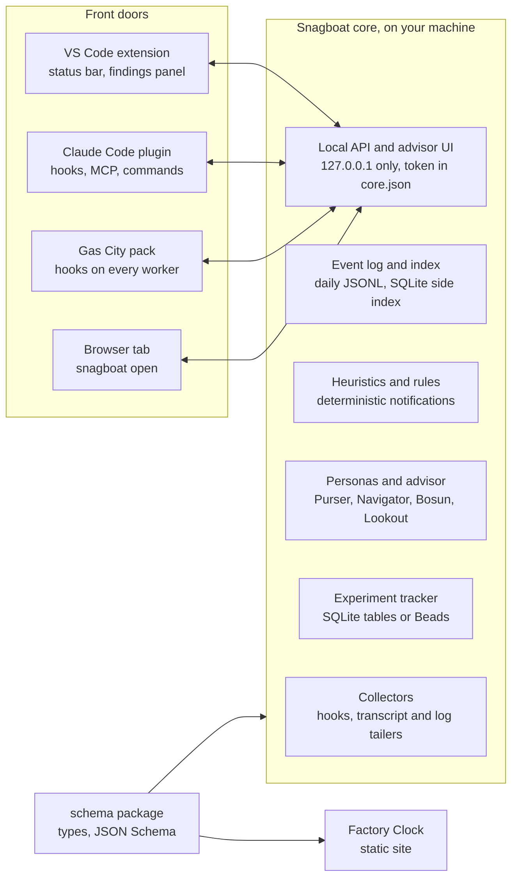

# Snagboat Architecture RFC

Status: proposed, 2026-11-08. Companion plan: [Factory Clock](factory-clock-plan.md).

## Summary

This RFC proposes moving Snagboat's engine out of the VS Code extension into one local core that every tool shares: VS Code, the Claude Code CLI, Gas City and a browser tab. The visualizations move into their own package. The split is cheap: 96 of the repo's 107 source files already have no VS Code import.

The decision asked for:

1. Approve the core-and-front-doors split and the monorepo layout below.
2. Approve a shared schema package as the contract between the core, the front doors and the visualization package.
3. Approve the migration order, which changes no behavior until step 3.

The companion review, *Review: ChatGPT's Snagboat Ecosystem Proposal*, explains why. The visualization package has its own plan.

## Goals and non-goals

**Goals**

- The same sessions, findings and personas from VS Code, the Claude Code CLI, Gas City and a browser.
- macOS first, without shutting out Linux or Windows. Today Windows is blocked by the POSIX hook script.
- Everything stays local. The advisor UI is served from your machine; sharing means exporting a redacted report.
- Personas stand for your project's measurement goals: cost, clock time, safety and focus.
- Experiments become tracked, auditable work with a clear decision.
- The visualizations become a standalone web project built on the shared schema.
- Keep the repo's current rule: no runtime dependencies beyond Node and VS Code built-ins.

**Non-goals**

- A hosted service or team cloud.
- Rewriting the heuristics, adapters or advisor abilities; they move, mostly unchanged.
- Replacing HypAware or Metergraph; Snagboat connects to them.
- Making Gas City or Beads a requirement.

## Architecture



Front doors send events in and show what the core returns; only the core reads and writes data. The schema package defines the records that both the core and the visualization package use, so the visualizations never depend on the core.

## Module mapping

Every current module has a destination in one of four packages: `schema`, `core`, `vscode` (the extension) and `viz`. Intelligence and research live inside `core` as on-demand modules until a second consumer justifies splitting them out.

| Current module | Today | Destination | Change needed |
| --- | --- | --- | --- |
| `src/core/types.ts`, `docs/schema.md` | `NormalizedEvent` and friends | `schema` | Generate JSON Schema from the types; version it |
| `src/core` (event log, store, sessions, turns, retention, aggregates) | No VS Code imports; data in per-window workspace storage | `core` | One per-user store; events tagged with their workspace |
| `src/adapters/claude-code` | Transcript tailer; hook receiver on each window's own port; POSIX hook script | `core` collectors | One receiver in the core service; hook script rewritten in Node |
| `src/adapters/copilot` | Session-log tailer; OTLP receiver on port 4318 | `core` collectors | Workspace filter from config instead of the VS Code API |
| `src/adapters/edit-tracker` | VS Code file saves | `vscode` | Posts its events to the core |
| `src/heuristics` | Engine, eight built-ins, rules, replay | `core` | Settings read from core config; only `index.ts` touches VS Code |
| `src/discovery` | Rule proposals from your history | `core` (intelligence) | None |
| `src/review` | Reviews and heuristic effectiveness | `core` (intelligence) | None |
| `src/nudges/nudger.ts` | Live nudges | `core` notification policy | Front doors only deliver; the Lookout persona measures it |
| `src/advisor` | Gateway, digests, providers, audit, prompts, abilities | `core` (intelligence) | Keys move from VS Code SecretStorage to the OS keychain; `persona.md` gains front matter |
| `src/backfill` | Backfill command | `core` CLI | `snagboat backfill` |
| `src/scripts` | Replay, eval, discovery and demo-trace scripts | `core` CLI (research) | Useful ones become `snagboat` subcommands |
| `src/ui` models and `media/*.js` | Detail view, sessions, explorer, suggestions | Advisor UI bundle, served by `core` | Loads in a VS Code webview or a browser tab |
| `src/ui` status bar and detail panel | VS Code surfaces | `vscode` | Read from the core's API |
| `src/ui/visualizers.ts`, `media/viz` (32 visualizers) | Plain JS behind a `mount(host, ctx)` registry | `viz` | Take schema session views, not `shared.js` helpers |
| `src/web`, `web/`, `scripts/webDemo.js` | GitHub Pages demo with synthetic sessions | `viz` demo | Covered by the visualization plan |
| `src/extension.ts` | Wires everything | `vscode` | Becomes thin: find or start the core, then present |

## Shared schema and contracts

The `schema` package is the only thing every other package depends on. It ships TypeScript types and generated JSON Schema, versioned with semver, with JSONL as the interchange format.

| Contract | Contents | Used by |
| --- | --- | --- |
| `NormalizedEvent` | Today's event shape from `docs/schema.md`, unchanged at version 1 | Collectors, core, HypAware import |
| Session view | The derived session, turn and actor structure that `buildSessionView` produces today | Advisor UI, `viz` |
| Metric | Name, inputs, unit, scope, value | Personas, experiments |
| Finding | Heuristic, evidence event IDs, severity, confidence | Front doors, advisor UI |
| Recommendation | Persona, finding IDs, proposed action, expected effect | Advisor UI, experiments |
| Rule | Today's `rules.json` format | Heuristics, personas |
| Persona | Front matter fields of `persona.md` | Core, advisor UI |
| Experiment | Hypothesis, persona version, data version, steps, decision | Experiment tracker |

Events, metrics, findings and recommendations stay separate records, each pointing back to what it came from, so an inference never passes as a measurement.

**Local API.** The core listens on 127.0.0.1 only and writes `~/.snagboat/core.json` with its port, a random token and its process ID. This generalizes today's per-folder route files. Front doors read that file and send the token with every request. The first endpoints:

- `POST /events` for hooks and collectors
- `GET /sessions` and `GET /sessions/:id`
- `GET /findings` and `POST /findings/:id/response` (useful, dismiss, mute)
- `GET /personas` and `GET /experiments`
- `GET /ui` for the advisor UI

The existing `AgentAdapter` and `AdapterContext` contracts stay as they are.

## Personas and measurable outcomes

The repo already supports personas as `~/.snagboat/advisors/<id>/persona.md`. This RFC keeps that file and adds structured front matter, so each persona is a measurement goal for your project and not just a voice. A persona and its goal are the same thing: each persona owns one measurable goal, sets up experiments to move it, and tracks its progress in the experiment store.

| Persona | Goal | First measures |
| --- | --- | --- |
| Purser | Token cost down | Cost per completed milestone; tokens per accepted change; cache hit rate |
| Navigator | Clock time not wasted | Milestones per session; time per milestone; build and test duration; stall minutes |
| Bosun | Unsafe tool use limited | Risky commands; approvals granted per session |
| Lookout | User not overly distracted | Notifications per hour; dismiss rate; share marked useful |

A persona file under this proposal:

```markdown
---
id: purser
goal: token-cost-down
measures: [cost_per_milestone, tokens_per_accepted_change, cache_hit_rate]
reads: [events, findings, outcomes]
may_change: [rules]          # proposes rule changes; never edits code
notify:
  rules: [token-budget, cache-thrash]
  max_per_hour: 2
cue: { icon: coin, color: amber, mood: frugal }
---
You watch what this project spends on tokens ...
```

**Deterministic alerts, agentic setup.** Notifications fire only from rules in the existing rule format. The persona's model work happens off the hot path: proposing rules and thresholds for this project (through today's `proposeHeuristics` and `proposeNudges` abilities) and measuring whether they helped (through `review/effectiveness`).

**Outcome capture.** These signals ship in the core before any persona depends on them:

| Outcome | Source |
| --- | --- |
| Commit kept or reverted | Git history of files the session edited |
| Tests going green | Tool calls in the tests-builds category, with their status |
| Code survival | Lines the session wrote still present after 7 and 30 days |
| Finding usefulness | Responses to findings: useful, dismissed, muted |
| Milestones completed | Closed tasks: Beads issues where present, else a commit with passing tests |

## Storage and experiments

Keep the repo's existing rule: daily JSONL is the source of truth, and SQLite is a side index rebuilt from it when missing or corrupt. That refines the review's suggestion of SQLite as the live store, and it keeps backups, `jq` and DuckDB working as they do today.

| Data | Home | Notes |
| --- | --- | --- |
| Events | `~/.snagboat/data/events/<day>.jsonl` | Moves from per-window workspace storage to one per-user store; each event gains a workspace field |
| Index | `~/.snagboat/data/index.sqlite` through Node's built-in `node:sqlite` | Sessions, turns, findings and metrics for fast queries; no native modules |
| Analysis exports | Parquet or JSONL from `snagboat export` | For DuckDB, notebooks and HypAware |
| Rules | `~/.snagboat/rules.json` | Moves out of VS Code global storage |
| Personas | `~/.snagboat/advisors/<id>/persona.md` | Already there; local only, versioned by content hash |
| Audit log and API keys | `~/.snagboat/advisor-audit.jsonl`; OS keychain | Keys leave VS Code SecretStorage so the CLI can use them |
| Experiments | Tracker interface: built-in SQLite tables, or a Beads adapter | Beads stores the steps and decision; results stay in Snagboat |

A one-time migration copies each workspace's existing event log into the per-user store, tagging the workspace, and leaves the originals in place.

**Experiments.** An experiment is a chain of steps: baseline, replay, evaluate, decide. Every experiment belongs to the persona whose goal it serves, so a persona's history of experiments is its progress record. With the Beads adapter, each step is a bead that becomes ready only when the one before it closes, and Dolt history keeps the audit trail. The experiment record names the persona version (a hash of its persona.md, stored with a copy of the file) and the data version (the days and index build it used), so a replay can be repeated. Experiment beads live in a Beads store with no remote, because they point at your session data. A long experiment is an epic; its sub-experiments are child beads, and a reworded experiment is a new bead linked to the old one with a discovered-from edge. Snagboat keeps each experiment's state and results itself, because Beads can garbage-collect closed beads after a retention window.

## Front doors

Each front door is thin: it finds or starts the core, sends events in, and presents what the core returns. Underneath them all is the snagboat CLI, whose commands print JSON with --json, so scripts and agents can use it with no front door at all.

| Front door | What it adds | Platforms |
| --- | --- | --- |
| VS Code extension | Status bar, native notifications, a compact findings panel that opens the full advisor UI in a browser, the edit tracker | macOS, Linux, Windows |
| Claude Code plugin | Hooks that run `snagboat hook`; an MCP server for asking about sessions and findings; slash commands such as `/snagboat findings`; a status-line command | macOS, Linux, Windows |
| Gas City pack | The same Claude Code or Codex hooks on every worker; milestone signals from closed beads | macOS, Linux; Windows through WSL |
| Browser | `snagboat open` serves the advisor UI at a localhost address | Any |

**Hooks on Windows.** Today's hook entry runs a POSIX `sh` and `curl` script, which is why the README says macOS and Linux only. The replacement is a small Node script with the same routing. Claude Code already requires Node, so this adds no dependency, and Windows works. Hook entries are written through the Claude Code plugin instead of editing each project's `.claude/settings.json`, with the current behavior kept as a fallback.

**Core lifecycle.** The first front door that needs the core starts it. It keeps running while any front door is connected and exits after an idle period. A stale `core.json` (its process gone) is replaced on the next start. If the core is down, hooks append to a spool file that the core reads on startup, so no events are lost.

**Several VS Code windows.** Today each window runs its own receiver and storage. With one core, windows become clients of the same service, and findings and mutes are filtered by workspace in the core.

## Install

One npm package, `snagboat`, holds the CLI and the core; every front door installs or finds it.

| Entry point | How it installs | What the user needs |
| --- | --- | --- |
| VS Code | From the Marketplace or Open VSX, with the core bundled inside the extension | VS Code 1.145 or later |
| Claude Code | A plugin from a marketplace in the Snagboat repository; its hooks and MCP server run `npx snagboat`, which fetches the package on first use | Claude Code |
| CLI and Gas City | `npm install -g snagboat`, then `snagboat init` to check hooks and storage | Node 24 or later |

Whichever front door starts the core first writes `core.json`, and the rest attach to it. If two versions are installed, the newer core wins and older clients warn. A Homebrew tap can come later.

## Migration plan

Seven steps, each shippable on its own. Steps 1 and 2 move code without changing behavior; the existing unit tests, transcript replay and CI on Ubuntu and macOS are the safety net throughout.

1. **Monorepo and schema.** Switch to npm workspaces with `packages/schema`, `packages/core`, `packages/vscode` and `packages/viz`. Move `src/core/types.ts` into `schema` and generate its JSON Schema.
2. **Core as a library.** Move core, adapters, heuristics, discovery, review, nudges, advisor and backfill into `packages/core`, replacing the 11 VS Code imports with small interfaces the extension implements. The extension still runs everything in-process.
3. **Core service and CLI.** Add the `snagboat` CLI, the local service and `core.json`. Replace the POSIX hook script with the Node one, migrate storage to `~/.snagboat/data`, and add Windows to CI. The extension becomes a client.
4. **Outcomes and personas.** Capture the outcome signals, add persona front matter, and ship the four default personas.
5. **Claude Code plugin and advisor UI.** Package hooks, the MCP server, slash commands and the status line as a plugin. Serve the full advisor UI from the core in a browser tab; the VS Code webview shows a compact findings panel that links to it.
6. **Experiments and Gas City.** Add the experiment tracker with its SQLite and Beads implementations, then a Gas City pack once its hook points are confirmed.
7. **Visualization package.** Runs in parallel from step 1, following the visualization plan.

## Open questions

- **Gas City hook points.** Which Gas City and Beads signals should Snagboat read? Worker activity already comes from the Claude Code and Codex hooks. For milestones, Beads offers its events journal (`bd events tail --follow`, or the event stream from `bd serve`), OpenTelemetry issue counts by status, and `bd provenance` to bind a bead to a session transcript or commit. Decided: revisit when we consider sources, alongside HypAware.
- **`node:sqlite`**** stability.** Snagboat targets the latest stable VS Code, 1.145, which ships Node 24.22.0; the CLI and core service should require Node 24 too, raising today's minimum of VS Code 1.119 and Node 22. Confirm `node:sqlite` runs on Node 24 without an experimental flag or warning before relying on it. JSONL stays the source of truth either way. Decided: start with SQLite. DuckDB remains the upgrade path for analysis, and Dolt is used only through Beads for experiments.
- **Per-window state.** Mutes live in VS Code `workspaceState` today. Each window also keeps its own event log in workspace storage. Decided: after step 3 every window shares one store, and the core keeps them apart by default: a window's token is scoped to its workspace, and it sees only that workspace's events, findings and mutes. Cross-workspace views, such as weekly reviews in the advisor UI, are a separate, explicit scope.
- **Plugin versus settings edits.** Should the Claude Code plugin fully replace writing hook entries into `.claude/settings.json`, or should both stay? Decided: both for now. Claude Code's VS Code extension runs the same engine and reads the same settings files and transcript folder, so settings-file hooks already work there today. Test that plugin-installed hooks fire in the extension, then drop the settings-file fallback.
- **HypAware as a source.** The architecture doc already lists HypAware as a planned source. Decide whether its import lands in step 3 or later. Decided: later, not in step 3.

## Sources

- [Snagboat repository](https://github.com/DChristianson/snagboat), including `docs/architecture.md`, `docs/schema.md`, `docs/roadmap.md` and `docs/design/trusted-advisor.md`
- [Beads FAQ](https://beads.gascity.com/reference/faq.md)
- [Beads observability](https://beads.gascity.com/reference/observability) and [events journal](https://beads.gascity.com/reference/events-journal)
- [Ry Walker: Gas City research notes](https://rywalker.com/research/gas-city)
- [HypAware on GitHub](https://github.com/hyparam/hypaware)
