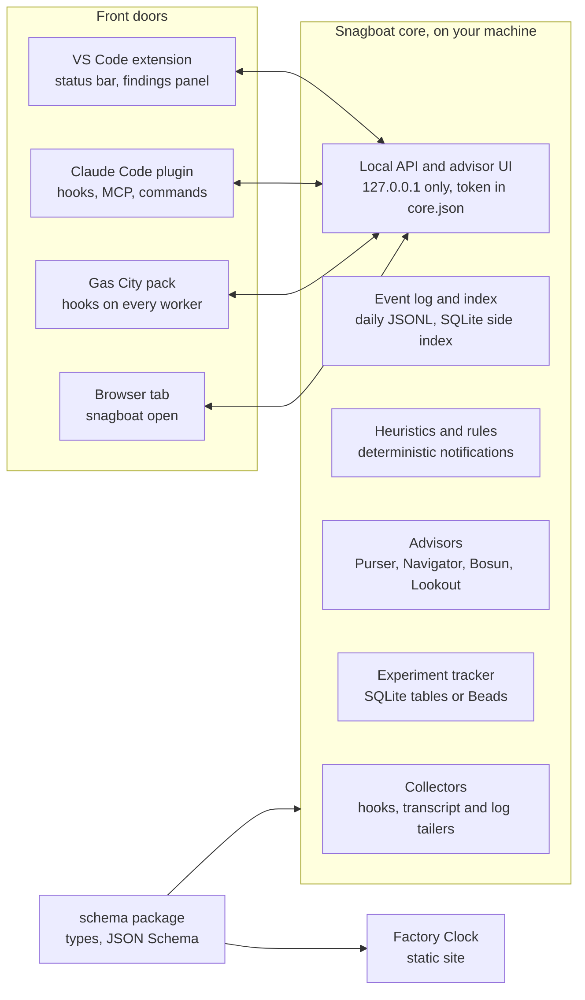

# Snagboat Architecture RFC

Status: proposed, 2026-11-08; being built on the `refactor` branch. Steps 1 and 2 are done, and step 3 is partly done (see [What changes for users](#what-changes-for-users)). Companion plan: [Factory Clock](factory-clock-plan.md). The next steps are in [handoff-3c.md](handoff-3c.md).

## Summary

This RFC proposes moving Snagboat's engine out of the VS Code extension into one local core that every tool shares: VS Code, the Claude Code CLI, Gas City and a browser tab. The visualizations move into their own package. The split is cheap: 96 of the repo's 107 source files already have no VS Code import.

The decision asked for:

1. Approve the core-and-front-doors split and the monorepo layout below.
2. Approve a shared schema package as the contract between the core, the front doors and the visualization package.
3. Approve the migration order, which changes no behavior until step 3.

The companion review, *Review: ChatGPT's Snagboat Ecosystem Proposal*, explains why. The visualization package has its own plan.

## What changes for users

"Built" means merged into `refactor` and listed under Unreleased in the [changelog](../../CHANGELOG.md), but not yet in a release.

| Change | Status |
| --- | --- |
| Minimum VS Code raised from 1.119 to 1.145, and Node.js from 22 to 24 (for building and for the `snagboat` CLI) | Built |
| Windows supported: Claude Code hooks run through Git Bash, as Claude Code itself requires there | Built; passes unit tests on Windows in CI, not yet tried with Claude Code on a real Windows machine |
| A `snagboat` command line that reads the event logs without VS Code | Built |
| Data moves from VS Code's per-workspace storage to `~/.snagboat/data`, one folder per workspace. Turning it on copies existing data and never moves or deletes it; `snagboat migrate` copies every store | Built as a preview, off by default: `snagboat.storage.perUserStore` |
| A core service per user (`snagboat serve`, `snagboat core start`), found through `~/.snagboat/core.json`. Claude Code hooks for a project with no VS Code window open go to it | Built as a preview. With `snagboat.storage.perUserStore` on, VS Code starts it and each window is its client (step 3c-3c). The core reads Claude Code and Copilot CLI sessions for every project; Copilot's OpenTelemetry export still goes to a window, which sends it to the core (its spans don't name a workspace). The core runs the heuristics for the workspaces windows follow (step 3c-3d); windows deliver the notifications and status bar |
| Settings outside VS Code: `~/.snagboat/config.json`, and a project's committed `.snagboat.json` for team settings | Built, with the per-user store on |
| Advisor API keys move from VS Code's secret storage to the OS keychain | Planned |
| Hooks installed by a Claude Code plugin. The hook entries Snagboat writes into `.claude/settings.json` stay for now | Planned (step 5) |
| Install through npm or `npx`. Today the extension is a `.vsix` from a GitHub release, and the CLI is built from source | Planned |

## Terms

- **Core:** the part of Snagboat that owns the data: collectors, event log, heuristics, advisor. It runs as one local process per user.
- **Front door:** a thin client of the core (the VS Code extension, a Claude Code plugin, a Gas City pack, a browser tab). It sends events in and shows what the core returns.
- **Beads:** an issue tracker that lives in the repo and is driven from its CLI, `bd`. Its issues are called beads, and one can block another; Snagboat's own work items are tracked in it.
- **Dolt:** the version-controlled database Beads stores its issues in. Its history is what gives a Beads experiment its audit trail.
- **Gas City:** a system that runs Claude Code or Codex workers and tracks their work as beads. A Gas City pack would put Snagboat's hooks on every worker.
- **HypAware:** an outside tool ([hyparam/hypaware](https://github.com/hyparam/hypaware)) that Snagboat plans to ask for insights about a workspace, as an advisor, and perhaps to read events from.
- **Metergraph:** an outside tool that Snagboat would connect to rather than replace. This RFC doesn't describe it further.

## Goals and non-goals

**Goals**

- The same sessions, findings and advisors from VS Code, the Claude Code CLI, Gas City and a browser.
- macOS first, without shutting out Linux or Windows. When this RFC was written, the POSIX hook script blocked Windows; step 3a runs it through Git Bash there.
- Everything stays local. The advisor UI is served from your machine; sharing means exporting a redacted report.
- Each advisor stands for one of your project's measurement goals: cost, clock time, safety or focus.
- Experiments become tracked, auditable work with a clear decision.
- The visualizations become a standalone web project built on the shared schema.
- Keep the repo's current rule: no runtime dependencies beyond Node and VS Code built-ins.

**Non-goals**

- A hosted service or team cloud.
- Rewriting the heuristics, adapters or advisor abilities; they move, mostly unchanged.
- Replacing HypAware or Metergraph; Snagboat connects to them.
- Making Gas City or Beads a requirement.

## Architecture



Front doors send events in and show what the core returns; only the core reads and writes data. The schema package defines the records that both the core and the visualization package use, so the visualizations never depend on the core.

## Module mapping

Every current module has a destination in one of four packages: `schema`, `core`, `vscode` (the extension) and `viz`. Intelligence and research live inside `core` as on-demand modules until a second consumer justifies splitting them out. "Today" is the repo when this RFC was written: since then, step 1 moved the schema to `packages/schema`, and step 2 moved the VS Code glue to `src/vscode/`.

| Current module | Today | Destination | Change needed |
| --- | --- | --- | --- |
| `src/core/types.ts`, `docs/schema.md` | `NormalizedEvent` and friends | `schema` | Generate JSON Schema from the types; version it |
| `src/core` (event log, store, sessions, turns, retention, aggregates) | No VS Code imports; data in per-window workspace storage | `core` | One per-user store, one folder per workspace; events tagged with their workspace |
| `src/adapters/claude-code` | Transcript tailer; hook receiver on each window's own port; POSIX hook script | `core` collectors | One receiver in the core service; the hook script stays POSIX `sh` and `curl`, and also routes to the core |
| `src/adapters/copilot` | Session-log tailer; OTLP receiver on port 4318 | `core` collectors | Workspace filter from config instead of the VS Code API |
| `src/adapters/edit-tracker` | VS Code file saves | `vscode` | Posts its events to the core |
| `src/heuristics` | Engine, eight built-ins, rules, replay | `core` | Settings read from core config; only `index.ts` touches VS Code |
| `src/discovery` | Rule proposals from your history | `core` (intelligence) | None |
| `src/review` | Reviews and heuristic effectiveness | `core` (intelligence) | None |
| `src/nudges/nudger.ts` | Live nudges | `core` notification policy | Front doors only deliver; the Lookout advisor measures it |
| `src/advisor` | Gateway, digests, providers, audit, prompts, abilities | `core` (intelligence) | Keys move from VS Code SecretStorage to the OS keychain; `persona.md` gains front matter |
| `src/backfill` | Backfill command | `core` CLI | `snagboat backfill` |
| `src/scripts` | Replay, eval, discovery and demo-trace scripts | `core` CLI (research) | Useful ones become `snagboat` subcommands |
| `src/ui` models and `media/*.js` | Detail view, sessions, explorer, suggestions | Advisor UI bundle, served by `core` | Loads in a VS Code webview or a browser tab |
| `src/ui` status bar and detail panel | VS Code surfaces | `vscode` | Read from the core's API |
| `src/ui/visualizers.ts`, `media/viz` (32 visualizers) | Plain JS behind a `mount(host, ctx)` registry | `viz` | Take schema session views, not `shared.js` helpers |
| `src/web`, `web/`, `scripts/webDemo.js` | GitHub Pages demo with synthetic sessions | `viz` demo | Covered by the visualization plan |
| `src/extension.ts` | Wires everything | `vscode` | Becomes thin: find or start the core, then present |

## Shared schema and contracts

The `schema` package is the only thing every other package depends on. It ships TypeScript types and generated JSON Schema, versioned with semver, with JSONL as the interchange format.

| Contract | Contents | Used by |
| --- | --- | --- |
| `NormalizedEvent` | Today's event shape from `docs/schema.md`, unchanged at version 1 | Collectors, core, HypAware import |
| Session view | The derived session, turn and actor structure that `buildSessionView` produces today | Advisor UI, `viz` |
| Metric | Name, inputs, unit, scope, value | Advisors, experiments |
| Finding | Heuristic, evidence event IDs, severity, confidence | Front doors, advisor UI |
| Recommendation | Advisor, finding IDs, proposed action, expected effect | Advisor UI, experiments |
| Rule | Today's `rules.json` format | Heuristics, advisors |
| Advisor | Front matter fields of `persona.md` | Core, advisor UI |
| Experiment | Hypothesis, advisor version, data version, steps, decision | Experiment tracker |

Events, metrics, findings and recommendations stay separate records, each pointing back to what it came from, so an inference never passes as a measurement.

**Local API.** The core listens on 127.0.0.1 only and writes `~/.snagboat/core.json` (owner-only) with its port, an admin token, its process ID and version. Front doors read that file and send a token with every request. The admin token reads every workspace and mints a token per workspace (`POST /tokens`); a workspace token sees only that workspace's data. Hooks get their own route file, `~/.snagboat/core.route`, in the same format as the per-folder route files, with a token good only for posting hooks. The endpoints:

- built: `POST /events`, `GET /sessions` and `GET /sessions/:id`, `POST /hook` for Claude Code hooks, plus `GET /health`, `POST /tokens` and `POST /shutdown`
- built for the advisor UI: `GET /ui/`, `GET /advisors`, `GET /findings`, `POST /findings/respond`, `GET /sessions/:id/view` (a session's view and outcomes) and `GET /explore`
- planned: `GET /personas` and `GET /experiments`

The existing `AgentAdapter` and `AdapterContext` contracts stay as they are.

## Advisors and measurable outcomes

An **advisor** is one measurement goal plus the rules, and the voice, that serve it. It owns that goal, sets up experiments to move it, and tracks its progress in the experiment store. Purser, Navigator, Bosun and Lookout are the four default advisors.

Today an advisor is a model with prompts and abilities (`snagboat.advisors`), and its voice can live in `~/.snagboat/advisors/<id>/persona.md`. This RFC keeps that file, the one that holds an advisor's goal and voice, and adds structured front matter for the goal.

| Advisor | Goal | First measures |
| --- | --- | --- |
| Purser | Token cost down | Cost per completed milestone; tokens per accepted change; cache hit rate |
| Navigator | Clock time not wasted | Milestones per session; time per milestone; build and test duration; stall minutes |
| Bosun | Unsafe tool use limited | Risky commands; approvals granted per session |
| Lookout | User not overly distracted | Notifications per hour; dismiss rate; share marked useful |

Built (step 4c): the four as built-in `persona.md` files with front matter, needing no model; a file in `~/.snagboat/advisors/<id>/` replaces or adds one, and a model advisor with the same id uses its body as voice. Their measures come from events and outcomes (cost is counted in tokens; time per milestone is active time; build and test duration is measured as minutes from a failing test to green), shown by `snagboat advisors`, `GET /advisors` and the weekly review ([usage](../usage.md#advisors-and-their-goals)). Each notification shown is recorded as a `notified` outcome, and the nudger holds each advisor's notifications to its `notify.max_per_hour` over the heuristics in its `notify.rules`. Approvals per session come from Claude Code's `PermissionRequest` and `PermissionDenied` hooks (run in the background, so they never decide a prompt), as `approval` outcomes; approximate, since Claude Code sends no hook when you deny a prompt yourself.

An advisor's `persona.md` under this proposal:

```markdown
---
id: purser
goal: token-cost-down
measures: [tokens_per_milestone, tokens_per_accepted_change, cache_hit_rate]
reads: [events, findings, outcomes]
may_change: [rules]          # proposes rule changes; never edits code
notify:
  rules: [token-budget, cache-thrash]
  max_per_hour: 2
cue: { icon: coin, color: amber, mood: frugal }
---
You watch what this project spends on tokens ...
```

**Deterministic alerts, agentic setup.** Notifications fire only from rules in the existing rule format. The advisor's model work happens off the hot path: proposing rules and thresholds for this project (through today's `proposeHeuristics` and `proposeNudges` abilities) and measuring whether they helped (through `review/effectiveness`).

**Outcome capture.** These signals ship in the core before any advisor depends on them:

| Outcome | Source |
| --- | --- |
| Commit kept or reverted | Git history of files the session edited |
| Tests going green | Tool calls in the tests-builds category, with their status |
| Code survival | Lines the session wrote still present after 7 and 30 days |
| Finding usefulness | Responses to findings: useful, dismissed, muted |
| Milestones completed | Closed tasks: Beads issues where present, else a commit with passing tests |

Outcomes are `outcome` events in the event log (schema version 3), so they get retention, the live feed and the CLI like any event, and they don't count as agent activity. Built: tests going green, and finding usefulness, with a **Useful** response beside acknowledge and mute ("dismissed" is a finding that passed without one). Also built, in the core: commits kept or reverted (at 7 days) and code survival (at 7 and 30 days), read from git (read-only, for commits touching files a session edited, on unless `outcomes.git` is off), and milestones from commits made after the session's tests last passed. A Beads adapter for milestones, and multi-root workspaces, later.

## Storage and experiments

Keep the repo's existing rule: daily JSONL is the source of truth, and SQLite is a side index rebuilt from it when missing or corrupt. That refines the review's suggestion of SQLite as the live store, and it keeps backups, `jq` and DuckDB working as they do today.

| Data | Home | Notes |
| --- | --- | --- |
| Events | `~/.snagboat/data/workspaces/<key>/events/<day>.jsonl` | Moves from per-window workspace storage to one per-user store, one folder per workspace (with its aggregates, tail checkpoints and finding responses); each event records its workspace (schema version 2). Built, behind `snagboat.storage.perUserStore` |
| Index | `~/.snagboat/data/index.sqlite` through Node's built-in `node:sqlite` | Sessions, turns, findings and metrics for fast queries; no native modules. Not built yet |
| Analysis exports | Parquet or JSONL from `snagboat export` | For DuckDB, notebooks and HypAware |
| Rules | `~/.snagboat/rules.json` | Moves out of VS Code global storage. Built, with the per-user store on |
| Settings | `~/.snagboat/config.json`; a project's `.snagboat.json` | Copied from VS Code's settings when they change; a project file may set team settings, and privacy settings only to be more private. Built, with the per-user store on |
| Advisors | `~/.snagboat/advisors/<id>/persona.md` | Already there; local only, versioned by content hash |
| Audit log and API keys | `~/.snagboat/data/advisor-audit.jsonl`; OS keychain | The audit log moved with the per-user store. Keys leave VS Code SecretStorage so the CLI can use them; not built yet |
| Experiments | Tracker interface: built-in SQLite tables, or a Beads adapter | Beads stores the steps and decision; results stay in Snagboat |

A migration copies each workspace's existing event log into the per-user store, tagging the workspace, and leaves the originals in place. Running it again copies only what's new (`snagboat migrate`, with `--dry-run` and `--verify`).

**Experiments.** An experiment is a chain of steps: baseline, replay, evaluate, decide. Every experiment belongs to the advisor whose goal it serves, so an advisor's history of experiments is its progress record. With the Beads adapter, each step is a bead that becomes ready only when the one before it closes, and Dolt history keeps the audit trail. The experiment record names the advisor version (a hash of its `persona.md`, stored with a copy of the file) and the data version (the days and index build it used), so a replay can be repeated. Experiment beads live in a Beads store with no remote, because they point at your session data. A long experiment is an epic; its sub-experiments are child beads, and a reworded experiment is a new bead linked to the old one with a discovered-from edge. Snagboat keeps each experiment's state and results itself, because Beads can garbage-collect closed beads after a retention window.

## Front doors

Each front door is thin: it finds or starts the core, sends events in, and presents what the core returns. Underneath them all is the snagboat CLI, whose commands print JSON with --json, so scripts and agents can use it with no front door at all.

| Front door | What it adds | Platforms |
| --- | --- | --- |
| VS Code extension | Status bar, native notifications, a compact findings panel that opens the full advisor UI in a browser, the edit tracker | macOS, Linux, Windows |
| Claude Code plugin | Hooks that run `snagboat hook`; an MCP server for asking about sessions and findings; slash commands such as `/snagboat findings`; a status-line command | macOS, Linux, Windows |
| Gas City pack | The same Claude Code or Codex hooks on every worker; milestone signals from closed beads | macOS, Linux; Windows through WSL |
| Browser | `snagboat open` serves the advisor UI at a localhost address | Any |

**Hooks on Windows.** The hook entry runs a POSIX `sh` and `curl` script, and it stays that way. This RFC first proposed a Node script, but Node isn't reliably on `PATH` where hooks run, and the hook runs after every tool call, where `sh` and `curl` start in about 12 ms against about 60 ms for Node. On Windows, Claude Code runs hook commands through Git Bash, which has `sh` and `curl`, so the same script works there (step 3a). Hook entries are written through the Claude Code plugin instead of editing each project's `.claude/settings.json`, with the current behavior kept as a fallback.

**Core lifecycle.** The first front door that needs the core starts it: a VS Code window with `snagboat.storage.perUserStore` on (step 3c-3c), or by hand with `snagboat serve` or `snagboat core start`. An open window keeps it running (its event stream counts as activity). It exits after an idle period with no requests (30 minutes by default). A stale `core.json` (its process gone) is replaced on the next start. If neither a window nor the core takes a hook, the hook script saves it in a spool folder, `~/.snagboat/data/spool/hooks/`, that the core reads on startup. The core creates that folder, so hooks are kept only once a core has run.

**Several VS Code windows.** Today each window runs its own receiver and storage. With one core, windows become clients of the same service, and findings and mutes are filtered by workspace in the core.

## Install

One npm package, `snagboat`, holds the CLI and the core; every front door installs or finds it.

| Entry point | How it installs | What the user needs |
| --- | --- | --- |
| VS Code | From the Marketplace or Open VSX, with the core bundled inside the extension | VS Code 1.145 or later |
| Claude Code | A plugin from a marketplace in the Snagboat repository; its hooks and MCP server run `npx snagboat`, which fetches the package on first use | Claude Code |
| CLI and Gas City | `npm install -g snagboat`, then `snagboat init` to check hooks and storage | Node 24 or later |

Whichever front door starts the core first writes `core.json`, and the rest attach to it. If two versions are installed, the newer core wins and older clients warn. A Homebrew tap can come later.

## Migration plan

Seven steps, each shippable on its own. Steps 1 and 2 move code without changing behavior; the existing unit tests, transcript replay and CI on Ubuntu and macOS (and Windows, from step 3a) are the safety net throughout. Steps 1 and 2 are done; step 3 is in progress, as broken down in [handoff-3c.md](handoff-3c.md).

1. **Monorepo and schema.** Switch to npm workspaces with `packages/schema`, `packages/core`, `packages/vscode` and `packages/viz`. Move `src/core/types.ts` into `schema` and generate its JSON Schema.
2. **Core as a library.** Move core, adapters, heuristics, discovery, review, nudges, advisor and backfill into `packages/core`, replacing the 11 VS Code imports with small interfaces the extension implements. The extension still runs everything in-process.
3. **Core service and CLI.** Add the `snagboat` CLI, the local service and `core.json`. Run the POSIX hook script through Git Bash on Windows, migrate storage to `~/.snagboat/data`, and add Windows to CI. The extension becomes a client. (All built, the client and the core's heuristics as a preview behind `snagboat.storage.perUserStore`. Windows still deliver nudges, as planned: notifications are VS Code's to show.)
4. **Outcomes and advisors.** Capture the outcome signals, add front matter to `persona.md`, and ship the four default advisors.
5. **Claude Code plugin and advisor UI.** Package hooks, the MCP server, slash commands and the status line as a plugin. Serve the full advisor UI from the core in a browser tab; the VS Code webview shows a compact findings panel that links to it. Decided (design pass, [mockup](https://claude.ai/code/artifact/946107be-f901-4ce5-8cfc-fc767d045326)): a one-time link opens a read-only browser session on every workspace; plain scripts, no framework; the plugin bundles the CLI; Sessions, Explore and Suggestions move from VS Code to the browser. Revised in the design pass: advisor cards hold a brief (status line, summary, watching, what to surface, with responses) rather than measures, which move to each advisor's page; Navigator shows what's ahead from Beads (the session's plan as a fallback later); a + adds an advisor. In order: 5a the core serves the UI and the advisors screen (built: `snagboat open`, **Snagboat: Open Advisor UI**, cards with briefs and responses, advisor pages); 5b sessions and Explore (built: session list with outcomes, a session's page, Explore over the core; the visualizers load from `media/` until Factory Clock step 4 moves them); 5c the VS Code compact panel and adding an advisor from the browser (built: the findings panel in Snagboat's sidebar, Sessions and Explore open in the browser with the per-user store on, the + form; Suggestions moves with advisor models in 5c-2, as accepting a proposal and asking a model need the core to hold providers and keys); 5d the plugin.
6. **Experiments and Gas City.** Add the experiment tracker with its SQLite and Beads implementations, then a Gas City pack once its hook points are confirmed.
7. **Visualization package.** Runs in parallel from step 1, following the visualization plan.

## Decisions

- **Gas City hook points.** Which Gas City and Beads signals should Snagboat read? Worker activity already comes from the Claude Code and Codex hooks. For milestones, Beads offers its events journal (`bd events tail --follow`, or the event stream from `bd serve`), OpenTelemetry issue counts by status, and `bd provenance` to bind a bead to a session transcript or commit. Decided: revisit when we consider sources, alongside HypAware.
- **`node:sqlite`**** stability.** Snagboat targets the latest stable VS Code, 1.145, which ships Node 24.22.0; the CLI and core service require Node 24 too. The minimum was raised from VS Code 1.119 and Node 22 to match. Confirm `node:sqlite` runs on Node 24 without an experimental flag or warning before relying on it. JSONL stays the source of truth either way. Decided: start with SQLite. DuckDB remains the upgrade path for analysis, and Dolt is used only through Beads for experiments.
- **Per-window state.** Mutes live in VS Code `workspaceState` today. Each window also keeps its own event log in workspace storage. Decided: after step 3 every window shares one store, and the core keeps them apart by default: a window's token is scoped to its workspace, and it sees only that workspace's events, findings and mutes. Cross-workspace views, such as weekly reviews in the advisor UI, are a separate, explicit scope.
- **Plugin versus settings edits.** Should the Claude Code plugin fully replace writing hook entries into `.claude/settings.json`, or should both stay? Decided: both for now. Claude Code's VS Code extension runs the same engine and reads the same settings files and transcript folder, so settings-file hooks already work there today. Test that plugin-installed hooks fire in the extension, then drop the settings-file fallback.
- **HypAware as a source.** The architecture doc already lists HypAware as a planned source. Decide whether its import lands in step 3 or later. Decided: later, not in step 3.

## Sources

- [Snagboat repository](https://github.com/DChristianson/snagboat), including `docs/architecture.md`, `docs/schema.md`, `docs/roadmap.md` and `docs/design/trusted-advisor.md`
- [Beads FAQ](https://beads.gascity.com/reference/faq.md)
- [Beads observability](https://beads.gascity.com/reference/observability) and [events journal](https://beads.gascity.com/reference/events-journal)
- [Ry Walker: Gas City research notes](https://rywalker.com/research/gas-city)
- [HypAware on GitHub](https://github.com/hyparam/hypaware)
