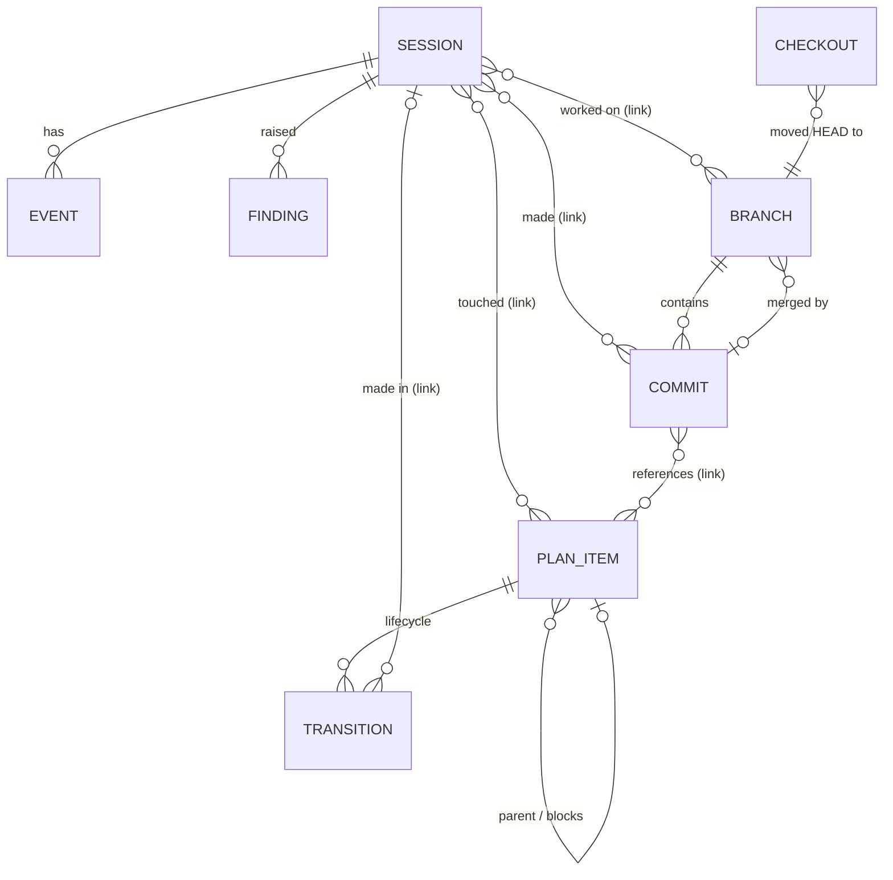

# Export: privacy rules and the normalized schema

The design for step 9 of the [Factory Clock plan](factory-clock-plan.md), how Snagboat exports what it knows about a project for Factory Clock (and anything else) to load. Written November 20, 2026, and tracked in Beads under `snagboat-93b.9`. Nothing here is built yet.

## Decision

Snagboat owns the sanitizing rules. Factory Clock reads files and never sees a raw store. In the maintainer's words: "snagboat should own the sanitizing rules. in order for the export to be meaningful I think we have to be able to export a fair amount of detail."

So the export keeps prompts, replies and tool calls, and removes what identifies the machine, the person, or the workspace's place on disk. Anything it isn't sure about is flagged for you to review. It doesn't silently pass or silently drop.

Factory Clock's scrape script ([factory-clock#31](https://github.com/DChristianson/factory-clock/pull/31)) was the first attempt at this from the other side. Its rules are a good start and this design takes most of them, but they belong here: Snagboat knows its own store layout, its own capture-time redaction, and which fields carry what. Once `snagboat export` exists, the scrape script reads its output instead of `~/.snagboat/data`. It can keep its own leak check as a second look.

## Contents

- [What an export holds](#what-an-export-holds)
- [The privacy rules](#the-privacy-rules)
- [The normalized schema](#the-normalized-schema)
- [How records are linked](#how-records-are-linked)
- [Recording git and plan history](#recording-git-and-plan-history)
- [The command](#the-command)
- [Build order](#build-order)
- [Open questions](#open-questions)

## What an export holds

One project: a git repository's working tree, with its other worktrees and any other paths you name. It covers a time range, all of the project's history by default. The export is a folder:

```text
<out>/
  manifest.json               what this is: versions, project name, range, counts, rules applied
  events/YYYY-MM-DD.jsonl     the sessions' events (schema v4, sanitized), UTC days
  sessions.jsonl              one record per session, with its branch, commits and plan items
  findings.jsonl              findings and early warnings, with how you responded
  git/commits.jsonl           commits, merges included
  git/branches.jsonl          branches: where they started, where they went
  git/checkouts.jsonl         HEAD moves: which branch was checked out when
  plan/items.jsonl            plan items (beads issues, or markdown plan steps)
  plan/transitions.jsonl      each item's lifecycle: created, claimed, status changes, closed, reopened
  links.jsonl                 typed edges between sessions, commits, branches and plan items
<out>.review/                 never shipped: what was flagged, with the values, for you to read
```

Everything is JSON Lines, apart from the manifest, so a large project streams and two exports can be compared line by line. Ids join the files. Nothing in the export is an absolute path.

## The privacy rules

The rules run in order on every string the export writes. They don't depend on where the string sits in a record. A rule that removes something leaves a typed placeholder, so a view can still say "a path outside the project was here" or "the same email again". Placeholders are numbered per export: the same value gets the same placeholder throughout one export, and the value itself appears nowhere.

### 1. The machine and the workspace's place on it

What the export removes is what says *whose* machine this is and *where* on it the project lives. What the project is stays, under the name you give it.

| What | Becomes |
| --- | --- |
| A path inside the project, or inside one of its worktrees | Relative to the project root: `src/core/export.ts`. A worktree's own path becomes `[worktree-1]`. |
| The home folder, or a path under it outside the project | `~` and `[path]`, keeping only the extension: `[path].ts`. |
| Any other absolute path (`/tmp/...`, `/var/...`, `C:\...`), including inside commands and text | `[path]`, with its extension |
| The user name, the machine's host name, and names found in home paths (`/Users/<name>`, `/home/<name>`) | `[user]`, `[host]` |
| The workspace's folder name and store key, `NormalizedEvent.workspace`, and the `raw` block (adapter refs name transcript files) | Dropped |
| Event ids that embed a path (fallback ids like `claude-code:<file>:<offset>`) | Re-keyed by HMAC (see below) |
| Git remote URLs | Dropped. The project's name comes from `--name`. |
| Container ids, dev container volume names, VS Code storage hashes | Dropped |
| People (git authors and committers, `Co-Authored-By` humans, bead `owner`, `created_by`, `assignee`, actors in bead history) | Pseudonyms: `person-1`, `person-2`. Agents keep their names (`claude-code`, `copilot`, "Claude" in a co-author line), since which agent did the work is the point. |
| Timestamps | Kept, in UTC. Git's timezone offsets are dropped, because they say roughly where you are. |

Session ids, subagent ids, turn ids, commit SHAs and bead ids are kept. They're random or content-derived, and joining two exports of the same project needs them. A commit SHA identifies a public commit if the repository is public. That's the price of joining commits across exports. [Open question 2](#open-questions) asks whether a "private repository" switch should re-key them.

**Re-keying and pseudonyms are stable per machine and unreadable off it.** They're an HMAC with a key the export creates once and keeps in `~/.snagboat/export.key`. Two exports from your machine agree (`person-1` is the same person in both), and nobody without the key can test a guess at a path or a name against them. Deleting the key starts fresh numbering.

### 2. Anything that looks like PII or a secret

Snagboat already redacts secret formats when it captures text (`SECRET_PATTERNS` in `src/core/excerpt.ts`): private keys, AWS, GitHub, Anthropic and OpenAI-style keys, Stripe, Slack and Google keys, JWTs, bearer tokens, credentials in URLs, and `password=` style values. The export runs them again, because a value captured before a pattern was added is still in the store. It also adds:

| What | Becomes |
| --- | --- |
| Email addresses (including `users.noreply.github.com` ones, which name a GitHub account) | `[email-1]` |
| IPv4 and IPv6 addresses, except loopback and unspecified (`127.0.0.1`, `::1`, `0.0.0.0`) | `[ip-1]` |
| MAC addresses | `[mac]` |
| Phone numbers in international or North American form | `[phone]` |
| Payment card numbers (13–19 digits passing the Luhn check) | `[card]` |
| `.env`-style lines (`NAME=value` where the name ends in KEY, TOKEN, SECRET, PASSWORD, PASS, PWD or CREDENTIALS, whatever the value looks like) | `NAME=[redacted]` |
| Connection strings with a password (`postgres://user:pw@`, `mongodb+srv://...`, `Server=...;Password=...`) | the password as `[redacted]` |
| SSH and PGP public key blocks, `authorized_keys` lines | `[public key]`. Not secret, but they identify a person. |
| Words you list in `export.deny` in `~/.snagboat/config.json` (a client's name, a codename) | `[denied-1]` |

### 3. What's preserved

Everything else, which is most of the detail:

- **Prompts and replies**, whole. The store caps them (prompts at 2,000 characters, reply excerpts at 500) because it keeps them on your machine for heuristics. The export reads the full text from the agent's own transcript while that's still on disk (Claude Code's JSONL, Copilot CLI's session state), and falls back to the store's copy. `manifest.json` says which sessions were read in full.
- **Tool calls**: tool name and category, status, timing, turn, subagent, and the input that matters to a view: the file it touched (made relative), the command it ran, the search pattern, the URL it fetched. Tool *output* isn't exported, apart from a test or build run's pass/fail, which is already the call's status. Output is where pasted logs, file contents and stack traces live, which is most of the risk and little of the value.
- **Plans**: todo lists, task tools, and plan items' titles, descriptions, design, notes, acceptance criteria and close reasons.
- **Git**: commit subjects and bodies, branch names, changed files with line counts.
- **Session names, compactions, model calls and tokens, findings and outcomes**, as stored.

`--text none` exports structure only (counts, kinds, times, relative paths, links), for sharing where even scrubbed text is too much.

### 4. Flagging what's questionable

Some things aren't clearly fine or clearly not. Each of these is **flagged**:

- a long high-entropy string that matches no known key format (40+ characters of base64 or hex, outside a SHA or a UUID);
- a prompt or reply that pastes a large block from outside the project, a stack trace with frames from other projects, or a file's contents that the agent read from outside the project;
- a URL to a host that isn't public: no public suffix, `.local` or `.internal`, or a bare host name. `localhost` with a port is fine.
- a person's name the export can see but didn't pseudonymize: a git author name that turns up in a prompt, or an `@mention`;
- a path that couldn't be made relative and is still named, such as a Windows share or a URL with a file path;
- any rule that hit a value and was then overridden by `--allow`.

A flagged value is replaced with `[flagged-N]` in the export. The review folder, `<out>.review/flags.jsonl`, lists each one: its number, the rule, the record and field, the value, and 80 characters of context each side. It's written beside the export, never inside it, so copying the export folder never copies it. Running the export again with `--allow flagged-3,flagged-7` (or `--allow-rule internal-url`) puts those values back. `--fail-on-flags` writes nothing if anything is flagged, for scripts.

### 5. The final check

After everything is written to a temporary folder, the export searches every file. It looks for the project's absolute paths and its worktrees', the home folder, the user and host names, every person's real name and email the pseudonyms replaced, and every rule 2 pattern. One hit and the export stops, writes nothing, and says which rule hit and in which file, without printing the value. It's the same fail-closed check as factory-clock#31's, run by the side that knows what the values were.

## The normalized schema

The schema extends what Snagboat already records rather than starting over. Events stay `NormalizedEvent` (version 4), and sessions stay what `snagboat sessions --json` prints, with more fields. Git and plan history are new records that sit beside them, joined by ids.



### Events: `NormalizedEvent` version 4

Version 4 is version 3 with these changes, so a v3 reader still reads the events it knows:

| Field | Change |
| --- | --- |
| `workspace`, `raw` | Never in an export. Still in the store. |
| `toolInput` | New, optional: `{ command?, path?, pattern?, url?, description? }`, the parts of a tool call's input worth drawing. Today only `target` holds one of them. |
| `refs` | New, optional: `{ commit?, branch?, planItems? }`, set on an event that *observably* acted on one: a tool call that ran `git commit`, `git checkout -b`, or `bd close snagboat-koh`. Inferred relations go in `links.jsonl`, not here. |
| `promptText`, `textExcerpt` | Whole in an export when the transcript was read (rule 3), else as stored. `textTruncated: true` says which. |
| `redactions` | New, export only: `{ field, rule, count }[]`, saying what rules 1, 2 and 4 replaced in this event, without the values. |

### Sessions: `sessions.jsonl`

What `snagboat sessions --json` prints for a session (id, agent, first and last time, prompts, tool calls, tokens, models, name), plus:

```ts
interface SessionRecord {
  sessionId: string;
  agent: AgentId;
  firstTs: string;
  lastTs: string;
  prompts: number;
  toolCalls: number;
  tokens: number;
  models: string[];
  name?: string;
  subagents: string[];
  /** '.' for the project root, or '[worktree-1]' for another worktree. */
  where: string;
  /** Branches checked out during the session, in order (from checkouts and links). */
  branches: string[];
  /** Commits linked to the session, with each link's confidence. */
  commits: Array<{ sha: string; confidence: Confidence }>;
  /** Plan items linked to the session, and how it touched each. */
  planItems: Array<{ id: string; how: 'created' | 'claimed' | 'updated' | 'closed' | 'mentioned'; confidence: Confidence }>;
  /** The full text came from the transcript (rule 3), not just the store's copy. */
  fullText: boolean;
}
type Confidence = 'observed' | 'inferred';
```

### Git: `git/commits.jsonl`, `git/branches.jsonl`, `git/checkouts.jsonl`

```ts
interface CommitRecord {
  sha: string;
  parents: string[];
  /** 'merge': two or more parents. 'squash': one parent, and its subject names a pull request ("(#157)"). */
  kind: 'commit' | 'merge' | 'squash';
  authoredAt: string;          // UTC
  committedAt: string;         // UTC
  author: string;              // person-N, or an agent's name
  committer: string;
  coAuthors: string[];         // from Co-Authored-By trailers: agents by name, people as person-N
  subject: string;
  body?: string;
  files: Array<{ path: string; status: 'A' | 'M' | 'D' | 'R'; added: number; deleted: number; from?: string }>;
  /** Pull request number from the subject, when there is one. */
  pr?: number;
  /** The commit this one reverts ("This reverts commit <sha>"). */
  reverts?: string;
  /** Branches whose history contains it when it was recorded, by name. */
  onBranches: string[];
}

interface BranchRecord {
  name: string;                // scrubbed by the rules like any text: a user name in it becomes [user]
  createdAt?: string;          // first reflog entry
  from?: string;               // the commit it started from
  head: string;                // its last known commit
  /** Where it went, if it did. */
  merged?: { into: string; at: string; via: 'merge' | 'squash' | 'rebase' | 'fast-forward'; commit: string; pr?: number };
  /** When Snagboat saw it gone. */
  deletedAt?: string;
}

interface CheckoutRecord {
  at: string;
  from: string;                // branch name, or a short SHA when detached
  to: string;
  /** '.' or '[worktree-N]', since each worktree has its own HEAD. */
  where: string;
}
```

A squash merge loses the branch's commits from `main`'s history. That's why `BranchRecord.merged` records it: the branch's own commits (in `commits.jsonl` with `onBranches`) and the squash commit on `main` are joined by `merged.commit` and the pull request number.

### Plan: `plan/items.jsonl`, `plan/transitions.jsonl`

Plan items follow Factory Clock's `PlanItem` (its `src/model/plan.ts`), so its views need no translation. The lifecycle is new:

```ts
interface PlanItemRecord {
  id: string;                  // the bead's id
  kind: 'epic' | 'milestone' | 'feature' | 'task' | 'bug' | 'step' | 'decision' | 'question' | 'note';
  title: string;
  status: 'open' | 'in_progress' | 'blocked' | 'done' | 'deferred' | 'dropped';
  priority?: number;
  parent?: string;
  labels: string[];
  created: string;
  started?: string;
  updated: string;
  closed?: string;
  closeReason?: string;
  assignee?: string;           // person-N
  text?: { description?: string; design?: string; notes?: string; acceptance?: string };
  source: 'beads' | 'markdown';
  confidence: Confidence;      // 'observed' from beads; markdown steps can be 'inferred'
}

interface TransitionRecord {
  id: string;
  item: string;
  at: string;
  type: 'created' | 'claimed' | 'status_changed' | 'updated' | 'closed' | 'reopened' | 'dependency_added' | 'dependency_removed' | 'commented' | 'label_added' | 'label_removed';
  from?: string;               // the old status, for status changes
  to?: string;                 // the new status, or the other item for a dependency
  /** For 'updated': which fields changed, not their values (the item has its current text). */
  fields?: string[];
  actor: string;               // person-N, or an agent's name
}
```

For beads, the source is bd's own audit journal (`bd history <id> --events`), which records `created`, `claimed`, `updated`, `status_changed`, `closed` and dependency changes, each with an actor and a time. Its `updated` entries carry the bead's whole old and new state. The export keeps only the names of the fields that changed, because the text is already on the item.

### Findings: `findings.jsonl`

Findings were half of step 9's original ask, and Factory Clock's page has shown none since step 8. One record per episode: heuristic or rule id, session, turn, first and last time, the events it's about, whether it was an early warning, and your response (`useful`, `muted`, `acknowledged`, `passed`) from the store's `finding_response` outcomes.

### Links: `links.jsonl`

```ts
interface LinkRecord {
  from: { type: 'session' | 'commit' | 'branch' | 'plan-item' | 'transition'; id: string };
  to: { type: 'session' | 'commit' | 'branch' | 'plan-item' | 'transition'; id: string };
  kind: 'made' | 'worked-on' | 'touched' | 'references' | 'merged' | 'made-in';
  confidence: Confidence;
  /** Why: rule names and the ids of the records that show it. */
  evidence: Array<{ rule: string; refs: string[] }>;
}
```

## How records are linked

Every link says whether it was **observed** (something recorded shows it directly) or **inferred** (a heuristic guessed it), and why. Views can draw the two differently, and a wrong guess can be traced to its rule.

| Link | Observed when | Inferred when |
| --- | --- | --- |
| session **made** commit | A tool call in the session ran `git commit` (or `gh pr merge`), and a commit by the same committer landed within 60 seconds after it | The [git outcomes rule](../../src/outcomes/gitOutcomes.ts): a commit between the session's first event and 30 minutes after its last that touches a file the session edited |
| session **worked-on** branch | A checkout during the session moved HEAD in the session's working tree, or a tool call ran `git checkout`, `git switch` or `git worktree add` | The branch was checked out in that working tree when the session started |
| session **touched** plan item | A tool call ran `bd` on the item (`create`, `update --claim`, `update`, `close`, `show`), and the item's transition at that time matches. The link carries `how`. | The item's id appears in a prompt or reply, or a commit the session made references it |
| transition **made-in** session | A tool call ran the `bd` command that made it, within a few seconds | It happened while the session was active, by the session's person, with no other session active then |
| commit **references** plan item | Its subject or body names the item's id (`(snagboat-79f.13)`) | Its branch's name or pull request names the item |
| branch **merged** into branch | A merge commit, or a squash commit naming the branch's pull request | The branch's head became reachable from the target, or it disappeared after a pull request with its name merged |

Bead ids are found by the project's own prefix: bd's `issue_prefix` (`bd config get issue_prefix`), else the most common `<prefix>-` among its beads. That keeps `snagboat-koh` from matching text that only looks like an id.

## Recording git and plan history

An export run months later can't rebuild everything from what's still on disk. Reflog entries expire (90 days by default), merged branches get deleted (this project deletes them as soon as their pull request merges), and squash merges drop a branch's commits from `main`. So the core records git and plan history **as it happens**, like the git outcomes job does today, and the export reads what it recorded.

- **A repository job in the core**, beside `GitOutcomesJob`. It runs for each workspace in the per-user store that's a folder in a git repository and doesn't have `outcomes.git` or `collect` turned off. It reads commits since its last run (`git log --all`), branches (`for-each-ref`), and each worktree's HEAD reflog, then appends what's new to the workspace's store as `git.jsonl`. Read-only git, as the outcomes job already uses. It runs every few minutes while a session is active in the workspace, so checkouts are seen with their times, and hourly otherwise.
- **Plan history** is appended to `plan.jsonl` the same way, from `bd export` and `bd history --events` when the project has a `.beads` folder and `bd` is installed. bd keeps its journal itself, so this is a copy for export rather than the only record.
- **What's stored is raw**, just as events are stored unsanitized and sanitized only on export. The rules run once, at export, so improving a rule improves every later export of old data.
- **Retention:** `git.jsonl` and `plan.jsonl` follow `retention.rawDays`, like events.

## The command

```sh
snagboat export --project <dir> --out <dir> [--name <name>] [--since <date>] [--until <date>]
                [--text redacted|none] [--allow <flag ids>] [--allow-rule <rule>] [--fail-on-flags]
                [--match <path>]... [--json]
```

- `--project` defaults to the current folder's repository. Sessions are kept when their `workspace` is the project, inside it, another worktree of its repository, or a `--match` path. These are factory-clock#31's rules, applied to the store Snagboat knows.
- `--out` must be outside the project, or a path git ignores in it, so an export never gets committed.
- It prints what it wrote, what each rule replaced (counts), how many flags there are and where the review file is. `--json` prints the same as `manifest.json`.
- In VS Code: **Snagboat: Export Project...** runs it for the window's folder and opens the review file when anything was flagged.
- Factory Clock loads an export folder as it loads daily event files today, and its scrape script takes `--from-export <dir>` in place of `--events`.

## Build order

Each is a bead under `snagboat-93b.9` once this is reviewed:

1. **Schema:** `NormalizedEvent` v4 fields, the new record types and their JSON Schemas in `packages/schema`, and `manifest.json`'s format.
2. **Sanitizer:** rules 1–5 as one module in `src/core/export/`, with tests on made-up data that plants every kind of value the rules name and checks none survives.
3. **Repository job:** `git.jsonl` (commits, branches, checkouts) in the core, with tests on a scratch repository: merge, squash, rebase, deleted branch, two worktrees.
4. **Plan recording:** `plan.jsonl` from bd's export and audit journal.
5. **Linker:** the link rules, each tested on its own, with `observed` and `inferred` cases.
6. **The command:** `snagboat export`, full text from transcripts, the review folder, the final check, and the VS Code command.
7. **Factory Clock:** load an export folder, and `--from-export` in the scrape script (in factory-clock's own tracker).

## Open questions

1. **Full text from transcripts.** Reading whole prompts and replies from the transcript at export time gives the detail you asked for. It also means the export can hold text the store never kept, from before capture was on or after you removed captured text. Should it read transcripts only for sessions whose text the store still has?
2. **Commit SHAs in a private repository.** They're kept so exports join up. Should `--private` re-key them with the HMAC? Then the export can't be matched with the repository's real history.
3. **Pseudonyms across machines.** The key is per machine, so two people's exports of the same project number people differently. Is that fine, or should a team share a key?
4. **Pull request detail.** Titles, reviewers and review comments are on GitHub, not on disk. Fetching them means a network call from the export, or from the repository job. Leave it out for now?
5. **Markdown plans.** Without beads, factory-clock#31 reads `docs/` markdown as a plan. Should the export do the same, with `confidence: 'inferred'` items, or only export beads?
