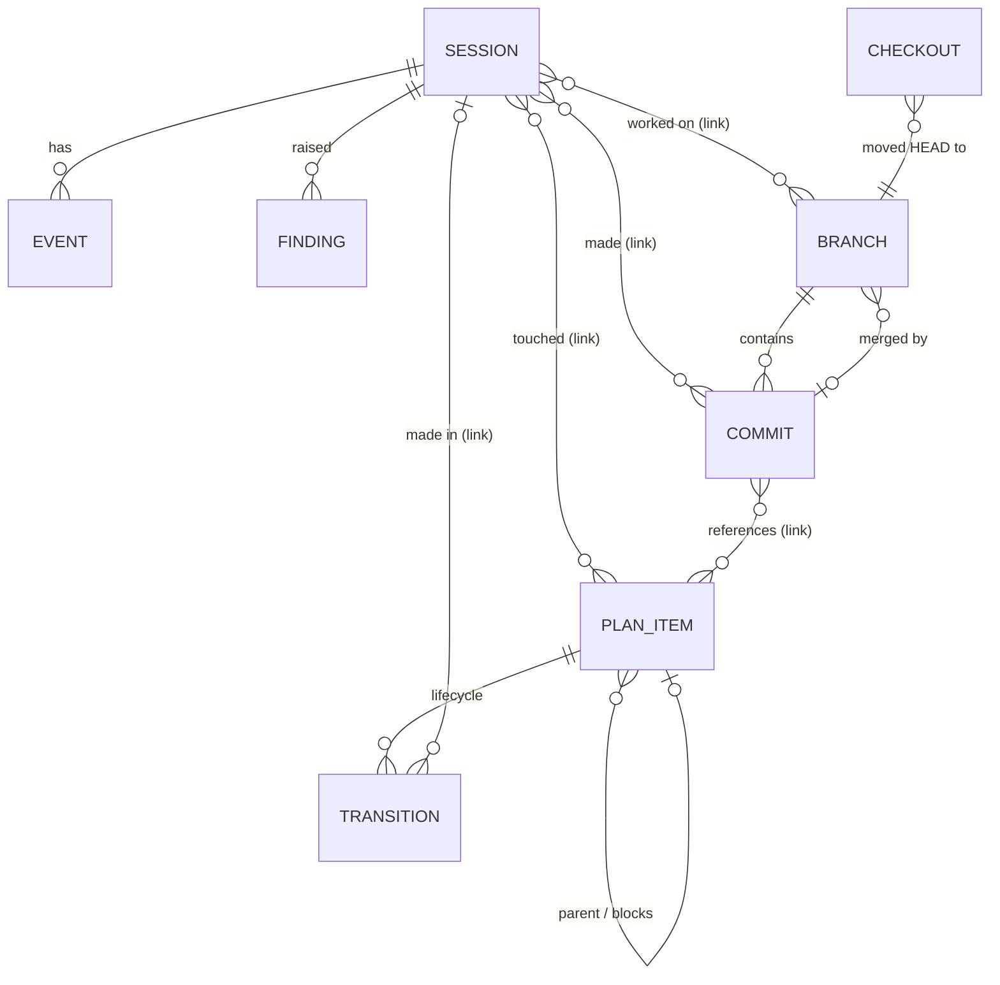

# Export: the privacy filter and the normalized schema

The design for step 9 of the [Factory Clock plan](factory-clock-plan.md), how Snagboat exports what it knows about a project for Factory Clock (and anything else) to load. Written November 20, 2026, and tracked in Beads under `snagboat-93b.9`; built under `snagboat-93b.10` (the command is documented in [cli.md](../cli.md#export)).

## Decision

Snagboat owns the privacy filter. Factory Clock reads files and never sees a raw store. In the maintainer's words: "snagboat should own the sanitizing rules. in order for the export to be meaningful I think we have to be able to export a fair amount of detail."

So the export keeps prompts, replies and tool calls, and the filter finds what might identify the machine, a person, or the workspace's place on disk, and asks you about each. It's your data and your decision: the filter supports it, and doesn't promise to catch everything (see [The privacy filter](#the-privacy-filter)).

**Everything exported comes from the Snagboat store.** The export never re-reads transcripts, git or bd. The store takes on the schema below: git state, plan state, and the links between them and sessions are recorded by the core as they happen, for heuristics as much as for export. The export does two things only: it selects one workspace's records, then applies the privacy filter. In the maintainer's words: "the export will just be selecting data for a given workspace and then applying the privacy rules." What the store doesn't hold, the export can't give.

Two more decisions came out of review:
- **The store keeps more text, by setting.** The caps on stored prompt and reply text become settings (see [What's preserved](#whats-preserved)).
- **The core records finding episodes as they happen.** Until now the store kept only your responses to findings. The maintainer called that "a gap in our original design", separate from export.

Factory Clock's scrape script ([factory-clock#31](https://github.com/DChristianson/factory-clock/pull/31)) was the first attempt at this from the other side. Its rules are a good start and this design takes most of them, but they belong here: Snagboat knows its own store layout, its own capture-time redaction, and which fields carry what. Once `snagboat export` exists, the scrape script reads its output instead of `~/.snagboat/data`. It can keep its own leak check as a second look.

## Contents

- [What an export holds](#what-an-export-holds)
- [The privacy filter](#the-privacy-filter)
- [The normalized schema](#the-normalized-schema)
- [How records are linked](#how-records-are-linked)
- [The store records it](#the-store-records-it)
- [The command](#the-command)
- [Build order](#build-order)
- [Decided in review](#decided-in-review)

## What an export holds

One workspace from the store: a git repository's working tree, with its other worktrees and any other paths you name. It covers a time range, all of what the store holds by default. Each file is the store's own records for that workspace, through the privacy filter. The export is a folder:

```text
<out>/
  README.md                   what each file is, how they join, what each placeholder means
  manifest.json               what this is: versions, project name, range, counts, what each rule rewrote
  schema/*.schema.json        the JSON Schemas the records follow
  events/YYYY-MM-DD.jsonl     the sessions' events (schema v4, filtered), UTC days
  sessions.jsonl              one record per session, with its branch, commits and plan items
  findings.jsonl              findings and early warnings, with how you responded
  git/commits.jsonl           commits, merges included
  git/branches.jsonl          branches: where they started, where they went
  git/checkouts.jsonl         HEAD moves: which branch was checked out when
  plan/items.jsonl            plan items (beads issues, or markdown plan steps)
  plan/transitions.jsonl      each item's lifecycle: created, claimed, status changes, closed, reopened
  links.jsonl                 typed edges between sessions, commits, branches and plan items
<out>.zip                     with --zip: <out>/ in one file to send
```

An export explains itself: `README.md` and `schema/` are static text, the same in every export, so a reader needs nothing from Snagboat's repository. The schema copies' `$id` is just the file name, since the published one is a URL into Snagboat's repository and names its owner. A web page reads the folder (`<input type="file" webkitdirectory>`, or a dropped folder) or the zip; it should refuse a folder without `manifest.json` at its top. The review file, which holds the values the filter found, is never beside the export: it's in the store ([Decisions](#decisions)).

Everything is JSON Lines, apart from the manifest, so a large project streams and two exports can be compared line by line. Ids join the files. A path is absolute only where you chose to keep one.

## The privacy filter

*Rebuilt under `snagboat-93b.11` (November 24, 2026). The first version ran some thirty rules in sequence over each string, each hiding its output from the next, detected everything a second time in a final check, and kept its policy inline in each rule, so every fix touched many files. This replaces it.*

**It's your data, and your decision to export it.** The filter is decision support: it finds values that might hurt you or your project if they left your machine, shows you each one with where it appears, and rewrites the ones you say to. It doesn't promise to catch everything, and it doesn't decide for you. By default nothing is written until you've decided every value it found.

The filter lives in `src/core/filter/` and knows nothing about exports: it imports nothing from the export code. The export hands it strings and writes back what it returns. One adapter, `src/core/exportFields.ts`, is the only code that knows the export's record structure: which fields of each record are free text, which name people, which are ids. `src/core/exportProject.ts` is plumbing: select the records, run them through the adapter and the filter, and either write the package or return what's still to be decided.

### Rules

Each rule is one file, `src/core/filter/rules/<id>.ts`, exporting a `Rule`:

```ts
interface Rule {
  id: string;                    // 'email'
  category: Category;            // 'Entities'
  describe: string;              // what it finds, for the generated rule table
  becomes: string;               // what a rewritten value reads as: '[email-N]'
  defaultAction: Action;         // 'review' | 'rewrite' | 'keep' | 'off'
  detect(text: string, ctx: FilterContext): Match[];             // spans in the ORIGINAL text
  replace(value: string, n: number, ctx: FilterContext): string; // the placeholder for value number n
}
interface Match { start: number; end: number; value: string }
```

`detect` sees only the original text, never another rule's output, so no rule depends on another having run. A match's `value` is what you decide on, which isn't always the text matched: every form of one person (their name, their email, `Name <email>`, their GitHub login) is one value, the person's name; a short SHA's value is the full SHA it abbreviates; a home path's value is the home folder (`/Users/dave`), not the whole path. Shared regex helpers live in `rules/util.ts`. `FilterContext` is what the caller knows about the project: its root, worktrees and `--match` paths, the people its records name, the commits its repository has, the repository's names, and `export.deny`.

The rule table below, in [PRIVACY.md](../../PRIVACY.md#exports) and in each export's `README.md` is generated from the rules (`ruleTable()` in the filter), and a test checks the docs' copies, so changing a rule means changing its file and its test, and running `npm run docs:rules`.

<!-- rule-table:start -->
| Category | Rule | Finds | Becomes | Default |
| --- | --- | --- | --- | --- |
| Local directories | `project-path` | The project's folder, its other worktrees' and the `--match` paths, wherever text names them (in `file://` URLs too). | `.`, `[worktree-N]`, `[match-N]` | review |
| Local directories | `home-path` | Home folders, anyone's: `/Users/<name>`, `/home/<name>`, `C:\Users\<name>`, in `file://` URLs too, `~<name>`, and this machine's home wherever it is. | `~` | review |
| Credentials | `secret` | The secret formats capture already redacts (private keys; AWS, GitHub, Anthropic, OpenAI-style, Stripe, Slack and Google keys; JWTs; bearer tokens; credentials in URLs; `password=` values), for text captured before a format was added. | `[secret]` | review |
| Credentials | `public-key` | SSH and PGP public key blocks, and `authorized_keys` lines. Not secret, but they identify a person. | `[public-key]` | review |
| Credentials | `connection-string` | Passwords in connection strings (`Server=...;Password=...`). | `[secret]` | review |
| Credentials | `env-value` | `.env`-style values: `NAME=value` where the name ends in KEY, TOKEN, SECRET, PASSWORD, PASS, PWD or CREDENTIALS. | `[secret]` | review |
| Entities | `person` | The people the records name (git authors, committers and co-authors, `Co-Authored-By` trailers, bd owners, creators, assignees and actors), by name, email or GitHub login, `@mentions` included. Every form of one person is one value. Agents and bots aren't people. | `[person-N]` | review |
| Entities | `email` | Email addresses (`users.noreply.github.com` ones too, which name a GitHub account), except agents' and bots' (`noreply@anthropic.com`). | `[email-N]` | review |
| Entities | `phone` | Phone numbers in international or North American form. | `[phone-N]` | review |
| Entities | `deny` | The words and phrases in the `export.deny` setting (a client's name, a codename), as whole words, ignoring case. | `[denied-N]` | rewrite |
| Network | `ip` | IPv4 and IPv6 addresses, except loopback and unspecified (`127.0.0.1`, `::1`, `0.0.0.0`). | `[ip-N]` | review |
| Network | `mac` | MAC addresses. | `[mac-N]` | review |
| Network | `internal-host` | Host names that aren't public (`.local`, `.internal`, `.lan`, `.corp` and the like), and a bare name in a URL (`http://buildbox/`). Not `localhost`. | `[host-N]` | review |
| Repository | `sha` | The repository's commit SHAs, whole or 7 or more characters, from everything the store knows about it, not just the export's range. A short SHA is the same value as the whole one. | `[commit-N]` | keep |
| Repository | `remote` | Links into the project's own repository (`https://github.com/<owner>/<repo>`, `git@github.com:<owner>/<repo>.git`), up to the repository's name. | `[repo]` | keep |
| Other | `high-entropy` | Long high-entropy strings matching no known format: 40 or more characters of base64, or more than 40 of hex. At the end of a URL path, only the token. | `[token-N]` | review |
| Other | `unknown-hex` | Runs of 7 to 40 lower-case hex characters, a letter and a digit both, that might be a commit SHA but match no commit the store knows. | `[hex-N]` | review |
| Other | `card` | Payment card numbers: 13 to 19 digits passing the Luhn check. | `[card-N]` | review |
<!-- rule-table:end -->

`deny` defaults to rewrite, since listing a word in `export.deny` already says what you want. The repository's own SHAs and links default to keep, since they're what joins an export to its history. Everything else defaults to review.

Placeholders are numbered per export, in the order values are first met, and consistent within it: the same value is the same placeholder in every file, so ids still join. Only rewritten values are numbered, so a gap never hints that something was kept. The adapter also drops what's never exported (an event's `workspace` and `raw`, and any field it doesn't know) and writes times in UTC, without git's timezone offsets; neither is a rule.

### The engine

`src/core/filter/engine.ts` runs every enabled rule over a text and settles overlaps by one policy:
- **Nested spans are separate items, and an outer rewrite wins.** If the outer value is rewritten, nothing inside it is applied; if it's kept, what's inside is applied as decided. So a project path inside the home folder is one item and the home folder another, and keeping the project path while rewriting the home folder gives `~/work/app/src`. A span nested in one of the same rule and value is dropped, since it can't be decided differently.
- **Crossing spans: the one that starts earlier wins, then the longer one,** then the rule listed first. The loser is dropped for that occurrence.

It groups matches by rule and value into **review items**, each with how often it occurs and a few snippets of context, and applies the decisions in one pass over the original text. There are no sentinels: applying with every value kept gives back the text unchanged.

### Actions, and how one is chosen

A rule's action is one of:
- `review`: you decide each value; until you have, nothing is written.
- `rewrite`: values are replaced, unless you decided to keep one.
- `keep`: values are kept, unless you decided to rewrite one.
- `off`: the rule doesn't run.

Each layer overrides the one before:
1. the rule's default;
2. `export.rules` in `~/.snagboat/config.json` (its defaults or the project's entry), such as `{ "sha": "rewrite", "ip": "keep" }`. A project's `.snagboat.json` can't set it;
3. the command line: `--rule <id>=<action>` (repeatable), `--rewrite-all` (every rule `rewrite`), `--no-filter` (every rule `off`). A `--rule` beats `--rewrite-all` for its rule; `--no-filter` takes neither;
4. your decision on a value.

### Decisions

Decisions are kept per workspace in the store, in the project's own folder: `~/.snagboat/data/workspaces/<key>/export-decisions.json`. Each is keyed by a hash of its rule and value, so the file never holds the values. A later export asks only about values you haven't decided.

**Reviewing.** When values are undecided, the export writes nothing. It writes a review file, `export-review.json`, in the same folder of the store (it holds the values, so never in the project), prints where it is and how many values each rule found, and exits 3. Each item has its rule, value, count, a few snippets and `"decision": null`:

```json
{
  "version": 1,
  "project": "/Users/dave/workspace/acme-app",
  "createdAt": "2026-11-24T18:00:00.000Z",
  "help": "Set each decision to \"rewrite\" or \"keep\", then run the export again. ...",
  "items": [
    { "id": "3f9a0c21…", "rule": "email", "category": "Entities", "value": "robin@example.org", "count": 4,
      "becomes": "[email-N]", "snippets": ["…please mail robin@example.org about the…"], "decision": null }
  ]
}
```

Set each `decision` to `"rewrite"` or `"keep"` and run the export again. It folds those into the decisions file, asks again only about what's still `null`, and once nothing is undecided writes the export and removes the review file. `--rewrite-all` or a `--rule` settles a run without deciding values one by one. The review file and the decisions are the core's (the CLI and VS Code are thin clients). A review page in VS Code comes later; until then **Export Project...** says how many values are undecided, with a button that opens the review file.

### No longer done

Dropped with the rebuild:
- the public/private distinction (`export.public`) and the export key (`~/.snagboat/export-keys/`): SHAs are kept or become `[commit-N]`, and people become `[person-N]`, numbered per export, so two exports don't share pseudonyms;
- the final check, which was a second detector to keep in step with the first;
- `--allow`, `--allow-rule` and `--fail-on-flags`, which decisions replace, and the `<out>.review/` folder;
- rewriting other absolute paths (`/tmp/...`) and the user and host names as words, flagging stack traces from other projects, `@mentions` of people the records don't name, and parts of names;
- re-keying ids hashed from SHAs or paths: checkout and link ids keep their hashes, and paths inside event ids are filtered like any text.

### What's preserved

Everything else, which is most of the detail:

- **Prompts and replies**, as the store holds them. The export doesn't go back to the transcripts for more. How much the store keeps is up to you, in two settings beside `captureContent`:
  - `snagboat.capture.promptChars`: the most of a prompt's text that's stored. Default 2,000, which 98% of real prompts fit whole.
  - `snagboat.capture.replyChars`: the most of a reply's text that's stored. Default 500.

  Both take up to 100,000 characters. They're resource-scoped like `captureContent`, and copied into `~/.snagboat/config.json`, so the core applies them per project. A raised cap applies to what's captured from then on. Text already stored stays as it was, and `textTruncated` says it was cut. Secret redaction runs on the whole text either way. Retention is unchanged: text is still removed after `retention.textDays`.
- **Tool calls**: tool name and category, status, timing, turn, subagent, and the input that matters to a view: the file it touched, the command it ran, the search pattern, the URL it fetched (`toolInput`, schema v4). Tool *output* is neither stored nor exported, apart from a test or build run's pass/fail, which is already the call's status. Output is where pasted logs, file contents and stack traces live, which is most of the risk and little of the value.
- **Plans**: todo lists, task tools, and plan items' titles, descriptions, design, notes, acceptance criteria and close reasons.
- **Git**: commit subjects and bodies, branch names, changed files with line counts.
- **Session names, compactions, model calls and tokens, findings and outcomes**, as stored.
- **Ids**: session, subagent, turn, bead, checkout, link and finding ids, so two exports of the same project join.

`--text none` exports structure only (counts, kinds, times, paths, links), for sharing where even filtered text is too much.

## The normalized schema

The schema extends what Snagboat already records rather than starting over. Events stay `NormalizedEvent` (version 4), and sessions stay what `snagboat sessions --json` prints, with more fields. Git and plan history are new records that sit beside them, joined by ids.

This is the **store's** schema, not only the export's. The core writes these records into each workspace's folder in `~/.snagboat/data`, heuristics and advisors read them there, and the export writes the same records through the privacy filter.

The types and JSON Schemas are in `packages/schema` (`storeRecords.ts` and `exportRecords.ts`; [schema.md](../schema.md#git-plan-link-and-finding-records) lists the schema files). Every store record also carries:
- `record`, its type, since one store file holds several: `'commit'`, `'branch'` or `'checkout'` in `git.jsonl`; `'item'` or `'transition'` in `plan.jsonl`; `'link'` in `links.jsonl`; `'finding'` in `findings.jsonl`. It's `record`, not `type`, because a transition already has a `type`. The export splits `git.jsonl` and `plan.jsonl` into one file per `record` and keeps the field.
- `version: 1`.
- A stable key: a commit's `sha`, every other record's `id` (given with each record below). The files are append only: a record that changes is appended again with the same key, the latest line with a key is the record, and a job appends nothing when a record hasn't changed, so running it again adds nothing. Hashed ids are the first hex characters of a SHA-256 of the fields named, joined by newlines.

The records below show the fields as the store holds them: git idents (`Name <email>`), bd's actor names, a worktree's absolute path. An export writes them through the filter, so with the defaults a person may read `[person-1]` and a worktree `[worktree-1]`.



### Events: `NormalizedEvent` version 4

Version 4 is version 3 with these changes, so a v3 reader still reads the events it knows:

| Field | Change |
| --- | --- |
| `workspace`, `raw` | Stay in the store. Never in an export. |
| `toolInput` | New, optional, recorded at capture: `{ command?, path?, pattern?, url?, description? }`, the parts of a tool call's input worth drawing. Today only `target` holds one of them. |
| `refs` | New, optional, recorded at capture: `{ commit?, branch?, planItems? }`, set on an event that *observably* acted on one: a tool call that ran `git commit`, `git checkout -b`, or `bd close snagboat-koh`. Inferred relations go in `links.jsonl`, not here. |
| `textTruncated` | New, optional: the prompt or reply text was cut at the store's cap. |

Since an exported event has no `raw`, which a stored event requires, it has its own schema: `ExportedEvent` (`exportedEvent.v5.schema.json`), version 4 without `workspace` and `raw`. Its version 4 also had `redactions`, what the rules replaced in each event; version 5 drops it, since the manifest counts what each rule rewrote.

### Sessions: `sessions.jsonl`

What `snagboat sessions --json` prints for a session (`SessionSummary`: id, agent, first and last time, prompts, model calls, tool calls, tokens, models, subagent count, days, name), plus:

```ts
interface SessionRecord extends SessionSummary {
  /** The subagents' ids. (SessionSummary.subagents stays their count.) */
  subagentIds: string[];
  /** The working tree's path; '.' or '[worktree-1]' once the filter rewrites it. */
  where: string;
  /** Branches checked out during the session, in order (from checkouts and links). */
  branches: string[];
  /** Commits linked to the session, with each link's confidence. */
  commits: Array<{ sha: string; confidence: Confidence }>;
  /** Plan items linked to the session, and how it touched each. */
  planItems: Array<{ id: string; how: 'created' | 'claimed' | 'updated' | 'closed' | 'mentioned'; confidence: Confidence }>;  // one per item and way
}
type Confidence = 'observed' | 'inferred';
```

### Git: `git/commits.jsonl`, `git/branches.jsonl`, `git/checkouts.jsonl`

In the store, all three are `git.jsonl`.

```ts
interface CommitRecord {
  record: 'commit';
  version: 1;
  sha: string;                 // the key
  parents: string[];
  /** 'merge': two or more parents. 'squash': one parent, and its subject names a pull request ("(#157)"). */
  kind: 'commit' | 'merge' | 'squash';
  authoredAt: string;          // UTC
  committedAt: string;         // UTC
  author: string;              // a git ident, or an agent's name
  committer: string;
  coAuthors: string[];         // from Co-Authored-By trailers: agents by name, people as idents
  subject: string;
  body?: string;               // only with captureContent on, for textDays; Remove Captured Text clears it
  files: Array<{ path: string; status: 'A' | 'M' | 'D' | 'R'; added: number; deleted: number; from?: string }>;
  /** Pull request number from the subject ("(#157)"), when there is one. Nothing else about pull requests is recorded: no network calls. */
  pr?: number;
  /** The commit this one reverts ("This reverts commit <sha>"). */
  reverts?: string;
  /** Branches whose history contains it when it was recorded, by name. */
  onBranches: string[];
}

interface BranchRecord {
  record: 'branch';
  version: 1;
  id: string;                  // `${name}@${firstSeenAt}`: a name deleted and made again is a new branch
  name: string;                // through the filter like any text
  firstSeenAt: string;         // when the repository job first saw it
  createdAt?: string;          // first reflog entry
  from?: string;               // the commit it started from
  head: string;                // its last known commit
  /** Where it went, if it did. */
  merged?: { into: string; at: string; via: 'merge' | 'squash' | 'rebase' | 'fast-forward'; commit: string; pr?: number };
  /** When Snagboat saw it gone. */
  deletedAt?: string;
}

interface CheckoutRecord {
  record: 'checkout';
  version: 1;
  /** 'checkout-' + 16 hex of SHA-256(worktree, at, commit); worktree is '.' or its name under .git/worktrees/. Not HEAD@{n}, which shifts. */
  id: string;
  at: string;
  from: string;                // branch name, or a short SHA when detached
  to: string;
  commit: string;              // the commit HEAD moved to
  /** The working tree's path, since each worktree has its own HEAD. */
  where: string;
}
```

A squash merge loses the branch's commits from `main`'s history. That's why `BranchRecord.merged` records it: the branch's own commits (in `commits.jsonl` with `onBranches`) and the squash commit on `main` are joined by `merged.commit` and the pull request number.

### Plan: `plan/items.jsonl`, `plan/transitions.jsonl`

Plan items follow Factory Clock's `PlanItem` (its `src/model/plan.ts`), so its views need no translation. The lifecycle is new:

```ts
interface PlanItemRecord {
  record: 'item';
  version: 1;
  id: string;                  // the bead's id, or 'md-' + 12 hex of SHA-256(file, heading path[, a task's text])
  kind: 'epic' | 'milestone' | 'feature' | 'task' | 'bug' | 'step' | 'decision' | 'question' | 'note';
  title: string;
  status: 'open' | 'in_progress' | 'blocked' | 'done' | 'deferred' | 'dropped';
  priority?: number;
  parent?: string;
  blockedBy?: string[];        // the items it depends on (bd's blocking dependencies)
  labels: string[];
  created: string;
  started?: string;
  updated: string;
  closed?: string;
  closeReason?: string;
  assignee?: string;           // a person (bd's assignee)
  owner?: string;              // a person (bd's owner)
  createdBy?: string;          // a person or an agent's name (bd's created_by)
  text?: { description?: string; design?: string; notes?: string; acceptance?: string };
  source: 'beads' | 'markdown';
  /** markdown: the file and heading it came from, relative to the project. */
  from?: { file: string; heading?: string };
  confidence: Confidence;      // 'observed' from beads; 'inferred' from markdown
}

interface TransitionRecord {
  record: 'transition';
  version: 1;
  id: string;                  // the bd audit event's id, or 'md-t-' + 16 hex of SHA-256(item, at, type, to)
  item: string;
  at: string;
  type: 'created' | 'claimed' | 'status_changed' | 'updated' | 'closed' | 'reopened' | 'dependency_added' | 'dependency_removed' | 'commented' | 'label_added' | 'label_removed';
  from?: string;               // the old status, for status changes
  to?: string;                 // the new status, or the other item for a dependency
  /** For 'updated': which fields changed, not their values (the item has its current text). */
  fields?: string[];
  actor: string;               // a person, or an agent's name
  confidence: Confidence;      // 'observed' from bd's journal; 'inferred' from markdown
}
```

For beads, the source is bd's own audit journal (`bd history <id> --events`), which records `created`, `claimed`, `updated`, `status_changed`, `closed` and dependency changes, each with an actor and a time. Its `updated` entries carry the bead's whole old and new state. The export keeps only the names of the fields that changed, because the text is already on the item.

**Without beads, the plan is inferred from markdown.** The plan job reads the project's planning markdown: files git tracks under `docs/` by default, or the paths in the project's `plans` setting. It doesn't read a README, CONTRIBUTING or changelog unless they're named. Every item it makes is `confidence: 'inferred'`, with `from` naming the file and heading:
- headings become epics or milestones;
- numbered steps and `- [ ]` checklists become tasks, with status from `[x]`, "done", "built" or strikethrough;
- dates beside them become times;
- an item's id is a hash of its file and its heading path, and for a task its text without its status marks (and the text of any task it's nested under), so marking it done, or inserting, removing or moving other tasks around it, keeps it. Two tasks with the same text under one heading are numbered. Markdown plans are a best-effort snapshot: ids come from the text as it is now, and earlier versions aren't compared, so rewording a task makes a new item (the old one dropped). Tasks a store kept under the older position-based ids are replaced when the plan job next reads their file (a file whose stored tasks share no id with its tasks now).

The lifecycle comes from watching the files. Each run compares an item with what the plan job last stored, and a change of status becomes a transition. Its time is the commit that changed the line (`git blame` of HEAD, which the plan job reads, as it reads the files at HEAD), and the actor is that commit's author, both `inferred`. A project that has both beads and markdown plans uses only the beads, as factory-clock#31 does, since the two usually describe the same work twice.

### Findings: `findings.jsonl`

Findings were half of step 9's original ask, and Factory Clock's page has shown none since step 8. One record per episode: heuristic or rule id and its version, session, turn, first and last time, the events it's about, whether an early warning came before it, and your response (`useful`, `muted`, `acknowledged`, `passed`).

```ts
interface FindingRecord {
  record: 'finding';
  version: 1;
  id: string;                  // 'finding-' + 16 hex of SHA-256(heuristicId, sessionId, firstTs)
  heuristicId: string;         // a heuristic's or saved rule's id
  heuristicVersion: string;    // a built-in's Snagboat version, or a hash of a saved rule's definition
  sessionId?: string;          // the session of its latest event; absent for a finding about no one session
  turnId?: string;
  severity: 'info' | 'warn';   // the worst it reached
  summary?: string;            // the latest finding's summary, as shown
  firstTs: string;
  lastTs: string;
  eventRefs: string[];
  earlyWarning: boolean;
  response: 'useful' | 'muted' | 'acknowledged' | 'passed';
}
```

Today the store keeps only your responses (`finding_response` outcomes, `finding-responses.jsonl`); the core works episodes out live from events. Replaying the heuristics at export time would break "the export only selects", and would give different answers once a heuristic changes. So the core also writes each episode to the workspace's `findings.jsonl` when it closes, as it was shown, and the export selects from that.

### Links: `links.jsonl`

```ts
interface LinkRecord {
  record: 'link';
  version: 1;
  /** 'link-' + 16 hex of SHA-256(from, to, kind, how): confidence isn't part of it, so a link that turns observed is the same link. */
  id: string;
  from: { type: 'session' | 'commit' | 'branch' | 'plan-item' | 'transition'; id: string };
  to: { type: 'session' | 'commit' | 'branch' | 'plan-item' | 'transition'; id: string };
  kind: 'made' | 'worked-on' | 'touched' | 'references' | 'merged' | 'made-in';
  /** touched: how the session touched the item. */
  how?: 'created' | 'claimed' | 'updated' | 'closed' | 'mentioned';
  confidence: Confidence;
  /** Why: rule names and the ids of the records that show it. */
  evidence: Array<{ rule: string; refs: string[] }>;
  /** Store only: the link that replaced this one. */
  supersededBy?: string;
  /** Store only: the time of the latest record in its evidence, for retention. */
  at?: string;
}
```

A link's ends name records by their key: a session's id, a commit's SHA, a branch's, item's or transition's `id`.

### The manifest: `manifest.json`

```ts
interface ExportManifest {
  format: 'snagboat-export';
  version: 2;                  // the export format's version
  eventSchema: 4;
  generatedAt: string;
  project: string;             // from --name, else the project folder's name
  range: { since?: string; until?: string; first?: string; last?: string };  // asked for; first and last event exported
  text: 'redacted' | 'none';
  counts: { days: number; events: number; sessions: number; findings: number; commits: number; branches: number;
            checkouts: number; planItems: number; transitions: number; links: number };
  snagboatVersion: string;
  /** reviewed: every rule ran, each value decided. rewrite-all: --rewrite-all. none: --no-filter. */
  filter: 'reviewed' | 'rewrite-all' | 'none';
  /** Distinct values each rule found and rewrote or kept, by rule id; rules that found nothing are left out. */
  rules: Record<string, { rewritten: number; kept: number }>;
  readme: 'README.md';
  schemas: Record<string, string>;   // each file or pattern (events/*.jsonl) and its schema in schema/
}
```

## How records are linked

The core works out links as records arrive and stores them, so heuristics use the same links the export writes. Every link says whether it was **observed** (something recorded shows it directly) or **inferred** (a heuristic guessed it), and why. Views can draw the two differently, and a wrong guess can be traced to its rule. A link that a later record overturns is replaced, not deleted: the store keeps `supersededBy`, and the export writes only the current links. An inferred made-in link the rules no longer give, with nothing in its place, is withdrawn the same way (`supersededBy: "withdrawn"`): no link is better than a wrong one.

| Link | Observed when | Inferred when |
| --- | --- | --- |
| session **made** commit | A tool call in the session ran `git commit` (or `gh pr merge`), and a commit by the same committer landed within 60 seconds after it | The [git outcomes rule](../../src/outcomes/gitOutcomes.ts): a commit between the session's first event and 30 minutes after its last that touches a file the session edited |
| session **worked-on** branch | A checkout during the session moved HEAD in the session's working tree, or a tool call ran `git checkout`, `git switch` or `git worktree add` | The branch was checked out in that working tree when the session started |
| session **touched** plan item | A tool call ran `bd` on the item (`create`, `update --claim`, `update`, `close`, `show`), and the item's transition at that time matches. The link carries `how`. | The item's id appears in a prompt or reply, or a commit the session made references it |
| transition **made-in** session | A tool call ran the `bd` command that made it, within a few seconds | The session had activity within 5 minutes of it and a sign of the item: it touched the item (a `bd` call on it, its id in a prompt or reply, a commit it made referencing it; rule `active-session-touched`) or ran `bd` within those 5 minutes (`active-session-bd`). By the session's person, and no other session qualifies; otherwise no link. A session that merely spans the time isn't enough: the store may not have the session that did it |
| commit **references** plan item | Its subject or body names the item's id (`(snagboat-79f.13)`) | Its branch's name or pull request names the item |
| branch **merged** into branch | A merge commit, or a squash commit naming the branch's pull request | The branch's head became reachable from the target, or it disappeared after a pull request with its name merged |

Bead ids are found by the project's own prefix: bd's `issue-prefix` (in `.beads/config.yaml`, read without running bd), else the most common `<prefix>-` among its beads. That keeps `snagboat-koh` from matching text that only looks like an id.

## The store records it

The store holds everything the export writes, because the core records it as it happens. Snagboat needs it for its own heuristics, and an export run later couldn't rebuild it anyway: reflog entries expire (90 days by default), merged branches get deleted (this project deletes them as soon as their pull request merges), squash merges drop a branch's commits from `main`, and transcripts get cleaned up.

Each workspace's folder in `~/.snagboat/data` gains four files beside `events/`:

| File | What writes it | From |
| --- | --- | --- |
| `git.jsonl` | A repository job in the core, beside `GitOutcomesJob` | `git log --all`, `for-each-ref`, and each worktree's HEAD reflog, read-only as the outcomes job's git already is. It runs every few minutes while a session is active in the workspace, so checkouts are seen with their times, and hourly otherwise. It appends commit, branch and checkout records, plus a branch's `merged` or `deletedAt` when it sees them. |
| `plan.jsonl` | A plan job in the core | With beads (a `.beads` folder, and `bd` installed): `bd export` and `bd history --events`, items as they change and every transition once. Where bd runs only in a dev container, what its exporter writes to `.snagboat/beads/`. Without beads: plans inferred from markdown ([above](#plan-planitemsjsonl-plantransitionsjsonl)). |
| `links.jsonl` | The core's linker, run as events, git records and plan records arrive | The rules in [How records are linked](#how-records-are-linked) |
| `findings.jsonl` | The core's findings service, as each episode closes | The episode as it was shown, with its heuristic's version |

Adapters record `toolInput`, and `refs` where a tool call observably acted on a commit, branch or plan item, when they capture the call (event schema v4).

**What's stored is raw.** Events are stored unsanitized today, with only capture-time secret redaction, and so are these. The privacy filter runs once, on export. So a better rule improves every later export of old data, and heuristics see real paths and names.

**Worktrees.** Each working tree of a repository is its own workspace with its own folder in the store. Each gets the repository's shared records, its commits and branches, and only its own working tree's checkouts. One run reads a repository once for all its workspaces, and a branch's `firstSeenAt` comes from whichever workspace's `git.jsonl` already has it, so the shared records are the same in each and an export of several worktrees folds them by key.

**Retention.** `git.jsonl`, `plan.jsonl`, `links.jsonl` and `findings.jsonl` follow `retention.rawDays`, as events do, by each record's time: a commit's commit time, a checkout's, a branch's deletion (a branch that still exists is kept), a plan item's closing (an open one is kept), a transition's, a link's latest evidence (`at`), a finding's `lastTs`. Commit bodies and plan item text are captured text: stored only while the project's `captureContent` is on, and following `retention.textDays`, by a commit's commit time and an item's `updated` time. Nothing older than that is appended, so a run doesn't put back what retention removed. `outcomes.git` and `collect` turned off for a project stop its git and plan jobs too. **Snagboat: Remove Captured Text** also clears commit bodies and plan item text in the workspace's own `git.jsonl` and `plan.jsonl` (as it does its events; other worktrees of the repository keep their copies until cleared from their own window or by `textDays`): the core rewrites each file (a temporary file, then a rename), so the text is gone from disk, not shadowed by a newer line. A job doesn't append a record again just because its stored copy lost its text; a commit or item that changes is stored whole again, with its text if capture is on.

**What heuristics get from it.** The point of storing it is that Snagboat can reason about the work, not only the session. These are examples, not commitments:
- a session that claimed a bead and ended with no commit and no status change;
- a branch with many sessions and no merge;
- work closed with no linked commit;
- time from claimed to closed, per bead kind;
- commits reverted after the session that made them closed its bead.

The git outcomes job's commit-to-session rule becomes one of the linker's rules, so `milestone`, `commit_kept` and `code_survival` use the stored links.

## The command

```sh
snagboat export --project <dir> --out <dir> [--name <name>] [--since <date>] [--until <date>]
                [--text redacted|none] [--rule <id>=<action>]... [--rewrite-all | --no-filter]
                [--match <path>]... [--zip] [--json]
```

- It only reads the store: one workspace's `events/`, `git.jsonl`, `plan.jsonl`, `links.jsonl` and findings, with or without the core running. It runs no git and no bd, and reads no transcript. The one thing it writes in the store is the filter's state, in the project's own folder: its decisions and, while values are undecided, the review file.
- `--project` defaults to the current folder's repository (the nearest folder with a `.git`). Records are selected when their workspace is the project, inside it, another worktree of its repository, or a `--match` path. Without git, another worktree is a workspace whose `git.jsonl` has the project's root commit and whose `.git` file points into the same repository (a separate clone, with its own `.git` folder, isn't one); its working tree is where its checkouts happened. These are factory-clock#31's rules, applied to the store Snagboat knows.
- `--out` must be outside the project and its worktrees, so an export never gets committed. Since the command runs no git, it can't ask what's ignored: the one place inside allowed is under the project's `.snagboat/` folder, where it writes a `.gitignore` for the export (as the beads exporter does for `.snagboat/beads/`).
- It prints what it wrote and how many values each rule rewrote and kept; `--json` prints `manifest.json`. While values are undecided it writes nothing, prints where the review file is and how many values each rule found, and exits 3 ([Decisions](#decisions)).
- `--zip` also writes `<out>.zip`, the export folder only, stamped with the manifest's time so the same store zips to the same bytes.
- In VS Code: **Snagboat: Export Project...** runs it for the window's folder and writes the zip (the export is usually for sending). While values are undecided it says how many, with a button that opens the review file; a review page comes later.
- Factory Clock loads an export folder or zip as it loads daily event files today, and its scrape script takes `--from-export <dir|zip>` in place of `--events`.

## Build order

Each is a bead under `snagboat-93b.9` once this is reviewed. The store comes first, so heuristics can use it before there's an export.

1. **Schema:** `NormalizedEvent` v4 fields, the git, plan, link, finding and session record types, their JSON Schemas in `packages/schema`, and `manifest.json`'s format.
2. **Capture:** adapters record `toolInput`, and `refs` for tool calls that observably ran git or bd. The `capture.promptChars` and `capture.replyChars` settings replace the fixed caps, with `textTruncated` on text they cut.
3. **Repository job:** `git.jsonl` (commits, branches, checkouts) in the core, with tests on a scratch repository: merge, squash, rebase, deleted branch, two worktrees.
4. **Plan job:** `plan.jsonl` from bd's export and audit journal, or inferred from markdown when the project has no beads.
5. **Linker:** `links.jsonl`, with each rule tested on its own in `observed` and `inferred` cases. The git outcomes job moves onto it.
   **Findings:** the core writes closed episodes to `findings.jsonl`.
6. **Sanitizer:** the privacy rules, with tests on made-up data that plants every kind of value the rules name. Rebuilt under `snagboat-93b.11` as [the privacy filter](#the-privacy-filter): a rule per file, one engine, decisions kept in the store.
7. **The command:** `snagboat export` (select, filter, review, write), and the VS Code command.
8. **Factory Clock:** load an export folder, and `--from-export` in the scrape script (in factory-clock's own tracker).

Heuristics that use git and plan state are their own beads, after step 5.

## Decided in review

The questions the first draft left open, and how they were settled (November 20–21, 2026):

1. **Everything exported comes from the store.** The export never re-reads transcripts, git or bd. The store takes on this schema and heuristics use it too.
2. **Finding episodes are recorded as they happen.** This was a gap in the original design, separate from export.
3. **The store's text caps become settings**, `capture.promptChars` and `capture.replyChars`.
4. **Commit SHAs are re-keyed for a private repository**, and every repository counts as private unless the project sets `export.public`. *Superseded by `snagboat-93b.11`: SHAs are kept by default, or rewritten as `[commit-N]`, and there's no public or private.*
5. **Pseudonyms use the same key as the SHAs for a private repository**, so a team that shares the repository's key gets exports that join up. *Superseded by `snagboat-93b.11`: people are `[person-N]`, numbered per export, with no key.*
6. **No pull request detail.** Only the number in a commit's subject, so the repository job and the export make no network calls.
7. **Without beads, plans are inferred from markdown**, with `confidence: 'inferred'` and their lifecycle from the files' git history.
