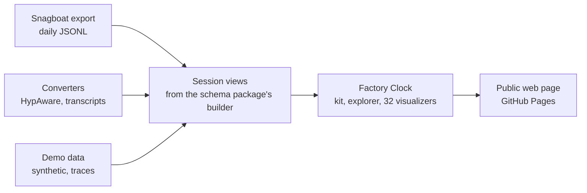

# Factory Clock: Visualization Package Plan

Status: proposed, 2026-11-09; revised by the decision of 2026-11-12 below. Companion to the [architecture RFC](architecture-rfc.md).

## Decision, 2026-11-12

Factory Clock is web only, and it is purely the explorer. It moves to its own repository. Snagboat keeps its own copy of the two drawings it uses, the turn tree and the context timeline, and drops Explore and the hero views. The two copies of the drawings will drift. That is accepted. A coding agent can bring them back in step when needed.

In the maintainer's words: "snagboat should just keep a copy of what it uses, and drops explore and no hero viz or any of that fancy stuff. the code will drift but that's what agentic coding is for. factory clock we will plan a way to export findings and plans, internal names should become factory clock's own". And earlier: "factory clock is just going to be web only and purely the viz explorer".

What changes in this plan:

- Snagboat's hosts no longer load the package. The VS Code detail view and the advisor UI draw sessions with Snagboat's own copy in `media/drawings/` (step 6).
- There are no versioned releases for Snagboat to pin. The old step 6, "Release `dist/`", is dropped.
- Factory Clock takes its own names inside: its npm name and its globals (step 7).
- After the move to its own repository (step 8), Snagboat and Factory Clock meet only through files. Snagboat will export findings and plans for Factory Clock to load (step 9).

The rest of this document is the plan as proposed on 2026-11-09, with the steps updated.

## Summary

Snagboat's 32 visualizers and its GitHub Pages demo become their own package, Factory Clock: a static site anyone can open, with no runtime dependencies, that reads only the shared schema. Most of the work is already done. The visualizers are plain scripts, the demo already deploys, and its security policy already forbids network requests. What's left is cutting three ties: the input model lives in Snagboat's TypeScript, the styling reads VS Code's theme variables, and the catalog lives in the extension.

The decision asked for:

1. Approve a separate `viz` package, first inside the Snagboat monorepo as this refactor, then in its own repository.
2. Approve moving the session-view builder into the schema package, so Snagboat and the visualizations derive sessions the same way.
3. Approve the steps below, which run in parallel with the architecture RFC.

## Where it stands today

| Piece | Today | What ties it to Snagboat |
| --- | --- | --- |
| Visualizers | 32 plain scripts in `media/viz`, each registered through `snagboatViz.register` with `mount(host, ctx)` | Nothing; they see only `ctx` and the sessions |
| Hero views | Living Network, Factory Clock, Conversation Landscape, Session Fingerprint, Terminal Board | Shared replay and force layout in `media/shared.js` |
| Helpers | `media/shared.js` (811 lines): DOM, formatting, tooltip, replay, force layout | Mixed with detail-view helpers |
| Explorer | `media/explore.js`: the carousel and the facet filter ("puck") over a source object | Nothing; the source object hides the host |
| Input model | `buildSessionView` and the session index in `src/ui` and `src/core` | TypeScript inside the extension's source tree |
| Catalog and taxonomy | `src/ui/visualizers.ts` | Lives in the extension |
| Styling | `media/detail.css`; the page defines VS Code's `--vscode-*` variables for light and dark | VS Code variable names |
| Web demo | `web/index.html`, `src/web`, `scripts/webDemo.js`; deployed by `pages.yml` | Built from the extension's repo and scripts |
| Demo data | Generated sessions, plus reviewed traces from `npm run demo:traces` | Trace tool lives in `src/scripts` |

The page's Content-Security-Policy already sets `connect-src 'none'`, so loaded files cannot leave the browser.

## Goals and non-goals

**Goals**

- Anyone can open the gallery on the web and load their own data, with nothing to install.
- No runtime dependencies: no framework, no charting library, no server, no web fonts to start.
- The only input is the shared schema: `NormalizedEvent` JSONL, turned into session views by the schema package's builder.
- The same files run unchanged in the public site and the core's advisor UI. VS Code no longer hosts visualizations. (Superseded on 2026-11-12: Factory Clock is web only, and Snagboat keeps its own copy of the two drawings it uses.)
- The package has its own identity: its own README, gallery, version, changelog and contribution guide.

**Non-goals**

- Live data on the public site; it stays replay-only.
- Reading other formats in the browser, such as Parquet or OpenTelemetry. Converters to JSONL can live outside the page.
- A charting library for general use. These views are specific to agent sessions.

## How data flows



Every input becomes `NormalizedEvent` JSONL before it reaches the page, and the schema package turns events into session views. The visualizers never see where data came from or which host they run in.

## Package layout and contracts

```text
packages/schema/
  types/              NormalizedEvent, SessionView, Finding, ...
  json-schema/        generated, versioned
  session-view/       buildSessionView and the session index (moved from src/ui, src/core)
packages/viz/
  kit/                dom, format, tooltip, replay, force layout (split out of shared.js)
  viz/                the 32 visualizers and registry.js
  explore.js          carousel and facet filter
  catalog.json        catalog and taxonomy (moved from src/ui/visualizers.ts)
  theme.css           the package's own color tokens, light and dark
  viz.css             the visualizers' and explorer's styles, on theme.css's tokens
  hosts/web/          index.html, loader, synthetic sessions, example traces
  dist/               prebuilt files for hosts that don't build
```

**Contracts it keeps.** The visualizer contract stays exactly as [documented](visualizer-contract.md): `register({ id, title, tags, mount(host, ctx) })`, an instance with `update(sessions, selection, options)`, `resize()`, `destroy()` and optional `setActive()`. The shared selection and the source object (`listSessions`, `loadSessions`, `getState`, `setState`) also stay.

**Contracts it changes.**

- **Input.** `SessionView` comes from `@snagboat/schema`, so a schema version bump is the only way the input can change.
- **Theme.** `theme.css` defines the package's own variables, such as `--sv-ink` and `--sv-accent`. Both hosts map them from `prefers-color-scheme`. Hero views keep their own palettes, as their design notes say.
- **Catalog.** The catalog and taxonomy move into the package as data, and its unit test moves with them.

## Dependencies, build and hosting

- **Runtime: none.** Plain scripts and SVG or canvas, as today. Fonts stay system stacks; shipping font files for the hero views is a later, separate decision.
- **Build: one step.** esbuild bundles the TypeScript session-view builder into one browser script, as `npm run build:web` does now. (A committed `dist/` for other hosts was dropped on 2026-11-12: the web page is the only host.)
- **Hosting.** GitHub Pages, deployed by a workflow in the package, with the same strict Content-Security-Policy: scripts only from the page, no network requests, no analytics, no service worker.
- **Testing.** The catalog test, replay-clock tests and a headless smoke check of the page move with the package.
- **Versioning.** Semver, tied to the schema version it reads. A schema major version means a viz major version.

## Data on the page

The page offers three kinds of data, all held in browser memory only.

| Data | Where it comes from | Notes |
| --- | --- | --- |
| Generated sessions | The package's synthetic generator | Always available; also used by unit tests |
| Example traces | `snagboat demo-traces`, the core CLI version of today's script | Committed only after their text report is reviewed by hand |
| Your own data | Daily JSONL files, or `snagboat export` output, dropped on the page | Parsed with `FileReader`; nothing fetched, posted or stored |

Other tools reach the page through the schema rather than through new readers in the browser. A HypAware or Claude Code transcript converter writes `NormalizedEvent` JSONL, and the page loads that like any other file.

## Steps

Each step leaves the web demo working.

1. **Move the builder.** Put `buildSessionView` and the session index in `packages/schema/session-view`, with no behavior change. This lines up with step 1 of the architecture RFC.
2. **Split `shared.js`.** Separate the visualization kit (DOM, format, tooltip, replay, force layout) from detail-view helpers that stay in Snagboat.
3. **Own the theme.** Add `theme.css` with the package's variables, switch the visualizers to them, and map them in the web page and the advisor UI.
4. **Move the files — done.** (The advisor UI already loads them from `media/`, served by the core: RFC step 5b.) Move `media/viz`, `explore.js`, `viz.css`, the catalog, `web/`, `src/web` and the Pages workflow into `packages/viz`. The advisor UI loads them from the package, and the VS Code detail view drops its Explore tab.

   **As built.** A pure move, no behavior change. `packages/viz` is `@snagboat/viz`, a workspace package like the schema's, built by `npm run build:viz`:
   - The page files sit at its root: `viz/` (the 32 visualizers and `registry.js`), `vizkit.js`, `explore.js`, `viz.css`, `theme.css`. `vizkit.js` stays one file; the `kit/` split is later.
   - Its TypeScript: `src/catalog.ts` (was `src/ui/visualizers.ts`), `src/explorerModel.ts`, and the web page's modules in `src/web` (`@snagboat/viz/web`, and `@snagboat/viz/web/page`). The catalog stays TypeScript; `catalog.json` is still open.
   - The web page's static files are in `hosts/web/`, and `scripts/webDemo.js` assembles it.
   - It imports only itself and `@snagboat/schema` (`vizBoundary.unit.test.ts`).

   The page's `EventSet` used to replay Snagboat's heuristics itself. It now takes a findings function from its host, and Snagboat's bundle entry passes `replayFindings` with the same heuristics, so the page is unchanged. That entry (`src/web/main.ts`, `src/web/findings.ts`) stays in Snagboat, and its bundle and the assembled page still land in `out/web`, which `pages.yml` deploys. The workflow stays in `.github/workflows`, the only place GitHub runs one from, until step 7.

   Hosts load the page files from the package folder. The VS Code webview adds `packages/viz` as a second local resource root, and the core serves them under `/ui/` from `packages/viz` beside `media/ui`. The VSIX ships those files through `.vscodeignore`, so the layout is the same in the repo and the installed extension. VS Code keeps its Explore tab for now: dropping it is RFC step 5c, behind the per-user store setting.
5. **Give it an identity — done.** Write its README and contribution guide, document the [visualizer contract](visualizer-contract.md) for outside authors, and publish the gallery as Factory Clock.

   **As built.** Docs and the page's name only; no code or contract changed:
   - [`packages/viz/README.md`](../../packages/viz/README.md): what Factory Clock is, the five hero views and the 32 in the catalog, how to build and open the web page, the three hosts, the input, the rules (no runtime dependencies, its own theme, its own imports), and the web page's privacy.
   - [`packages/viz/CONTRIBUTING.md`](../../packages/viz/CONTRIBUTING.md): the steps to add a visualizer (script, catalog entry, each host's loading, styling, accessibility, tests), and a checklist.
   - [The visualizer contract](visualizer-contract.md) now covers each host's load order, how hosts build `ctx` (with `tipFor` and `hashId`, so its list matches every name `vizkit.js` exports), the advisor UI's security policy, and the explorer's own host interface (`snagboatExplore.mount(root, source, ctx)` and the source object). Its list of gaps before outside authors stands.
   - The web page is titled Factory Clock, with a line saying it is part of Snagboat and a link to the repository. The root README's "Try it in your browser" section and Quick tour's Explore bullet name it, and the bullet says Explore opens in the advisor UI when the per-user store preview is on. `docs/usage.md` and `PRIVACY.md` name it too.

   Left for later, outside the repository's files: the page is still served at `dchristianson.github.io/snagboat/`, from the Snagboat repository's Pages site. A Factory Clock address of its own comes with its own repository in step 8. The globals keep the names `snagboatViz`, `snagboatVizKit` and `snagboatExplore`, and the package keeps the npm name `@snagboat/viz`; renaming them is step 7.
6. **Snagboat keeps its own copy; drops Explore — done (2026-11-12).** This replaces the old step 6, "Release `dist/`": there are no versioned releases for Snagboat to pin.

   **As built.** Snagboat copied what its session page draws with into its own files, under its own names, and stopped loading the package:
   - `media/drawings/turnTree.js` and `contextTimeline.js`, from the package's two visualizers, without the registry. A host calls `window.snagboatDrawings.turnTree(host, ctx)` and `.contextTimeline(host, ctx)` directly.
   - `media/drawings/kit.js` (`window.snagboatKit`), the part of `vizkit.js` they and the detail view use: DOM and SVG, formatting, the tooltip, the session helpers.
   - `media/theme.css` with Snagboat's own `--sb-*` tokens, `media/base.css` (the page base from `viz.css`), and `media/drawings/drawings.css` (the two drawings' styles from `viz.css`). The webview maps the tokens to VS Code's in `vscodeTheme.css`; the advisor UI uses `theme.css` as is.
   - Explore is gone from the detail view, the advisor UI, the core (`GET /explore`, `SessionPages.explore`) and `SessionController`. The core no longer serves the package's files, and the VSIX no longer ships them.
   - A unit test (`vizBoundary.unit.test.ts`) keeps Snagboat's extension, core and pages from importing or loading the package. The web page's entry in `src/web` and the demo trace script in `src/scripts` still use it, as do some unit tests for their synthetic sessions; they move with Factory Clock.
7. **Rename internals to Factory Clock's own names.** The npm name (`@snagboat/viz`) and the globals (`snagboatViz`, `snagboatVizKit`, `snagboatExplore`) become Factory Clock's own.
8. **Move to its own repository**, with the web page, its workflow and its tests. Factory Clock is web only.
9. **Plan how Snagboat exports findings and plans** for Factory Clock to load, beside the daily event files it loads today.

## Open questions

- **Name.** Decided: Factory Clock. The project shares its name with the Factory Clock hero view on purpose.
- **Builder location.** Decided: the session-view builder stays in the schema package for now, to keep the package count down.
- **Hero fonts.** Shipping font files would add a `font-src` rule to both security policies. Decide per hero view, later.
- **Outside visualizers.** Should the gallery accept visualizers contributed by others, and under what review? Deferred until the Factory Clock repository exists.
- **Data the hero views wait for.** These split across three layers. Base schema, scraped: each subagent's parent, and a waiting marker when a hook reports the agent is waiting on you. Outcome layer: task identity and outcome, from the RFC's outcome capture. Derived layer: labels for other quiet gaps, and the embeddings or model labels behind Conversation Landscape and Terminal Board.

## Sources

- [Snagboat repository](https://github.com/DChristianson/snagboat), including `docs/design/visualization-explorer.md`, `media/viz/registry.js`, `scripts/webDemo.js` and `web/index.html`
