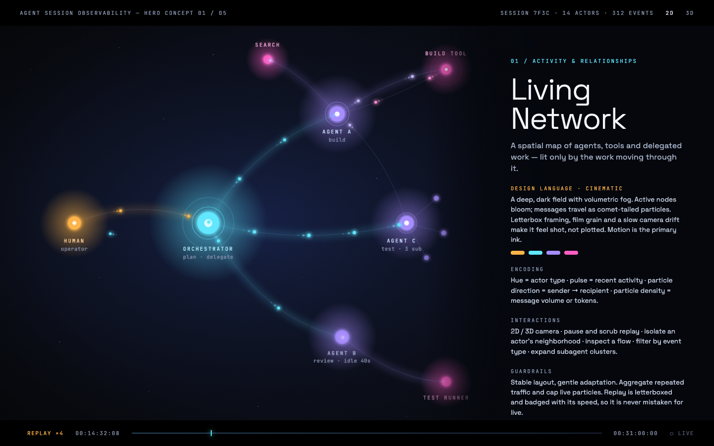
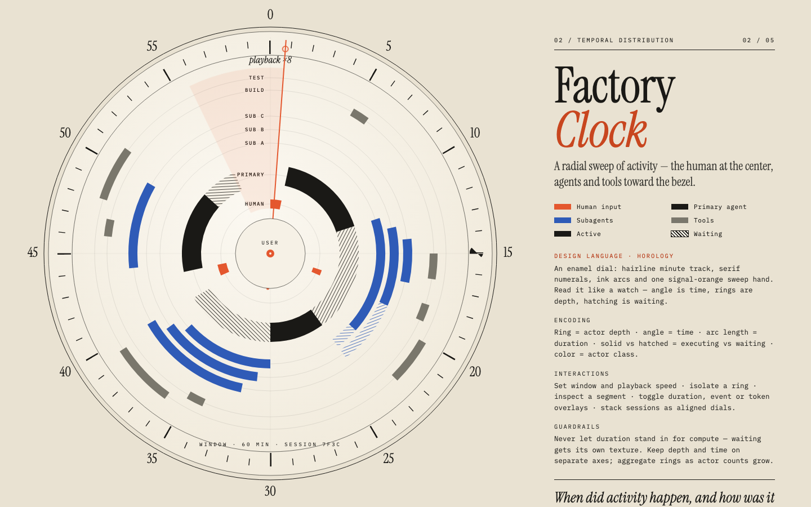
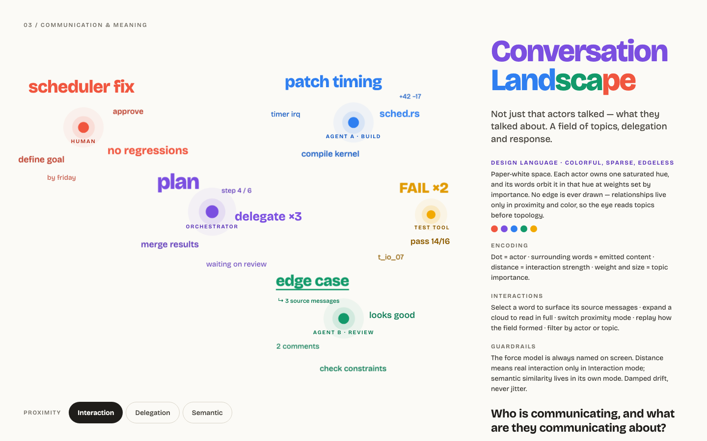
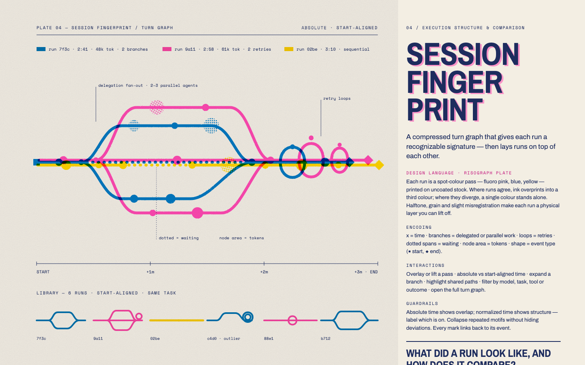
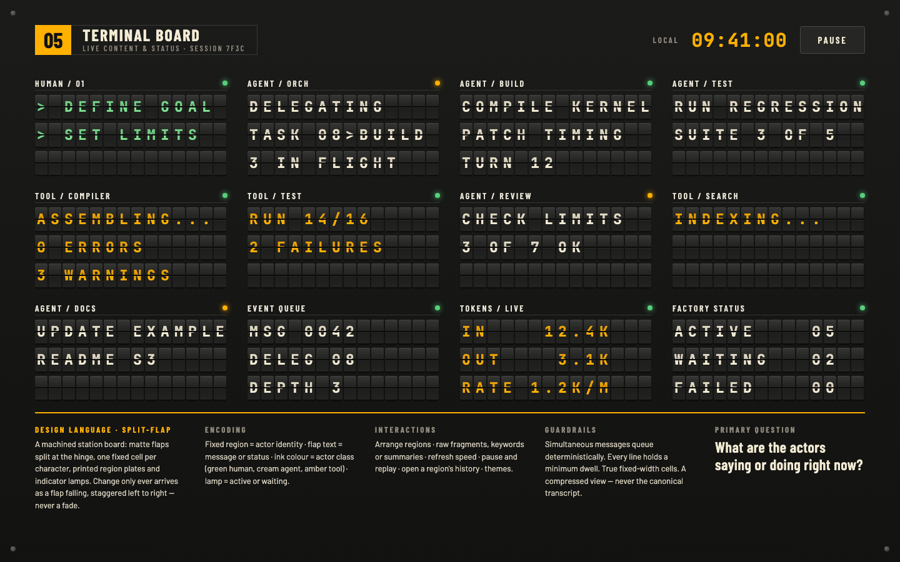

# Design: visualization explorer

Status: **accepted** (2026-11-03; decisions confirmed the same day). The visualization part of [phase 7](trusted-advisor.md#phases) of the advisor design, and the "visualizing sessions" half of the [prototype task](../roadmap.md#planned-tasks) in the roadmap. Steps 1–5 are built (2026-11-03); where the build differed from the text, the [implementation notes](#implementation-notes) at the end say how. Step 6 has built [every view this document names, and thirteen more](#built-so-far) from the proposal's tables; the rest of the proposal remains a catalog to draw from. Step 7, five [hero visualizations](#hero-visualizations) with their own design languages, has its design language facet in; the views aren't started.

## Summary

The Sessions tab shows one session two ways: a turn tree (icicle) above a context timeline. Those were the first two of many possible views, and the roadmap planned to try alternatives as throwaway pages over exported history. This design puts the comparison inside Snagboat instead: an **Explore** tab in the detail view holds a horizontal carousel of *visualizers*. Every visualizer takes the same input, one or more sessions, and draws them its own way, and every one declares **tags** that place it in a small taxonomy (what kind of question it answers, whether it informs or expresses, what level it works at, and which dimensions it highlights). A floating **puck** in a corner of the page names the visualizer you're looking at, lists its tags, and lets you narrow the carousel to visualizers with the tags you pick.

The two existing views move into the carousel as its first two visualizers, so the explorer starts with real content and the Sessions tab stops owning them. The tab is labeled experimental: it's a place to try views and compare them on real data, and whatever earns its keep later moves into the Sessions tab or replaces it.

## Problems this addresses

1. **Comparing views needs the same data in front of you.** Throwaway pages over a fixture each reinvent loading, colors, and tooltips, and never see a live session. Inside the detail view a new visualizer is one file, and gets the sessions, the theme, and the helpers for free.
2. **Only one session at a time.** Every question across sessions ("which of this week's sessions was the costly one", "does context fill up the same way each time") has no view today. The explorer's contract is a *list* of sessions from the start.
3. **No vocabulary for what a view is for.** Without one, the set of views grows by whim. Tags make the choice explicit (temporal versus quantitative, informative versus expressive, one session versus a project), show gaps in the set, and give the puck something to filter on.

## Goals

- One contract for visualizers: a list of sessions in, a rendering out, plus declared tags.
- The turn tree and the context timeline ported to that contract, with the Sessions tab drawing them through the same code.
- A carousel to move between visualizers, and a puck to see and filter by tags.
- Two or three new visualizers that take several sessions, to prove the contract and the taxonomy on more than the two views that shaped them.
- The same rules as the rest of the page: plain DOM and SVG, no framework, no dependencies, `textContent` only, nonce CSP, both themes.

## Non-goals

- Replacing the Sessions tab. The explorer is experimental; promotion is a later decision.
- New data. Visualizers draw what `SessionView` already carries. A view that needs a new field proposes it in its own change.
- The preferences prototype (the other half of the roadmap task). It stays separate.
- Screenshots for vision models and the presentation review's checks over the explorer (phase 7, later).
- A hosted service of any kind. The web demo is a static page that reads files you choose and sends nothing.

## The visualizer contract

A visualizer is a plain script in `media/viz/` that registers itself:

```js
window.snagboatViz.register({
  id: 'turn-tree',
  title: 'Turn tree',
  description: 'Where the tokens went: by prompt, then agent, then tool category.',
  tags: { category: ['quantitative', 'actor'], purpose: ['informative'], level: ['session', 'project'], dimension: ['quantity', 'actor', 'hierarchy'], language: ['standard'] },
  mount(host, ctx) {
    // Build the DOM once under host. ctx has the shared helpers (el, svg, compact, fmt, tooltip, ...),
    // and ctx.select(selection) to announce a selection.
    return {
      update(sessions, selection) {}, // Redraw for these SessionViews and the shared selection.
      resize() {},                     // The slide's width changed.
      destroy() {},
    };
  },
});
```

- **Input** is `SessionView[]`, exactly what `buildSessionView` produces per session today, so every visualizer sees prompts, calls, compactions, subagents, marks, findings, and the tree.
- **Selection** is shared across the carousel: `{ sessionId?, turnId?, range?: [fromMs, toMs] }`. Moving from the turn tree to the timeline keeps the turn you clicked; a visualizer may ignore it. This is what makes the carousel an explorer rather than a slideshow.
- **Catalog and tags live in TypeScript**, in `src/ui/visualizers.ts`: the taxonomy (facets and their vocabularies) and one catalog entry per visualizer (id, title, description, tags). The extension sends them to the page with the sessions. The registry in the page matches each catalog entry to a registered renderer by id and lists any mismatch in the puck, so a visualizer with no catalog entry, or an entry with an unknown tag, is caught in unit tests, not on screen. The JS side keeps `title` and `tags` only as a convenience for reading the file; the catalog wins.
- **Drawing rules** come from the rest of the page: the theme variables in `detail.css`, the five category colors and two turn shades from the turn tree, and the series colors of the daily chart. A visualizer that needs a new color adds it to the validated set in `detail.css`, not inline.

### Taxonomy

Five facets. Values within a facet are not mutually exclusive: a visualizer gives one or more per facet, and every facet must be given, so filters never silently miss a visualizer.

**Category**: the kind of question the visualization answers.

| Value | Question |
| --- | --- |
| `temporal` | When did something happen, and for how long? |
| `actor` (actor / topology) | Who interacted with whom? |
| `conversational` | What was communicated, and in what sequence? |
| `dependency` (dependency / causality) | What depended on what? |
| `quantitative` | How much, how often, how expensive? |
| `state` (state / process) | What state was the system in, and how did it change? |
| `semantic` (semantic / conceptual) | What was the content about, and how did ideas relate? |

**Purpose**: what the visualization is designed for.

| Value | Designed primarily to |
| --- | --- |
| `informative` | communicate precise information, support inspection, or enable diagnosis |
| `expressive` | communicate patterns, scale, complexity, activity, or structure through an engaging visual |

**Level**: what the visualization works over. Only these two for now; other levels (a turn, a day, all workspaces) can come later.

| Value | Meaning |
| --- | --- |
| `session` | One continuous conversation or workflow |
| `project` | Multiple sessions within a project (a workspace) |

`level` also tells the carousel how to hand a visualizer the sessions picked. A `session`-only visualizer gets them one at a time: the slide stacks one drawing per session, each under a header with the session's name, so three sessions picked are three context timelines down the slide. A `project` visualizer gets the whole list, and with a single session picked it draws that one without complaint. A visualizer tagged both decides for itself (the turn tree draws a forest).

**Dimension**: the dimensions the visualization highlights. Not a strict or scientific list; it changes as views are added, and that's the facet where new values are expected first.

`time`, `actor` (human, agent, tool), `hierarchy`, `dependency`, `communication`, `quantity` (cost), `content` (what was said; added with prompt terms)

**Design language**: the looks a visualization supports. Added for [step 7](#design-language-facet); every view so far is `standard`.

The first visualizers, tagged:

| Visualizer | category | purpose | level | dimension |
| --- | --- | --- | --- | --- |
| Turn tree (ported) | quantitative, actor | informative | session, project | quantity, actor, hierarchy |
| Context timeline (ported) | temporal, quantitative, state | informative | session | time, quantity |
| Session strips (new) | temporal, state | expressive, informative | project | time |
| Cost per prompt (new; deferred from the [conversation view](conversation-view.md)) | quantitative, conversational | informative | session, project | quantity, actor |
| Context fill (new) | state, quantitative | expressive, informative | project | time, quantity |

None of the first five is `semantic` or `dependency`, and none highlights `communication`. The views that fill those gaps come from the [visualization proposal](agent_conversation_visualization_design_proposal.docx), which lists candidates per category (see [More visualizers](#more-visualizers-from-the-proposal)); the first `semantic` view needs prompt text, so it depends on text capture being on. The proposal's categories are this taxonomy's `category` facet, and its informative, expressive, and hybrid purposes map onto `purpose`, with hybrid meaning both values.

## The Explore tab

A fourth tab after Suggestions, labeled **Explore (experimental)**. Its parts, top to bottom:

- **Session picker.** Every retained session in one scrolling list, newest start first, with the Sessions tab's rows and a checkbox each, and no day filter, so sessions from different days can be compared; **Load** sends the picked ids to the extension. Up to 8 sessions, since every `SessionView` carries all of a session's calls and prompts. The session open in the Sessions tab is pre-checked the first time, so "explore this session" is one click.
- **Carousel.** One slide per visualizer in the catalog's order, each the full width of the page, in a horizontally scrolling strip with scroll snapping. Previous and Next buttons, the arrow keys when the strip has focus, and a row of dots that name each slide. The strip takes the height left in the window (at least 320px) so the controls under it stay in view; a drawing taller than that scrolls inside its slide, under the slide's header. Only the current slide and its two neighbors are mounted and updated, so a slow visualizer doesn't slow the page while it's offscreen. The current slide is whichever an `IntersectionObserver` reports as mostly visible.
- **Slide.** The visualizer's title and description as a header, then its host element. For a `session`-only visualizer the carousel mounts one instance per picked session, stacked, each under the session's name; a `project` visualizer gets one instance with every session. No slide ever says it can't draw.
- **Puck.** A floating rounded rectangle fixed to a corner of the window (bottom-right until moved), above the tooltip layer. It shows the current visualizer's title, description, and tags as chips grouped by facet (category, purpose, level, dimension), with the chips of every facet value in the catalog shown dimmed so the whole vocabulary is visible. Clicking a chip toggles it as a filter: within a facet, picked values are ORed; across facets, ANDed. Slides that don't match leave the carousel, the dots and count follow, and if the current slide leaves, the carousel moves to the nearest that stays. A **Clear** link resets filters, and a collapse button shrinks the puck to a small circle with its title so it doesn't cover a chart; it starts that way. Dragging its head (the whole circle when collapsed) drops it in the corner of the quadrant it's let go in, and the arrow keys do the same from its toggle. The carousel's controls stand on the side away from it and draw above it.

**State:** the picked session ids, the current visualizer, the filters, whether the puck is collapsed and which corner it's in, and the shared selection persist in the webview's state, as the other tabs' state does, so the tab reopens where you left it.

**Updates:** the picked sessions are loaded when you press Load, and the extension keeps them current from live events exactly as it does the Sessions tab's open session (each session gets its own replay for past findings, so loading 8 sessions costs 8 replays, once). The page redraws the current slide on each push, debounced as the rest of the page is.

### Extension side

- `SessionController` grows from one open session to a small set: `open(sessionId)` stays for the Sessions tab, and `explore(sessionIds)` loads the rest the same way (read from the days' files once, then `ingest` keeps them current). The Sessions tab's open session is always a member, so the two tabs share one copy.
- `ExplorerState` (`src/ui/explorerModel.ts`, vscode-free): `{ taxonomy, catalog, sessions: SessionView[], notLoaded: string[] }`, built from the controller and sent whole on the `explorer` message, the way `sessions` and `session` are today.
- Messages: `tab: 'explore'`, `explore: { sessionIds }`, and `closeExplorer`. `isDetailMessage` gains the three cases; `DetailTab` gains `'explore'`; `navigate` learns the tab.
- Unit tests: the catalog conforms to the taxonomy (every facet given, every value in the vocabulary, ids unique); `ExplorerState` carries the sessions in the order picked and names the ones no longer retained; the controller keeps the Sessions tab's session when the explore set changes.

## Porting the turn tree and the context timeline

Both become visualizer modules, `media/viz/turnTree.js` and `media/viz/contextTimeline.js`, and `sessions.js` draws them through the same `mount`/`update` interface with its own selection state (`focusId`, `selectedTurn`, `zoom`, `expanded`) mapped onto the shared selection. The Sessions tab's behaviors move with them: click to zoom, the breadcrumb (driven by the selection the tree emits), prompt rules selecting a turn, drag to zoom when expanded. `expanded` becomes an option the Sessions tab passes and the explorer doesn't.

The multi-session turn tree is the one real change: with several sessions, the root is a `sessions` node whose children are the sessions' trees, widths by tokens, labeled with the session's name or short id, so the same zoom-by-click compares sessions at the top level and drills into one below. `buildSessionView` is unchanged; the forest is assembled in the visualizer.

The context timeline stays at the `session` level in this phase, so with several sessions picked the carousel stacks one timeline per session, each on its own time axis. A shared axis across sessions is the **context fill** visualizer's job in the list above (by call sequence, where sessions line up; the clock-time version is the session strips).

The alternative, copying the two renderers into the explorer and leaving `sessions.js` alone, was considered and set aside: the explorer is where the views will change next, and two copies would drift the week after. The cost is that the Sessions tab is touched, and its look is checked by hand (there are no unit tests over `media/`).

## New visualizers

Three, chosen because `SessionView` already has everything they need and together they exercise the `project` level, the `expressive` purpose, and the `state` category:

- **Session strips.** One row per session, x is clock time over the union of their spans, each turn a block (two alternating shades, as the tree), compactions as ticks, findings as the badges the timeline uses. Hover gives the turn's prompt text and tokens; click selects the turn. Answers "what happened when, across sessions", and shows idle gaps, which the tree can't.
- **Cost per prompt.** One column per turn, tokens stacked by agent (main, subagents) or by tool category, sessions side by side as small multiples with a shared y axis. Answers "which prompts were expensive", the view deferred by the conversation view; its mockup generator is still in `docs/design/images/generate_mockups.py`.
- **Context fill.** Context size per main-agent call, x is the call's index, one line per session, compactions marked, each model's largest-seen and limit as the timeline draws them. Sessions line up by progress rather than clock, so their shapes compare.

Each follows the [dataviz](#references) rules the existing charts follow: one axis, categorical hues in fixed order, a legend for two or more series, a hover layer, and the theme's colors.

## A web demo on GitHub Pages

The visualizers should also run on a static page attached to the repository, so they can be shown without installing the extension, over synthetic sessions by default, and over a person's own Snagboat data loaded from their disk into the browser without anything leaving it. The page is files only: HTML, CSS, and scripts served by GitHub Pages, with no server of Snagboat's behind it.

The same scripts then run in two places, the detail view's webview inside VS Code and an ordinary browser tab. The two differ only in where sessions come from and where a little state is kept.

**What's shared.** Three layers, two of which already have no VS Code in them:

| Layer | Where | In the webview | On the page |
| --- | --- | --- | --- |
| Visualizers (`media/viz/*.js`) and the carousel and puck (`media/explore.js`) | Plain scripts; they see only `ctx` (the helpers, the tooltip, `select`) and the source object below | As today, via script tags | Copied as-is into the site |
| The session model: `buildSessionView`, `SessionIndex`, `contextSize`, the catalog and taxonomy, `FindingReplay` with the built-in heuristics and their default settings | TypeScript under `src/core`, `src/ui`, `src/heuristics`, none of it importing `vscode` or `fs` | In the extension process | Bundled by esbuild (`platform: 'browser'`, a second entry `src/web/main.ts`) into one script the page loads |
| The source: where sessions come from and where state is kept | `media/explore.js` talks to a small source object: `listSessions()`, `loadSessions(ids)`, `getState()`, `setState()` | `postMessage` to the extension, `vscode.getState` | An in-browser index built from loaded files, `localStorage` for the small state |

The parts that touch disk (`EventLog`, `ContextLimits`, `RuleStore`, the adapters' tailers) stay out of the bundle. The page replaces them with a reader of `File` objects, builds context marks in memory from the events it loaded (largest seen always; a limit only where an auto-compaction or context error was seen), and uses the heuristics' defaults rather than anyone's settings.

**Loading your own data.** A file input and a drop zone take the daily files Snagboat writes, `events/YYYY-MM-DD.jsonl` under the workspace's storage folder (a **Snagboat: Reveal Event Log Folder** command makes that folder easy to find; an export command would be the same thing with a nicer name). The page parses them with `FileReader`, builds the session index and views, and holds everything in memory only: nothing is fetched, posted, or stored, and reloading the page starts empty. A later option is loading raw Claude Code transcripts the same way, since the adapter's normalizer is also VS Code-free; it isn't needed to start.

**The promise, and how it's kept.** The page's `<meta http-equiv="Content-Security-Policy">` sets `default-src 'self'` and `connect-src 'none'`, so a script can't make a network request even by mistake; there is no analytics, no service worker, and no third-party script. [PRIVACY.md](../../PRIVACY.md) gets a paragraph saying the demo page reads files you choose, in your browser, and sends nothing. GitHub still sees the page request itself, as for any site, but none of the loaded data. Prompt text in loaded files is in page memory for as long as the tab is open, like in the webview.

**Synthetic data.** With nothing loaded the page shows a few generated sessions, produced by a small generator in `src/web/` that the wireframe's generator becomes, labeled as examples. The redacted transcript fixture in `src/test/fixtures` is a candidate for a realistic one once transcript loading exists.

**Build and deploy.** A `pages.yml` workflow (`actions/configure-pages`, `upload-pages-artifact`, `deploy-pages`) runs `npm run build:web`, which bundles the entry and copies `media/viz/`, `media/explore.js`, the stylesheet, and `web/index.html` into `out/web/`. Nothing generated is committed. The stylesheet is `detail.css` itself: it reads VS Code's `--vscode-*` variables, so the page defines those variables for light and dark (from `prefers-color-scheme`) and the same CSS draws the same charts.

**What it costs.** Nothing to run: there is no server. The cost is in upkeep, since the same scripts now have to work in two places, the webview and a browser tab, and a change made with one in mind can break the other. The bundle build type-checks the model code, and the webview is checked by hand as before; a page that breaks shows up when the workflow's build fails or when someone opens it, not in a unit test. Keeping the visualizers ignorant of where they run (no `acquireVsCodeApi`, no `postMessage`, nothing but `ctx` and the source object) is the rule that keeps this cheap, and it's the same rule the catalog already imposes.

## Steps

1. **Model and catalog — done.** `src/ui/visualizers.ts` (taxonomy and catalog), `src/ui/explorerModel.ts`, the controller's session set, the messages, and their unit tests. Nothing visible yet.
2. **Explore tab — done.** `media/explore.js` (tab, picker, carousel, puck, registry, behind the source object) and the two ported visualizers under `media/viz/`, with `sessions.js` drawing through them. Checked by hand in both themes: the Sessions tab looks and behaves as before, and the explorer shows the same two views for the same session.
3. **New visualizers — done.** Session strips, cost per prompt, and context fill, one at a time, each a file under `media/viz/` and a catalog entry.
4. **Web demo — done.** The browser bundle, the page with its file loader and synthetic sessions, the Pages workflow, the Reveal Event Log Folder command, and the PRIVACY.md paragraph. It can start as soon as step 2 is in, in parallel with step 3.
5. **Docs — done.** A section in [usage.md](../usage.md), the detail webview paragraph in [architecture.md](../architecture.md), a link to the demo from the README, and the roadmap entry marked done; this document gains implementation notes where the build differed.

6. **More visualizers, from the proposal.** After step 5, more views are added starting with the ones listed per category in the [visualization proposal](agent_conversation_visualization_design_proposal.docx) (see below). Each is its own change: a file under `media/viz/`, a catalog entry, and a note here. None is built before step 5.
7. **Hero visualizations — in progress.** First the [shared foundations](#shared-foundations), each its own change: the design language facet (done), shared replay (done), shared force layout (done), and demo traces (the tool and the page are done; the traces wait for review). Then five views that each carry a design language, one per change, last in the carousel. See [Hero visualizations](#hero-visualizations).

Steps 1 and 2 are one pull request (the tab is empty without the catalog); the rest follow as the views land.

## More visualizers, from the proposal

The [visualization proposal](agent_conversation_visualization_design_proposal.docx) (in `docs/design/`, 2026-11-03) is the catalog of views to consider, organized by the seven categories of the `category` facet, each view marked informative, expressive, or hybrid. Step 6 works from it. Its closing recommendation names the most useful initial set, which is the order to start in, after the five in this design:

| From the proposal | category | purpose | What Snagboat has for it |
| --- | --- | --- | --- |
| Gantt or trace waterfall | temporal | informative | Turns, calls, subagent spans, tool calls with timestamps; waiting time is visible once [phase 8](trusted-advisor.md#phases) labels quiet gaps |
| Sequence diagram | conversational | informative | Prompts, replies, tool calls and results, subagent starts and ends, per turn |
| Actor interaction graph (force-directed, Sankey, or adjacency matrix) | actor | hybrid | Human, main agent, subagents, tools, models; edges typed as delegation, tool call, or message, as the proposal insists |
| Event or dependency graph | dependency, conversational | hybrid | Event order and turn membership today; dependency edges need links from tool calls to the model call that requested them, which not every source gives, so inferred edges are drawn as inferred |
| Treemap of tokens or cost | quantitative | hybrid | The turn tree's data, by another layout |
| Heatmap of aggregate patterns | quantitative, temporal | hybrid | Sessions by hour, tool by category, findings by heuristic and day, at the `project` level |

Four views named in earlier drafts of this design belong in step 6 too. Two are in the proposal's tables already: a **treemap of tokens by tool category across sessions** is its treemap, and an **agent-and-subagent graph** of who delegated to whom is its hierarchical tree or force-directed graph with delegation edges. Two are not, and are added here: a **tool-call ribbon** showing which tool category followed which within turns (dependency, conversational / hybrid / session / dependency, communication), nearest to the proposal's alluvial diagram but over transitions rather than stages, and the **week-in-one-picture** from the advisor's [abilities](trusted-advisor.md#abilities) (temporal, quantitative / expressive / project / time, quantity), nearest to its calendar heatmap but one picture of a week's sessions by day and hour, with tokens and findings, rather than a longer-period grid. Findings by heuristic and day, also from an earlier draft, is the heatmap row above.

### Built so far

These four were taken ahead of the order above, because each fills a gap in the taxonomy: no view was `semantic` or `dependency`, `actor` and `conversational` were only secondary tags, and nothing highlighted `communication`.

| Visualizer | category | purpose | level | dimension |
| --- | --- | --- | --- | --- |
| Sequence diagram | conversational, actor | informative | session | communication, actor, time |
| Event graph | dependency, conversational | expressive, informative | session | dependency, communication |
| Actor graph | actor | expressive, informative | session, project | actor, communication, quantity |
| Prompt terms | semantic | expressive | session, project | content |

They needed `SessionView` to carry each tool call (name, category, status; never its target or arguments) and each model call's reply excerpt.

#### Later additions

From the recommended order and the views named in earlier drafts, then the views in the proposal's tables that `SessionView` can already feed, each its own pull request:

| Visualizer | category | purpose | level | dimension |
| --- | --- | --- | --- | --- |
| Gantt and waterfall | temporal | informative | session | time, actor, hierarchy |
| Treemap | quantitative | expressive, informative | session, project | quantity, hierarchy |
| Heatmap | quantitative, temporal | expressive, informative | project | quantity, time |
| Tool-call ribbon | dependency, conversational | expressive, informative | session | dependency, communication |
| Week in one picture | temporal, quantitative | expressive | project | time, quantity |
| Histogram | quantitative | informative | session, project | quantity |
| Box and violin | quantitative | informative | project | quantity |
| Ridgeline | quantitative | expressive, informative | project | quantity |
| Scatter plot | quantitative | informative | session, project | quantity, time |
| Bubble chart | quantitative | expressive, informative | project | quantity, time |
| Sunburst | quantitative | expressive | session, project | quantity, hierarchy, actor |
| Calendar heatmap | temporal, quantitative | expressive, informative | project | time, quantity |
| Radar | quantitative | expressive | session, project | quantity, actor |
| Parallel coordinates | quantitative | informative | session, project | quantity, time |
| Streamgraph | temporal, quantitative | expressive | session | time, quantity, actor |
| Sankey | actor, quantitative | expressive, informative | session, project | quantity, actor |
| Adjacency matrix | actor | informative | session, project | actor, communication, quantity |
| Swimlane | conversational, actor | informative, expressive | session | communication, actor |
<!-- rows -->

**Gantt and waterfall** draws both forms named in the proposal behind one toggle. Events have no durations, so a bar is the span from a turn's or agent's first event to its last, and calls are ticks. Waiting isn't told apart from working until [phase 8](trusted-advisor.md#phases) labels quiet gaps, and the view's note says so. The waterfall's selected turn gets its own chart rather than zooming the first, so the session's shape stays in view while reading one turn.

**Week in one picture** counts the loaded sessions, not the whole week, because the explorer's contract is the picked sessions; the cap of eight applies, and the note says so. The rings give outer days more area than inner ones, so color rather than size carries the value, and a table carries the numbers. With the agent-and-subagent graph covered by the actor graph, every view this document names is now built.

The distribution and comparison views share helpers in `media/shared.js`, which reach a visualizer through `ctx`: per-turn numbers (`turnStats`), the measurements (`METRICS`, `metricValues`), `quantile` and `density`, `heatScale`, `modeButtons`, and the slide's layout (`vizPanel`).

### What comes next

The rest of the proposal's tables stay a catalog to consider, none planned yet. Those left mostly need something `SessionView` doesn't have: the dependency views need links between events and what they produced, the state views need states someone has defined, and the semantic views need derived data. Three of its guidelines are already in this design and should hold for every view added: preserve event identity (the shared selection), separate observed from inferred (the turn tree's ≈ and hatching), and make expressive views lead to the underlying events rather than end in a picture. Its cross-cutting encodings (node size, edge thickness, typed edges, glow for an active agent) are the vocabulary for the graph views when they come. Semantic views depend on derived representations, embeddings or model labels, which Snagboat doesn't produce; they wait on the advisor, and on a decision about what derived data to keep. Prompt terms doesn't change that: it counts words in the page at draw time and keeps nothing, and it says it's word counts rather than a model's reading.

## Hero visualizations

Added 2026-11-04 from two sources, neither part of the proposal: the [concept pages](agent_visualization_concept_pages.pdf) (in `docs/design/`), one page per view with its purpose, visual model, encoding, interactions, and guardrails over a simple diagram; and a design canvas, which gives each concept a design language in a 1440×900 mockup, shown below. ChatGPT (gpt-6) contributed to the design: it generated the concept pages. **Where they differ, the concept pages say what a view shows and the canvas says how it looks.** The differences are listed per view below.

The views in step 6 answer a question in the page's shared look; a hero view also has a look of its own, chosen to suit its question, and is meant to be the view you show someone. They go last in the carousel.

The tags below are approved, and go in the catalog when each view is built. "Hero" isn't itself a tag; what sets these views apart is the new [design language](#design-language-facet) facet.

| Hero view | Question | language | category | purpose | level | dimension |
| --- | --- | --- | --- | --- | --- | --- |
| Living Network | What is happening across the system, and how is work moving? | `cinematic` | actor, temporal | expressive | session | actor, communication, time |
| Factory Clock | When did activity happen, and how was it distributed? | `horology` | temporal | expressive, informative | session | time, actor, hierarchy |
| Conversation Landscape | Who is communicating, and what are they communicating about? | `edgeless` | semantic, conversational, actor | expressive | session | content, actor, communication |
| Session Fingerprint | What did a run look like, and how does it compare? | `risograph` | dependency, temporal | expressive, informative | session, project | time, hierarchy, dependency, quantity |
| Terminal Board | What are the actors saying or doing right now? | `split-flap` | conversational, state | expressive | session | communication, actor, content |

### Shared foundations

Four things are built once, before the views that need them, plus defaults for the limits.

#### Design language facet

A fifth facet, `language`, says which design languages a visualizer supports, and the puck filters by it the way it filters by the other four: OR within the facet, AND across facets. It's a list, like every other facet, so a view can support several later; each supports one for now.

| Value | Meaning | Visualizers |
| --- | --- | --- |
| `standard` | The page's shared look: theme variables, validated colors, both themes | The existing 27 |
| `cinematic`, `horology`, `edgeless`, `risograph`, `split-flap` | One hero view's look, with its own ground and palette | One hero view each, added to the vocabulary with that view, so the puck never offers a chip that matches nothing |

- **Colors.** `standard` is the only value that follows the VS Code theme. Any other language draws its own ground and palette in either theme, keeps its colors in variables scoped to the view in `detail.css`, and still meets the contrast checks. This is the one exception to the [drawing rules](#the-visualizer-contract).
- **Fonts.** System font stacks for now, chosen per language to come close to the typefaces named below (a serif for `horology`, a monospace for `split-flap`'s cells). Those names are the target for a later change, which would have to ship font files and add `font-src` to both CSPs. The mockups' look depends partly on them, so expect the first builds to look plainer than the images.
- **The catalog.** Every facet must be given, so the facet landed with `standard` on all 27 existing entries, the taxonomy and unit test updated, before any hero view.

#### Shared replay

Four views need playback and Session Fingerprint needs the same handling of time, so replay is one helper in `media/shared.js`, reached through `ctx`, rather than one per view.

- **The clock.** It merges a session's prompts, calls, tools, and compactions in timestamp order, with a fixed tie-break, so a replay always runs the same way. Views read the current position from it and keep no timers of their own.
- **The controls.** One bar: play and pause, scrub, speed, and a badge naming what's on screen, `LIVE` or `REPLAY ×4`, so replay is never mistaken for live.
- **Live.** When an update brings new events and the clock is at the end, it stays at the end. Scrubbing back leaves live until you return. The web demo is always replay.
- **Stopping.** The contract gains an optional `setActive(active)` on instances, so the carousel can stop a slide when it isn't the current one, even though its neighbors stay mounted. With `prefers-reduced-motion`, a view opens on its final state and doesn't autoplay; scrubbing still works.

Terminal Board's queue and minimum dwell sit on top of the clock, in the view.

**As built.** `ctx.createReplay({ onFrame })` returns the clock and `ctx.replayBar(clock)` its bar; `ctx.replayEvents(sessions)` is the merged list on its own. Within one timestamp the order is prompt, compaction, model call, tool call, then session order and position in the session. Speeds are ×1, ×10, ×60 (the default), and ×600 of session time, and a quiet stretch longer than 1.5 seconds of playback is cut to 0.4 seconds, which the bar says while playing; without that, a session with a lunch break in it plays mostly nothing. A finished session opens at its start and plays the first time its slide is current; a live one (last event under ten minutes old) opens at its end. The carousel calls `setActive(false)` on the current slide's neighbors and on every slide while the Explore tab is hidden (`snagboatExplore.hidden()`, called by the detail view's tab switch). The clock is tested in Node (`heroShared.unit.test.ts`) over the synthetic sessions.

#### Shared force layout

Living Network and Conversation Landscape both need a force layout and no view has one, since the actor graph uses fixed columns. It's a small hand-written helper in `media/shared.js`, with no dependencies.

- **Stable.** Starting positions come from actor ids rather than randomness, so one session always gets the same picture. It settles before drawing, and an update starts from the current positions, so nodes move gently. Any ambient drift is decoration on top, and doesn't change the positions.
- **Named.** The caller passes the weights (interaction counts, delegation), and the view says on screen which model is on.

**As built.** `ctx.forceLayout(nodes, links, { width, height, previous })` returns a map of positions inside the box. A node starts at an angle and distance taken from a hash of its id (`ctx.hashId`, FNV-1a), so neither input order nor chance moves it; each step pushes every pair apart, pulls linked ends to a rest length that shortens as the link gets heavier, pulls gently to the center, and separates nodes that overlap by their radii. A cold layout runs 300 steps; with `previous`, known nodes start where they were, a new node starts beside a neighbor that has a position, and it runs 100 gentler steps. A node can be pinned. `ctx.drift(id, t, amplitude)` is the decoration: a small smooth offset, the same for the same id, applied when drawing and never fed back into the layout. Every pair is compared, which is fine for the few dozen nodes these views draw after folding.

#### Demo data

The web demo's four example sessions were written for the first views, and these views need more to be judged fairly: several subagents working in parallel, failures followed by retries, several runs of comparable work for Session Fingerprint, and prompts and replies with enough text for Conversation Landscape and Terminal Board. The demo will use a set of traces chosen for this rather than more generated sessions; which traces is still to come. No real prompt text goes in unreviewed.

**As built.** The traces come from Snagboat's own event logs for two workspaces, this repository and another project of the owner's (chosen 2026-11-05). `npm run demo:traces -- --events <dir> … --session <id> …` (`src/scripts/demoTraces.ts`) keeps only the named sessions and only the fields the session views read: shell-command and file targets and the raw source reference (a path) are dropped, ids are renumbered, the home folder in text becomes `~`, and secrets are redacted again. Prompts, reply excerpts, and session names stay as written, so the tool also writes a review report listing every piece of text, with lines that hold an address, URL, path, long token-like string, or similar flagged first. It writes `web/demo/traces.js`, a script rather than a data file because the page's CSP forbids fetching; `scripts/webDemo.js` adds it to the page only when it exists. The page opens on the traces when it has them and offers the generated sessions beside them, which stay for the unit tests and for builds without traces. **The traces file is committed only after the owner has read the report.** The first set is six sessions: two with parallel subagents, three comparable milestone runs from the other project (one with a dozen failed tool calls, one with subagents), and one with long prompts.

#### Default limits

Each limit is a named constant at the top of the view's file, with a chosen default, tuned on the longest real session available and recorded in the view's note. They start from what's already drawn:

| Limit | Starting default | From |
| --- | --- | --- |
| Subagent nodes, before folding into "+N" | 12 | The actor graph's `MAX_SUBAGENTS` |
| Overprinted runs, with the rest in the library row | 3 | The Session Fingerprint mockup |
| Board regions, with the rest folded | 12 | The Terminal Board mockup |
| Words per actor | 5 | The Conversation Landscape mockup |
| Tool rings, before an "other" ring | 2 | The Factory Clock mockup |
| Live particles | Chosen when built | No precedent; depends on what real traffic costs to draw |

#### Data these views wait for

Step 7 adds no fields to `SessionView`. Features that need data Snagboat doesn't have wait for it, and aren't approximated beyond what's noted per view:

| Waits for | What waits |
| --- | --- |
| [Phase 8](trusted-advisor.md#phases) labeling quiet gaps | True waiting versus working in Factory Clock and Session Fingerprint |
| A parent for each subagent | Nested subagent clusters in Living Network |
| Task identity and outcome for a session | Those two filters in Session Fingerprint |
| Derived data, embeddings or model labels | Conversation Landscape's semantic mode, and Terminal Board's summaries |

### Living Network

A spatial map of agents, tools, and delegated work, lit only by the work moving through it.



- **Why this view:** to make the software factory feel alive, and to show which actors are active, how work is delegated, and where messages and results travel.
- **Visual model:** agents, tools, and human participants occupy spatial nodes. Messages, delegations, and results travel between them as glowing particles or animated flows.
- **Design language:** a deep, dark field with volumetric fog. Active nodes bloom and messages travel as comet-tailed particles. Letterbox framing, film grain, and a slow camera drift make it feel shot rather than plotted. Motion is the primary ink.
- **Palette and type:** ground `#05070d`; human amber `#ffb347`, orchestrator cyan `#5ee7ff`, agents violet `#a68cff`, tools magenta `#ff5ec4`. Space Grotesk, with JetBrains Mono for labels.
- **Encoding:** hue is actor type, pulse is recent activity, particle direction is sender to recipient, particle density is message volume or tokens.
- **Interactions:** 2D or 3D camera, pause and scrub replay, isolate an actor's neighborhood, inspect a flow, filter by event type, expand subagent clusters.
- **Guardrails:** a stable layout that adapts gently. Repeated traffic is aggregated and live particles are capped. Replay is letterboxed and badged with its speed, so it's never mistaken for live.
- **What Snagboat has for it:** the actor graph's nodes and typed edges, and timestamps for replay. Delegation edges are inferred, as the actor graph already draws them. `SessionView` records no parent for a subagent, so every agent hangs off the main one until nesting has its data. Positions come from the [shared force layout](#shared-force-layout) and playback from the [shared replay](#shared-replay). A 3D camera has no precedent under the no-dependencies rule, so it comes after 2D, if at all.
- **As built** (`media/viz/livingNetwork.js`): SVG, a static layer (fog, grain, links, nodes) redrawn on update and resize, and a live layer of blooms and particles redrawn from the clock each frame. The particles in flight are every event within the last 0.9 seconds of playback, at most three per link (the rest grow the newest) and 48 in all, so they hold no state and pause, scrub, and reduced motion come free. Models aren't nodes, as they are in the actor graph: a node's second line names its model. Limits: 12 subagent nodes and 10 tool-category nodes, each folding the rest into one. Layout weights are the square root of each link's count, a subagent's tool links pull at a third of that so subagents ring the agent rather than knot in its middle, and you are pinned at the left; the note says so. Drift moves nodes only while playing. Tried on the longest demo session (811 events) and one with five subagents. Not built: 3D, expanding subagent clusters (no parent data), and inspecting a flow beyond its tooltip.

### Factory Clock

A radial sweep of activity, with the human at the center and agents and tools toward the bezel.



- **Why this view:** to show when work happened, how long it lasted, and how activity was distributed across the agent hierarchy, including parallel work.
- **Visual model:** angle is elapsed time, and one revolution is the selected time window. Concentric rings are actor depth: human interaction at the center, then the primary agent, subagents, and tools. A radial sweep advances through the event history.
- **Design language:** an enamel dial with a hairline minute track, serif numerals, ink arcs, and one signal-orange sweep hand. You read it like a watch: angle is time, rings are depth, hatching is waiting.
- **Palette and type:** dial `#fbf8f1` to `#efe8d8` on `#e9e2d2`; human and sweep hand orange `#e4572e`, primary agent ink `#1a1916`, subagents cobalt `#2f5bb7`, tools gray `#7a776c`. Instrument Serif, with IBM Plex Mono for labels.
- **Encoding:** ring is actor depth, angle is time, arc length is duration, solid or hatched is executing or waiting, color is actor class, intensity is activity volume. The concept page has intensity and the mockup doesn't; it's kept, since event counts can drive it.
- **Interactions:** set the window and playback speed, isolate a ring, inspect a segment, toggle duration, event count, or token overlays, compare sessions. The concept page compares in aligned layers and the mockup in stacked dials. Stacked dials are what the carousel already does for a `session`-level view, so they come first; layers would make this a `project` view too.
- **Guardrails:** duration never stands in for compute, so waiting gets its own texture. Depth and time stay on separate axes, and rings aggregate as the actor count grows.
- **What Snagboat has for it:** events have no durations, so as in the Gantt an arc is a span from first event to last. Waiting can't be told from working until [phase 8](trusted-advisor.md#phases) labels quiet gaps. Until then the hatching means "quiet gap", and the view's note says so, or the guardrail above doesn't hold. Tool rings are per tool name or category, with a cap and an "other" ring.

### Conversation Landscape

Not just that actors talked, but what they talked about: a field of topics, delegation, and response.



- **Why this view:** to show what communication was about, not only that it happened.
- **Visual model:** agents and tools are nodes in a force-directed graph, with short phrases or keyword clouds around the sending node. A recipient is drawn toward the node that delegated to it, and responses reinforce or reshape the relationship.
- **Design language:** paper-white space. Each actor owns one saturated hue, and its words orbit it in that hue at weights set by importance. No edge is ever drawn. Relationships live only in proximity and color, so the eye reads topics before topology. The concept page's diagram does draw edges; leaving them out is the canvas's choice of look, and the force model underneath is the same.
- **Palette and type:** ground `#fbfaf6`; `#f0563f`, `#7b4fe0`, `#2f7ff0`, `#12996a`, `#f2a900`, each with a darker shade for small text. Bricolage Grotesque.
- **Encoding:** a dot is an actor, surrounding words are what it emitted, distance is interaction strength, weight and size are topic importance.
- **Interactions:** select a word to surface its source messages, expand a cloud to read it in full, switch proximity mode (interaction, delegation, semantic), replay how the field formed, filter by actor or topic.
- **Guardrails:** the force model is always named on screen. Distance means real interaction only in interaction mode, and semantic similarity lives in its own mode. Drift is damped, never jitter. Original messages are preserved and one click away.
- **What Snagboat has for it:** prompt text and reply excerpts when text capture is on, and prompt terms' word counts as the measure of importance. Positions come from the [shared force layout](#shared-force-layout) and playback from the [shared replay](#shared-replay). Tools have no text, only names and statuses. Semantic mode needs the derived data [What comes next](#what-comes-next) says Snagboat doesn't keep, so it's left out at first, and the view says it's word counts, as prompt terms does. With text capture off there are no words, so the view shows the dots and says why.

### Session Fingerprint

A compressed turn graph that gives each run a recognizable signature, then lays runs on top of each other.



- **Why this view:** to compare runs and find differences in branching, retries, waiting, tool use, duration, and token spend.
- **Visual model:** underneath is a turn and event graph. Nodes are messages, tool calls, delegations, results, and terminal events, and edges are execution relationships. Branches show parallel work, loops show retries, and gaps or spans show waiting.
- **Design language:** each run is a spot-color pass (fluoro pink, blue, yellow) printed on uncoated stock. Where runs agree, the inks overprint into a third color; where they diverge, a single color stands alone. Halftone, grain, and slight misregistration make each run a physical layer you can lift off.
- **Palette and type:** stock `#f3eee3`, text navy `#1d2c5e`; passes blue `#0078bf`, pink `#ff48b0`, yellow `#ffd400`. Archivo Narrow and Archivo, with Space Mono for labels.
- **Encoding:** x is time, branches are delegated or parallel work, loops are retries, dotted spans are waiting, node area is tokens, shape is event type (square for start, diamond for end). The concept page uses color or shape for event type, and its diagram gives each run its own lane. The canvas spends color on the run and actually overprints, so event type falls to shape alone, and it needs more shapes than the mockup's two.
- **Interactions:** overlay or lift a pass, absolute or start-aligned time, expand a branch, highlight shared paths, filter by model, task, tool, or outcome, open the full turn graph.
- **Guardrails:** absolute time shows overlap and normalized time shows structure, so the view labels which is on. Repeated motifs collapse without hiding deviations. Every mark links back to its event, which here means the shared selection.
- **What Snagboat has for it:** turns, subagent spans, tokens, and tool status. The event graph already builds this kind of graph, with observed, inferred, and retry edges, so this view starts from its logic. Retries aren't recorded, so a loop is inferred and drawn as inferred. Waiting has the same phase 8 limit as the clock. Sessions have no task identity or outcome, so those two filters wait, and sessions are only comparable if you pick comparable ones. The mockup overprints three runs and shows the rest in a small library row beneath, which fits the explorer's cap of eight.
- **As built** (`media/viz/sessionFingerprint.js`): tagged `session` and `project`, so it gets every loaded session in one drawing. A turn is a circle at its prompt, sized by the square root of its tokens (halftone above 6px); start is a square, end a diamond, a compaction a triangle. A branch is a subagent's span on a lane of its own while spans overlap (six lanes, then they share). A loop is a failed tool call followed by the same tool, by the same agent, in the same turn, counted while the failures continue, and dashed. A quiet gap is over 10 minutes with nothing recorded. Four time modes: active (start-aligned, each quiet gap drawn as 2 minutes, the default, since real runs span hours with nights in them), elapsed, absolute, and normalized (the library always uses it). Passes blend by `multiply`, each nudged under a pixel off register by a hash of its run and its trunk set 6px from the next so agreement shows along the edges instead of piling into black. Yellow on the stock is under 2:1, so the yellow pass's strokes carry a darker edge. No replay: the clock's merged events are used for time only. Not built: expanding a branch, highlighting shared paths, and the model and tool filters; task and outcome filters wait for that data.

### Terminal Board

A fixed board with one region per actor, refreshing as events arrive.



- **Why this view:** to put communication itself on display. As on an airport or railway board, each actor has a known place, and new information visibly replaces old.
- **Visual model:** every agent and tool has a fixed rectangular region on a character grid. Words, phrases, status lines, and compact summaries from that actor appear only in its region, and the board's geometry never changes.
- **Design language:** a machined station board with matte flaps split at the hinge, one fixed cell per character, printed region plates, and indicator lamps. Change only ever arrives as a flap falling, staggered left to right, never a fade. The concept page allows flipping, scrolling, or overwriting and describes a plain ASCII grid; the flap is the canvas's choice, and the concept's "switch themes" interaction would make it one theme of several.
- **Palette and type:** ground `#1b1b1a` to `#121211`, flaps `#262624`; human green `#7be08f`, agents cream `#f2ead3`, tools amber `#ffb000`, active lamp `#56d07a`. JetBrains Mono for flaps, Barlow Condensed and Barlow for plates.
- **Encoding:** a fixed region is an actor's identity, flap text is a message or status, ink color is actor class (green human, cream agent, amber tool), a lamp is active or waiting, a replacement animation is a new event. Optional indicators show queue, tokens, and health.
- **Interactions:** arrange regions, choose raw fragments, keywords, or summaries, set refresh speed, pause and replay, open a region's history, themes.
- **Guardrails:** simultaneous messages behave deterministically (the concept page allows queueing, prioritizing, or aggregating; the canvas picks queueing). Every line holds a minimum dwell. Cells are truly fixed-width. It's a compressed view, never the canonical transcript.
- **What Snagboat has for it:** the extension pushes updates to loaded sessions, so a running session can drive the board live, and a finished one needs replay from its timestamps. A tool region can show a tool's name, category, and status only, because `SessionView` never carries targets or arguments. The mockup's file names, diff sizes, and test counts aren't available, and shouldn't be added for this. Agent regions show reply excerpts when text capture is on and model and tokens otherwise. Summaries need the advisor.

### What applies to all five

The mockups are specifications of the look and don't port directly. They're static images rendered from the canvas's artboards, so the motion they describe doesn't show, and Terminal Board shows its first frame. Their sample actors and numbers are illustrative, and their side panels are explanation: in the carousel, the puck and the slide header already carry the title, description, and tags, so the drawing gets the whole slide.

- **Same contract.** Each is a file under `media/viz/`, a catalog entry, a script tag, and a note here, with ids `living-network`, `factory-clock`, `conversation-landscape`, `session-fingerprint`, and `terminal-board`. It draws real `SessionView` data, knows nothing about where it runs, and works at any slide size rather than a fixed 1440×900, down to the carousel's 320px height.
- **Markup comes from `ctx`, styles from `detail.css`.** The webview's CSP has no `'unsafe-inline'` for styles and the page's has none either, so the mockups' `style` attributes and helmet stylesheets move into `detail.css`, under a class scoped to the view.
- **Fonts can't load as drawn.** Both CSPs are `default-src 'none'` with no `font-src`, and the web demo promises no network requests, so the mockups' Google Fonts won't load. Hence [system stacks for now](#design-language-facet).
- **Leading back to the events.** Every view takes part in the shared selection: clicking a mark selects its turn or session, as the proposal's guidelines require of expressive views.
- **Performance.** Blurs, grain, and blend modes are costly over many marks. Traffic is aggregated and particles capped from the start, and each view is tried on the longest real session available, not only on the demo data.

**Suggested order**, by how little each one waits on: Living Network (the actor graph's data is ready), Session Fingerprint, Conversation Landscape, Terminal Board, and Factory Clock last, since its main distinction is the one phase 8 provides.

## Decisions

Confirmed in review on 2026-11-03.

| Question | Decision |
| --- | --- |
| Where the explorer lives | A fourth tab, Explore (experimental), not inside the Sessions tab, so the Sessions tab keeps working while the explorer changes |
| Where tags are declared | In a TypeScript catalog, validated in unit tests; renderers in plain JS match by id |
| Facets | Values not mutually exclusive: category (the question answered), purpose (informative or expressive), level (session or project), dimension (what's highlighted; an open-ended list), and from 2026-11-05 design language (the looks it supports); every facet given by every visualizer (2026-11-03, replacing a first draft's subject, layout, time, scope, and grain) |
| Filter logic | OR within a facet, AND across facets |
| Porting the existing views | Moved into visualizer modules the Sessions tab also draws through, not copied |
| Many sessions in the turn tree | A root node with one child per session |
| Many sessions in the context timeline | Stacked, one per session, by the carousel's rule for `session`-level visualizers; a shared axis is context fill (by call sequence) or session strips (by clock) |
| A visualizer and the wrong number of sessions | Never refuses: `session`-level stacks one drawing per session, `project`-level draws one session as a list of one |
| How sessions reach the explorer | A picker on the tab (every session, newest start first, checkboxes, Load; no day filter), up to 8 sessions, kept live like the open session |
| Puck placement | Any corner, by drag or arrow keys; collapsible to a small circle; a rounded rectangle when expanded |
| A web demo | Yes, on GitHub Pages: the same visualizer scripts, the session model bundled for the browser, synthetic sessions by default, your own daily files loaded in the browser and never sent anywhere (CSP `connect-src 'none'`) |
| Hero visualizations | Planned as step 7 (2026-11-05), under the same contract, with the tags listed there; last in the carousel; no new `SessionView` fields, so features needing missing data wait |
| Design languages | A fifth facet listing the languages a visualizer supports, filterable in the puck; `standard` follows the theme, the others carry their own ground and palette |
| Hero view fonts | System font stacks for now, not font files |
| Shared code for hero views | A shared replay and a shared force layout in `media/shared.js`, both built before the views |
| Limits and demo data | Each limit gets a chosen default, as a named constant; the demo moves to a chosen set of traces as part of step 7 |

## Open questions

- **Whether the Sessions tab should become the explorer** once the carousel has the same two views plus better ones, or stay as the stable arrangement with the explorer as its lab. Decide after the three new visualizers are in and have been used for a week or two.
- **Whether the selection should carry across tabs**, so a turn selected in the Sessions tab is selected in the explorer and back. Cheap if both read one saved selection; left out until the explorer's own selection is working.
- **How `dimension` is kept honest.** It's meant to change, so the unit test only checks that each value is in the current list; adding a value is a one-line change plus the visualizers it applies to. Whether the puck should show dimensions nobody has tagged yet (as it does for the other facets) or only the ones in use is a judgment to make once there are more than five visualizers.
- **The session cap.** Eight is a guess; the first use on real history (a day with twenty short sessions) says whether the cap or the picker is the problem.

## References

- [Visualizing agent conversations and execution](agent_conversation_visualization_design_proposal.docx), the proposal whose categories and purposes are this taxonomy, and whose tables are the source of views for step 6.
- [Hero visualization concept pages](agent_visualization_concept_pages.pdf), the source of the [hero visualizations](#hero-visualizations)' models, encodings, interactions, and guardrails.
- [Conversation-aware view](conversation-view.md), whose two views are ported, and whose cost-per-prompt view is built here.
- [Trusted advisor, phase 7](trusted-advisor.md#phases), which this is part of.
- The charts' rules of form and color are the ones the existing charts follow (one axis, fixed categorical order, validated palettes, a legend for two or more series, a table or labels where contrast is low); `detail.css` records the validated colors.

## Implementation notes

Step 2 (the Explore tab and the two ported visualizers) differs from the text above in these details:

- **`update` takes options.** The contract is `update(sessions, selection, options)`: `options` is what the host passes per render (`{ expanded }` from the Sessions tab, nothing from the explorer), since it changes over time; `ctx` carries only the helpers, the tooltip pair, and `select`. The full contract is in the header of `media/viz/registry.js`.
- **Instances expose a little more than the three methods.** The turn tree has `focus(nodeId)`, which the Sessions tab's breadcrumb calls; the context timeline has `zoomAll()` and `zoomTo(range | null)`, which "Show whole session" and a finding's Show call. A visualizer's selection may carry `focusId` (the tree's), which the tree adopts on `update` when present and otherwise keeps its own.
- **The timeline's "Showing …" note moved into the visualizer**, under its chart, so the explorer shows it too; the Sessions tab's panel head (Expand, Show whole session) stays chrome.
- **Where the shared code lives.** The helpers both the page and the visualizers use are `media/shared.js` (`window.snagboatShared`); the registry is `media/viz/registry.js`; the webview's source object is `media/exploreSource.js`, the only explorer file that touches VS Code. The source contract gained `closeExplorer()`, `onSessions(cb)`, `onExplorer(cb)`, and `openSessionId()` beyond the four methods named above; it is documented in the header of `media/explore.js`.
- **The picker has an Unload button** (the `closeExplorer` message), and repeats the session cap (8) since `ExplorerState` doesn't carry it.
- **The tab is labeled "Explore" with an "experimental" badge** rather than the literal "Explore (experimental)".
- **The puck sits above the tooltip layer** as designed (`z-index` 20 over the tooltip's 10), so a tooltip raised under it is covered; collapsing or moving the puck is the remedy for now.

### Step 3

The three new visualizers (`media/viz/sessionStrips.js`, `costPerPrompt.js`, `contextFill.js`) follow the text above with these details:

- **Session strips draws calls no turn claims** as a dashed block (the tree's Unlinked), with its own tooltip and no click, so a session whose prompts weren't captured still shows where its calls fell. A turn's block runs from its first prompt to its last model call, subagent calls included.
- **Cost per prompt's stacking toggle is two buttons** (`aria-pressed`) above the chart, and the mode lives in the instance, not in saved state, so it resets when the slide is remounted. By agent, the series are main agent and subagents in the daily chart's first two series colors; by tool category, the tree's five category colors plus the neutral "Other and replies only", with ≈ in the tooltip and the note since the tree's category split is an approximation. The Unlinked column selects its session without a turn. Column labels thin when columns are narrow, keeping the first of each session's group.
- **Context fill's x is the index among the main agent's calls**, not among all of a session's calls, since only those are drawn. Its line colors are a fixed order over the validated hues (`--series-1`, then `--cat-1`..`--cat-5`) and repeat with a dashed stroke past six, so the explorer's cap of eight sessions stays distinguishable with the legend. The marks of a model several sessions share are drawn once (largest seen and lowest limit). Hovering uses a nearest-point layer over the plot rather than one hit target per call, so its points are not keyboard-reachable; a turn selected elsewhere is ringed on its calls.
- **New CSS classes, existing variables only.** `detail.css` gains `.viz-chart` (the grid, axis, hover, and mark conventions of the context chart for the explorer's charts), the strips, cost, and fill chart classes, `.line-0`..`.line-5` for the fill lines, and legend swatches for turns, compactions, finding badges, lines, and dashed lines. No new colors.

### Step 4

The web demo (the browser bundle, the page, the Pages workflow, the Reveal command, and the PRIVACY.md paragraph) differs from the text above in these details:

- **What was split for the browser.** esbuild refuses to resolve a node builtin for the browser, and a re-export keeps the module in the graph, so the pure parts moved out rather than the fs parts: `eventDay` to `src/core/eventDay.ts` (re-exported by `eventLog.ts`), the marks and their rules (`ModelContextMarks`, `contextSize`, `mergeMarks`, and `marksFromEvent`, which `ContextLimits.observe` now uses) to `src/core/contextMarks.ts` (re-exported by `contextLimits.ts`), and `sessionNameId`, the one crypto user in `sessions.ts`, to `src/core/sessionNames.ts`, with its two adapter importers following it. `SessionListPayload` moved to `explorerModel.ts` (re-exported by the controller) so the page can share it. The modules in the bundle's graph import from the new files; everything else still imports from the old ones.
- **The bundle.** `src/web/main.ts` is the esbuild entry; `src/web/page.ts` holds the DOM code and both are excluded from the root tsconfig and checked by `tsconfig.web.json` (DOM lib, no node types). The pure parts under `src/web` (`synthetic.ts`, `jsonl.ts`, `marks.ts`, `eventSet.ts`) stay under the root tsconfig and `src/test/unit/web.unit.test.ts`. `EventSet` is the page's stand-in for the log, index, limits, and controller: `explore` is reproduced without the live-findings merge, so no finding on the page is ever "active", and the heuristics run with their defaults (`() => ({})`, since each applies its own).
- **The build.** `npm run build` builds both entries, so CI fails if a node import creeps into the model; `npm run build:web` type-checks the page, bundles it, and runs `scripts/webDemo.js`, which copies `media/shared.js`, `media/explore.js`, `media/viz/*.js`, `media/detail.css`, and `web/` into `out/web/` and writes one script tag per visualizer file into `index.html` (the registry first), so a new visualizer needs no edit to the page.
- **The CSP** is `default-src 'none'` with `script-src 'self'; style-src 'self'; img-src 'self' data:; connect-src 'none'; base-uri 'none'; form-action 'none'`, tighter than the `default-src 'self'` written above; the page has no inline script or style.
- **The page pre-picks two sessions** (`openSessionId()` is null on the page, so nothing would be drawn on a first visit otherwise) and, when the data changes (files loaded, or back to the examples), remounts the explorer, keeping the picked ids the new data has and falling back to the default pick. The state lives in `localStorage` under one key.
- **The examples** are four sessions dated 2026-11-02, with the long session's sixth turn editing one file twelve times to trip tool-churn and backtracking on replay; the Copilot session reports its budget rather than compacting.
- **The Reveal command** also reports "no events logged" when the folder exists but holds no daily file, since activation creates the folder.

